# B-cdf6 实际命令流程 × 论文阶段

Story **B-cdf6**「Rename the lattice CLI brand to proof-or-stop」，2026-08-10 17:34 立案 → 08-11 16:02（数据截至 08-12 复查，当前 DEV 尾声）。仅含实际执行过的命令（activity.jsonl 1338 条 CLI 记录）。

**容器标题即论文阶段**：蓝=plan，绿=review⇄reflect，红=gate→transition，青=execute。白框=命令，黄圆柱=收据，红菱形=门禁。

```mermaid
flowchart TB
    subgraph S1["plan ｜ INIT 立案 · 08-10 17:34"]
        A1["story_create"] --> A2[("index.json · background.md · checklist.json")]
        A2 --> A3["scope_boundary_set · execution_boundary_set"]
        A3 --> A4[("boundary ×2 ＋ scope-freeze-check.json")]
    end
    subgraph S2["review ⇄ reflect ｜ INIT 三轮审查 · 17:34–18:13"]
        R1["R1 · dispatch ×2 → init_check_set ×2 · 提 issue"]
        R1 --> F1["修复① · background_append ×2 · checklist_add / update"]
        F1 --> R2["R2 · 重审（旧签名已作废）· 又提新 issue"]
        R2 --> F2["修复② · background_set · story_update · checklist_update"]
        F2 --> R3["R3 · 重审 · issues 清零 ✓"]
        R3 --> RC[("init-check.json ＋ _hash 签名 · 共写 6 次")]
    end
    subgraph S3["gate → transition ｜ INIT→INIT_CHECK · 18:14"]
        P1["init_preflight ×4 · scope_freeze_check · 只读预检"]
        P1 --> G1["⛔ 门禁 Eq.2 ：签名匹配 ∧ issue 清零 ∧ 边界冻结"]
        G1 --> T1["story_advance INIT_CHECK → 创建 worktree"]
    end
    subgraph S4["plan ｜ PLAN 规划 · 08-11 03:24–03:36"]
        B1["understanding_set ×2 · decision_set ×3"]
        B1 --> B2["写 plan.md · scope_contract_init_from_plan · proofstory_contract_set"]
        B2 --> B3["original_intent_snapshot_set · intent_collision_set"]
        B3 --> B4[("understanding · decision · plan.md · scope-contract · proofstory · intent ×2")]
    end
    subgraph S5["review ⇄ reflect ｜ PLAN 审查 · 03:28–03:44"]
        C1["dispatch scope-plan reviewer → scope_check_save"]
        C1 --> C2[("scope-check.json ＋ openQuestions ×2")]
        C2 --> C3["scope_question_resolve ×2 · 主代理书面消解 OQ"]
        C3 --> C4["story_review ×4 · 通过"]
    end
    subgraph S6["gate → transition ｜ PLAN→DEV · 03:45"]
        G2["⛔ 门禁 ：scope-check 签名 ∧ OQ 全消解 ∧ 计划审查通过"]
        G2 --> T2["story_advance DEV"]
    end
    subgraph S7["execute ｜ DEV 开发 · 08-11 03:45–16:02"]
        E1["dispatch → implementer · red_evidence_create"]
        E1 --> E2["checklist_update ×26 · verification_evidence_add ×69"]
        E2 --> E3["validate ×12 · verify_codex ×8 · quantum_claim 品牌钉死门 ×35"]
        E3 --> E4[("checklist 6/6 done ＋ 69 条证据 · red-evidence.json")]
    end
    CUR(["📍 当前 ：DEV 尾声 · 待 story_advance REVIEW"])
    NEXT["后续 ：REVIEW → TEST → DONE（full-test receipt ＋ 合并）"]

    A4 --> R1
    RC --> P1
    T1 --> B1
    B4 --> C1
    C4 --> G2
    T2 --> E1
    E4 --> CUR
    CUR -.-> NEXT

    style S1 fill:#eef3f8,stroke:#a8bccc
    style S4 fill:#eef3f8,stroke:#a8bccc
    style S2 fill:#eef6ef,stroke:#a3c4a9
    style S5 fill:#eef6ef,stroke:#a3c4a9
    style S3 fill:#faecec,stroke:#d3a3a3
    style S6 fill:#faecec,stroke:#d3a3a3
    style S7 fill:#eaf4f2,stroke:#96c2ba
    classDef cmd fill:#ffffff,stroke:#8a949c,color:#24292e
    classDef art fill:#f5efdc,stroke:#c4b47e,color:#4d431f
    classDef gate fill:#a15050,stroke-width:0,color:#ffffff
    classDef cur fill:#54639e,stroke-width:0,color:#ffffff
    classDef next fill:#f3f2ef,stroke:#b8b2a7,color:#6a737d,stroke-dasharray:4
    class A1,A3,R1,R2,R3,F1,F2,P1,T1,B1,B2,B3,C1,C3,C4,T2,E1,E2,E3 cmd
    class A2,A4,RC,B4,C2,E4 art
    class G1,G2 gate
    class CUR cur
    class NEXT next
```

## 读图要点

1. **容器标题即论文阶段**，且同一阶段重复出现：INIT 有一套 plan/review/gate，PLAN 又有一套——论文 Eq.2 作用于**每一次**相变，不只最后一步。
2. **两处 gate 都真实拒绝过**：`story_advance` 共调用 8 次，成功相变只有 4 次，其余是被门禁打回的尝试。
3. **DEV 的 69 条 verificationEvidence** 逐条绑定验证意图（intentRef→command→result），是 DEV→REVIEW 门的准入材料；`quantum_claim_*` ×35 是 CHK-005「品牌钉死机械门对账」的实际执行。
4. 期间发生 2 次 `story-owner-lease-takeover`（跨 session 接管）、923 次 `agent_prompt`（代理取权威指令）——均由 hook 层记入 activity.jsonl，即本图数据来源。

## 命令 → 收据 → 论文阶段速查

| 命令 | 次数 | 收据 | 论文阶段 |
|---|---|---|---|
| `story_create` | 1 | index.json + background.md | plan |
| `scope_boundary_set` / `execution_boundary_set` / `scope_freeze_check` | 2/1/2 | 三个 boundary/freeze 文件 | plan |
| `dispatch`（审查/实现代理） | 15 | process-events dispatch 事件 | review / execute |
| `init_check_set` | 6 | init-check.json（+_hash） | review |
| `background_set/append` · `checklist_add/update` · `story_update` | — | background.md / checklist.json / index.json | reflect |
| `init_preflight` | 4 | 只读 | gate |
| `story_advance` | 8 次调用 / 4 次成功 | index.events + process-events 相变 | gate → transition |
| `understanding_set` / `decision_set` | 2 / 3 | understanding.json / decision.json | plan |
| `proofstory_contract_set` / `proofstory_gate_check` | 1 / 3 | proofstory.json | plan / gate |
| `original_intent_snapshot_set` / `intent_collision_set` | 1 / 1 | original-intent-snapshot.json / intent-collision.json | plan |
| `scope_contract_init_from_plan` | 5 | scope-contract.json | plan |
| `scope_check_save` / `scope_question_resolve` | 2 / 2 | scope-check.json（含 OQ resolutions） | review / reflect |
| `story_review` | 4 | review.json | review |
| `verification_evidence_add` | 69 | checklist.json 内嵌证据 | execute |
| `checklist_update`（DEV 期） | 26 | checklist.json | execute |
| `red_evidence_create` | 1 | red-evidence.json | execute |
| `validate` | 12 | test 证据 + validation 事件 | execute / gate |
| `verify_codex` | 8 | codex adapter 校验证据 | execute / gate |
| `quantum_claim_check/benchmark/report` | 21/7/7 | 品牌钉死门对账报告 | execute |
| `acceptance_basis_generate` | 1 | acceptance-basis.json | execute |
| `session_brief` ×196 · `agent_prompt` ×923 · `check` ×11 等 | — | 只读（activity.jsonl 心跳） | 横切 |

> 数据来源：`.worktrees/B-cdf6/.lattice/story/actives/B-cdf6/`（index.json 事件流、process-events.jsonl 37 条）与 worktree `activity.jsonl` 1338 条 CLI 记录。
