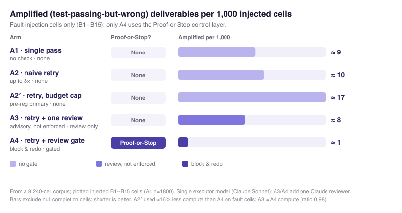

# Proof-or-Stop

> An evidence-gated control layer for unattended agent development — every phase advance, review pass, and "done" must present fresh, code-state-bound, mechanically verifiable proof, or the loop stops.

**Proof-or-Stop** is an evidence-gated control layer that lets coding agents (Claude, Codex, …) run an unattended development loop — *plan → execute → review → reflect → done* — where every step forward is admitted only on **mechanically verifiable evidence bound to the current code state**, never on the agent's word. If the evidence isn't there, the loop repairs or stops. The point isn't that an agent *can* run unattended — plenty of frameworks do that. The point is that what an unattended run marks "done" comes with a **mechanically checkable merge-readiness claim** — evidence a reviewer or merge policy can act on.

## The problem: "done" is a claim, not a proof

Agents write code, run tests, and report `tests passed / reviewed / done` on their own — and downstream automation (merge, release, next task) takes those words at face value. But they are **claims, not evidence**:

- tests may have run against **stale code**;
- a "LGTM" may have **no auditable artifact** behind it;
- a green pipeline can **coexist with a real defect** (the *green-but-wrong* failure).

The most expensive incident is the quiet one: **tests green, code wrong, auto-merged to main.**

## The control rule

Any lifecycle advance — next phase, review pass, mark done, merge-readiness claim — **must** be backed by structured evidence that is **fresh** (still bound to the current code-state hash — the moment code changes, prior evidence is void) and **tamper-evident** (signed, not hand-waved). No qualifying evidence → **repair, downgrade, or stop.** Never pass on the agent's testimony.

> Think of it less as a better engine and more as a traffic light for autonomous development: the value isn't speed — it's making "the wrong thing auto-merges to main" *mechanically hard to happen*.

## Loop Engineering

```
plan ──▶ execute ──▶ review ──▶ reflect ──▶ done
  ▲                                          │
  └──────────  proof, or stop  ◀─────────────┘
```

## How it's proven

Seven kinds of proof, each mapped to the evidence behind it:

| # | Proof | What it establishes | Evidence |
|---|---|---|---|
| 1 | **Formal** | when a claim is *admissible* is precisely defined | admissibility predicate + gated lifecycle-transition equations |
| 2 | **Mechanism** | the gate's verdict can't be faked or gamed | freshness binding, anti-forgery, receipt verification; **10/10** engine contract (zero false DONE); **18** tamper classes rejected (zero false accepts) |
| 3 | **System** | the method is really implemented, not just theory | Proofbound runs it as a full autonomous coding lifecycle (PLAN→DEV→REVIEW→TEST→DONE) |
| 4 | **Empirical** | stronger control *causally* reduces amplification | 9,240-cell powered ablation; pre-registered primary **A4 vs A2′: 31/1800 → 2/1800** (≈1.6pp, CI excludes zero) |
| 5 | **Failure** | missing or wrong evidence → repair or safe-stop, never a false DONE | injected-failure runs exhibit repair / safe-stop / no-false-DONE |
| 6 | **Operational** | it works in real, sustained lifecycle use | self-application corpus: **565 stories / 1,007 findings**; **26/28 (93%)** deep-set findings from independent review while the author's tests were green |
| 7 | **Boundary** | it states honestly what is *not* proven | threats / future work: no general PR-less auto-merge; cross-vendor quorum & multi-model generalization remain open |



The empirical result's sharpest cut is **enforcement, not review**: given the *same* review signal, treating it as advisory (A3) lets 14 defects through while enforcing it (A4) lets only 2 — at nearly identical token spend (A3/A4 = 0.98×). And "green tests ≠ correct" is common, not rare: in the deep set, 93% of findings came from independent review while the author's own tests were green.

## Where it fits

**Proof-or-Stop specializes evidence-gated claim admissibility for autonomous coding lifecycles.** What sets it apart is the combination:

- **No admissible evidence → no lifecycle advance.**
- Agent / reviewer / tool output is a **claim**, not truth.
- Evidence must be **mechanically checkable** — structured, not prose.
- Evidence must be **bound to current state** — `materialHash` / `headHash` / `storyFilesHash` / `policyHash` / `commandSetHash`.
- The gate controls specific **transitions** — PLAN→DEV, REVIEW→TEST, TEST→DONE, handoff, merge-readiness.
- Failure is not an infinite loop — **repair / degrade honestly / escalate / stop safely.**
- **Host-neutral** — host identity affects provenance and independence, not gate semantics.

## What it does *not* do

- It does **not** make the agent smarter.
- It does **not** make development faster — on a clean task it's roughly **2× pure overhead**.
- It does **not** replace your merge policy — the gate yields a **merge-readiness claim**; the actual merge stays a repo/human decision.
- Cross-vendor quorum and multi-model generalization are **still future work**.

Its job is narrow and expensive-to-skip: turn the costliest failure — *wrong code silently reaching main* — into something mechanically difficult.

## CLI

Proof-or-Stop ships as a CLI (`lattice`). Full command reference: **[docs/CLI.md](docs/CLI.md)**.

```bash
lattice session_brief   # recover project state
lattice validate        # run the gates
```

> `lattice` is the CLI command name for historical reasons; the project is **Proof-or-Stop**. (`lattice --version` currently prints `Proofbound CLI` — a rename in progress.)

## Status

Private / active development. Current release: `v0.3.155`.
