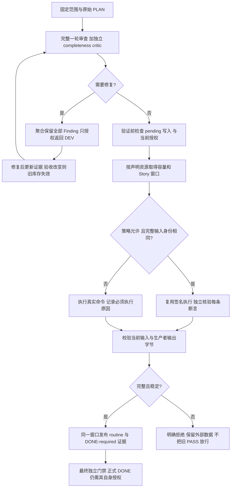
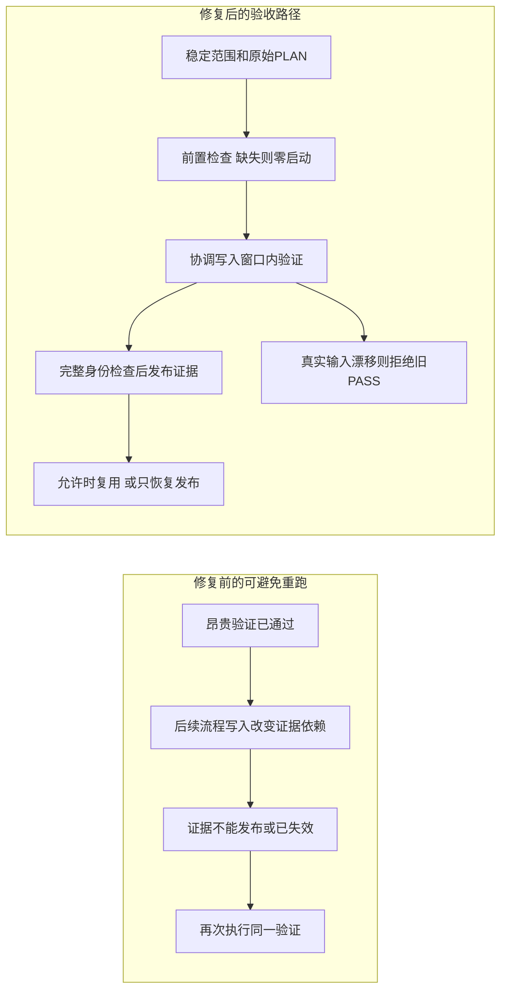
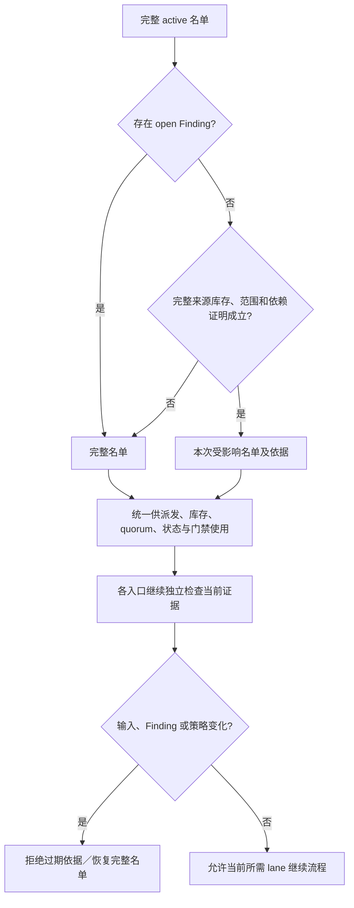
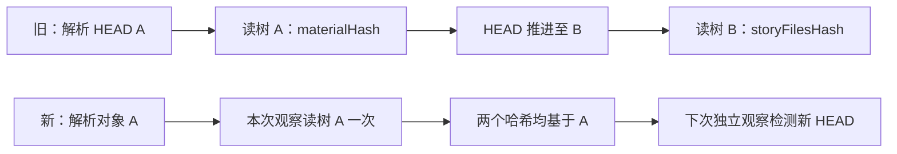
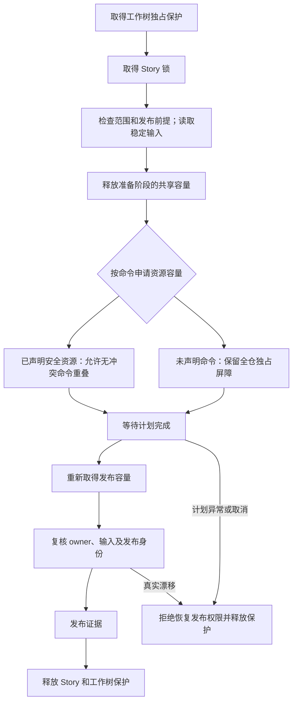
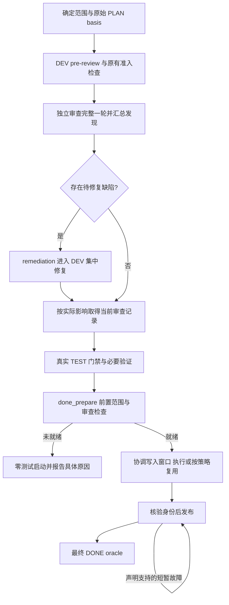

# Historical evidence log

Historical records only; not a replay on the integrated candidate. All limitations in the linked reports remain applicable.


## mechanism-red-green/REPORT.md

[Original report](/Users/jek/.codex/visualizations/2026/09/08/01a0803c-566c-71a1-a7a1-29c4cc3d46b8/mechanism-red-green/REPORT.md) SHA256: `a49b4627cc0f98b548ca7a360b3bc23d009c5b225d3b39495902deb81bf2fd4f`

# 五类问题的 RED/GREEN 证据

2026-09-08；当前 main 为 v0.3.284，cf21df09c273074d7aa3227a5f436c6f5badf47a。

本轮新增诊断测试，不修改项目配置、产品源码或真实 Story 状态。RED/GREEN 分三种：同一 main 的执行条件对照、旧版本与当前版本对照、main 与未合入候选快照对照。不能将三种对照都称为“最新 main 已修复”。测试内存 store、admissibility probe 和模拟审查记录属于测试夹具，不能作为正式 Story DONE 或产品发布凭证。

## 1. 重复验证：启用机制与实际生效

断言：两个消费者在相同输入下调用同一真实 witness，只能启动一次子进程，第二次必须有 reused 回执。

- RED：不声明 executionReuse。两个消费者均 code=0，但产生两个不同 witness UUID、两次子进程启动，断言 IDENTICAL_CONSUMERS_EXECUTED_TWICE 失败。
- GREEN：同一 main、同一 witness，显式声明 exact-inputs 与空外部输入列表。一次执行、一次 reused，两个消费者的 executionKey 和 receiptHash 相同。
- 反向控制：实际环境输入变化后必须重新执行，不能靠无条件缓存得到 GREEN。
- 边界：这是受控 witness 的配置实验，不是批准将全部 136 个生产命令统一开启复用。实际命令须逐项验证完整输入和 forbidden/build/risk 策略，且当前配置 dynamic.mode=observe 仍不使用此共享执行路径。

[RED 日志](reuse-red.log) · [GREEN 日志](reuse-green.log) · [测试脚本](contracts.mjs)

## 2. 跨工作树串行：声明完整且不冲突才能并发

断言：同一临时 Git 仓库的两个真实工作树执行独立任务，最大同时执行数应为 2。测试调用 declaredValidationCapacity 和真实容量锁。

- RED：缺少资源声明，最大并发=1，两个任务顺序执行。
- GREEN：声明各自工作树内独占路径，最大并发=2，进入/退出时间区间重叠。
- 反向控制：将资源改为同一个固定端口后，必须保持串行；红绿两侧此控制均通过。
- 该次两个各等待 200ms 的受控任务窗口：432.2ms → 236.5ms。它验证调度行为，不能换算为完整验证或 Story 提速。
- 边界：没有为真实命令编造资源声明。尚需逐项审计当前缺失声明以及共享 Git/path/port 冲突，完整生产清单的并发收益未证实。

[RED 日志](capacity-red.log) · [GREEN 日志](capacity-green.log) · [测试脚本](contracts.mjs)

## 3. 审查修复入口：一轮证据能否进入修复

断言：完整独立审查波次与 critic 证据允许 repair-only 入口，同时禁止借此进入 certification/TEST。

- RED：使用此前冻结的 v0.3.281 运行快照，verifyReviewInventoryReceipt 返回 false，目标断言 FIRST_COMPLETE_WAVE_CANNOT_ENTER_REPAIR 失败。
- GREEN：同一测试夹具在 v0.3.284 上返回 true，并成功消费修复回执。
- 反向控制：certification 消费被拒绝、篡改 authorizesTest 被拒绝、缺少 critic 被拒绝。
- 边界：这证明已修复“第一完整波次不能进入修复”的具体限制。没有证明验收标准漂移、重复发现或主观范围扩大全部解决。那些问题需要固定验收集、多轮评审轨迹及范围变更审计，不能用这一条入口测试替代。

[RED 日志](review-first-wave-red.log) · [GREEN 日志](review-first-wave-green.log) · [测试脚本](review-first-wave.mjs)

脚本复用仓库 review-inventory-epoch-smoke 的夹具构造，去除本目标前的独立断言，保留目标断言与其后的反向控制。版本对比只解释目标结果；日志中的夹具历史标签不是本报告新增结论。

## 4. 收尾顺序、并发写入、环境身份：拆成三个独立对照

### 4a. 范围确认顺序

断言：生成的 acceptance basis 回执须匹配最终 scope contract。

- RED：先生成并签发回执，再改变内存夹具中的范围确认记录。原始回执在原始绑定下先通过；与最终范围比较时仅出现 scope-contract digest mismatch。
- GREEN：先稳定同样的范围确认记录，再调用生产派生、签发和验证函数，返回 ok=true。
- 反向控制：GREEN 后换成不同范围摘要仍须拒绝。
- 没有修改真实 scope-contract.json；使用生产函数生成与校验测试回执，没有伪造签名。这个场景证明顺序依赖，尚不证明主流程已自动排序。

[RED 日志](scope-order-red.log) · [GREEN 日志](scope-order-green.log) · [测试脚本](scope-order.mjs)

### 4b. 验证期间写入

断言：在稳定输入下完成的 witness 应能发布回执供第二消费者复用。

- RED：等真实子进程启动后修改临时仓库的已跟踪 process-observation.txt，生产执行器报 shared validation inputs changed before publication，回执数为 0。
- GREEN：将完全相同的写入提前提交，再运行验证，取得执行回执并成功复用。
- 边界：这是真实执行器对受控文件写入的机制复现，不是重放 B-adc3 的 127 个测试、reviewer 进程或完整 TEST→DONE。输入变化时拒绝发布是正确保护；待修的是如何避免不必要的中途写入，不是删除保护。

[RED 日志](publication-red.log) · [GREEN 日志](publication-green.log) · [测试脚本](contracts.mjs)

### 4c. MAX/IDLE 身份

断言：预期复用的两个消费者必须保持执行环境身份。

- RED：第一次 MAX=900000、IDLE=600000；第二次 MAX=1200000、IDLE=720000。同一 witness 被启动两次，产生两个 executionKey。
- GREEN：两次均固定为第一次的环境值，只执行一次，第二次 reused。
- 反向控制：另外改变真实环境输入仍须执行。
- 此处 RED 表示违背“固定身份”的运行前提，并非证明环境哈希本身有 bug；不能未经语义分析就从身份中删除超时变量。该实验也不是 B-fe8f 的 132 命令端到端重放。

[RED 日志](environment-red.log) · [GREEN 日志](environment-green.log) · [测试脚本](contracts.mjs)

## 5. quorum 热点：正确性证据与性能证据分开

零匹配正确性对照已重新运行：main 返回成功并输出 passed (0 checks)，目标断言失败；此前冻结的 B-e40f 候选快照明确拒绝零匹配，断言通过。

[RED 日志](quorum-selector-red.log) · [GREEN 日志](quorum-selector-green.log)

这不是完整 smoke 性能测试。完整性能 GREEN 必须在相同 case 集和工具链下保留所有必要检查，至少三轮交替比较 baseline、jobs=1、jobs=2。已有 B-e40f 基准要求 jobs=2 中位耗时比 baseline 至少减少 20%，比 jobs=1 至少减少 15%；正确性、样本干扰或覆盖条件失败均不得认定性能通过。

本轮再次实际运行候选 performance-contract，候选 HEAD 为 44468eb04b66c038f73c4ee9d74489e0545c3e28，设置空闲等待上限 60000ms。它在 baseline build 前停止：idle_wait_timeout，最后 idle=0.734，存在 competing_processes=31431，退出码 1。该失败是采样环境未满足要求，**不能当作性能回归 RED，也没有性能 GREEN**。没有中断其他会话的进程或降低采样标准。

[完整基准日志](quorum-performance.log)

## 复核与证据完整性

[results.json](results.json) 记录七组机制/正确性对照的命令、退出码和整个探针耗时。GREEN 包含附加反向控制，且多数组使用短 witness；这些 wallSeconds 不可用来比较产品性能。

[runtime-manifest.json](runtime-manifest.json) 记录当前源码/dist 构建绑定；旧 baseline 和 quorum 候选快照的 dist 摘要重新计算后与最初记录一致。review 对比的旧版本是 v0.3.281，quorum 正确性候选是 9a876b95e2e4a11712125e47f9c3956098c0678d；二者不是此次完整性能尝试的候选 HEAD。

initial/setup2 日志是测试夹具调试记录，不计入 RED/GREEN 证据。最终日志必须匹配目标断言；导入失败、夹具不完整、锁资源路径错误均不能充当目标 RED。

结论：已有七组目标断言失败→通过，其中六组对应前四类的具体机制，第七组只验证 quorum 零匹配正确性。生产配置全面启用、评审范围收敛、主流程自动收尾调度和 quorum 完整性能仍不能标记解决。


## merge285-targeted-validation/REPORT.md

[Original report](/Users/jek/.codex/visualizations/2026/09/08/01a0803c-566c-71a1-a7a1-29c4cc3d46b8/merge285-targeted-validation/REPORT.md) SHA256: `d2e05546338171629f5f7818e7411757bb71cc3631c67fbbd2aeffc02377e126`

# 合并 0.3.285 后的针对性验证

验证对象：Lab 提交 `619111e94d`，前置合并 `9742088def`。只验证资源保护、环境声明、参数和清单；不重跑完整 73 项，不提出新的整套性能数字。main 未修改，版本仍为 0.3.285。

## 修复与证据

| 项目 | 修复前 | 修复后 | 原始记录 |
|---|---|---|---|
| 9 个已审计共享写入命令 | 配置声明使默认独占屏障消失；9 组受控子进程见证发生重叠 | 撤回这 9 个 validate 声明；9 组均不重叠 | scheduler-red.log、scheduler-green.log、lab-green.log |
| 安全负例及正常并发 | 错误共享声明可导致重叠 | 故意注入错误声明仍能复现重叠；独立资源仍可并行，测试能区别两者 | scheduler-green.log |
| 原资源门禁 | 真实配置没有默认独占命令，测试失败 | 135 条 validate：126 条有声明，9 条默认独占；38 条断言通过 | resource-green.log |
| 环境声明 | 合并增加两条命令各 115 个声明键 | 两条命令均覆盖有限环境读取清单；声明变化前后实际子进程环境摘要相同；稳定输入可复用，CI 输入变化要求新执行 | environment.log |
| quorum 参数 | 新测试拒绝既有的单用例超时参数 | 精确断言包含 --jobs=2 和 --case-timeout-ms=360000；保留资源精确断言、选择器负例和清单检查 | convergence-green.log |
| 清单数量 | 旧探针固定 136 | 137 项分类，含 9 个默认独占；保留 graph 与 DONE 端口检查 | inventory-green.log |

调度实验使用真实配置声明、真实 resolveValidationPlanEntries/canonicalizeEntries/runScheduled 和真实子进程；子进程只在临时目录写时间事件，**未执行 9 个原始破坏性测试主体**。它证明默认屏障的调度效果，不冒称逐个原始命令已实现隔离。

环境实验使用真实 runValidationCommand 和执行回执，但替换为受控摘要命令；只对 CI 做真实输入改变负例，其他键核对有限清单覆盖。不是两套完整 smoke 的重跑，也不是默认 observe 跳过验证的证明。声明元数据本身不是实际环境变化；这里没有把元数据变化强行等同于必须重跑。

## 安全与效率的边界

包含默认独占命令的完整 validate 调用恢复默认独占容量，因此不再宣称全量跨工作树并行。只包含安全资源声明的子集仍可并行。该取舍是恢复保护，不是新的提速结果。

从合并前 5616d389 到当前提交，73 个 quorum 用例、公共 worker 和 fixture 未改。先前单跑 qsm-016 和 inventory-bijection 的结果保留在相邻 story-performance-v4-main285-merge 目录；本轮没有重复执行未受影响的用例。旧 4 次完整 quorum 和耗时记录仍属于旧提交，不改写其绑定。

## 复现

在保留的 Lab worktree 中执行：

```sh
node scripts/probe-merge285-scheduler.mjs
node scripts/probe-merge285-environment.mjs
node packages/main/tests/validate-resource-claims.test.mjs
node scripts/probe-resource-inventory-v4.mjs
node packages/main/tests/red/red-B-e40f-lab-convergence.mjs
```

Lab 的 RED/GREEN 固定命令是第一条调度探针；其他边界分别保留日志。不是正式 Story DONE 或发布证据。Claude 的最终独立结论见 claude-audit.md。

## 独立审计结果

Claude CLI 独立执行调度、环境、原资源门禁和清单四项检查，全部通过，返回 `AUDIT_TARGETED_VERDICT: APPROVE`，限定增量范围无阻断项。它核对 quorum 代码未变，确认不需要重跑完整73项。全文见 claude-audit.md。


## red-green-timing/REPORT.md

[Original report](/Users/jek/.codex/visualizations/2026/09/08/01a0803c-566c-71a1-a7a1-29c4cc3d46b8/red-green-timing/REPORT.md) SHA256: `5ab93c14cf607e0c5cb94123fba86b30d210ee25b3b7eae3a4f7e30db5479e0b`

# RED/GREEN 与耗时实验：实际结果

日期：2026-09-08。此次新增两个独立探针，使用已存在的候选实现做只读比较；没有声称新实现或完成合并全部四项流程优化。

## 1. 先验证命题是否成立

| 命题 | 当前 main | 已有候选 | 结论 |
|---|---|---|---|
| 提交 dev-memory/experience.jsonl 不应使 materialHash/storyFilesHash 失效；产品源码变化仍须失效 | GREEN | B-c86f GREEN | 当前 main 已有修复，不能再称其为当前可复现根因 |
| quorum smoke 未匹配任何 case 时必须明确失败 | RED：子进程返回 0，宣称 passed (0 checks) | B-e40f GREEN：返回 1，明确 unknown selector / zero cases | 确认正确性修复；不是吞吐量证明 |

探针：[memory-contract.mjs](memory-contract.mjs)、[selector-contract.mjs](selector-contract.mjs)。
证据：[main memory 日志](memory-contract-baseline.log)、[候选 memory 日志](memory-contract-memory-candidate.log)、[main selector RED 日志](selector-round1-baseline.log)、[候选 selector GREEN 日志](selector-round1-quorum-candidate.log)。

main 固定为 50573909b58a3a4ae063e01ccd6f2cc2320049d1（v0.3.281），B-e40f 固定为 9a876b95e2e4a11712125e47f9c3956098c0678d。构建绑定与运行快照见 [runtime-snapshots.json](runtime-snapshots.json)。使用复制的 dist/templates 与绑定的依赖，避免后续工作树变化污染探针。

## 2. 已测得的时间及适用范围

未知 selector 探针三轮交替运行，计时包括 Node 启动和探针断言：

| 轮次 | main / 秒 | B-e40f / 秒 |
|---|---:|---:|
| 1 | 0.998 | 0.770 |
| 2 | 0.937 | 0.583 |
| 3 | 0.856 | 0.602 |
| 中位数 | 0.937 | 0.602 |

来源：[selector-alternating-results.json](selector-alternating-results.json)。这是零匹配输入的处理耗时，两侧均未执行有效 smoke case，不能外推为完整 smoke 或 Story 提速。主机有并发负载，因此也不把差值解释为稳定性能收益。

memory 探针内部单次耗时 main 1022 ms、候选 676 ms，均为 GREEN；单次且有负载，不构成修复收益或性能基准。

## 3. 完整 smoke 性能对比尚无有效结果

已尝试 B-e40f 自带 performance-contract：同一候选工具链及依赖、固定 73 个 case，构建仅替换旧 smoke 文件的受控基线，比较旧实现、候选 jobs=1、候选 jobs=2，计划各三轮交替测量。

基线 smoke 来源提交 3eec15009ba93740b5dd74c0563bf1b3ca098b32，文件 blob 517c223ff61178e5796a23f285478c93d03a9716。该基线不是 v0.3.168，也不是与候选完全不同依赖的历史整仓运行。必须把此实验与版本总体性能比较区分开。

两次运行均在正式样本开始前等待主机空闲，随后收到 SIGTERM，清理结果 survivors=0、cleanupErrors=0。第二次最后记录 idle=0.530、load1=13.79，未满足 harness 的空闲条件。只能证明环境未满足采样前提以及实验中断，不能断言 SIGTERM 的发送者或原因。第二次整个进程存活约 67.70 秒，包含准备和等待，不能当作测试耗时。

原始证据：[首次日志](quorum-performance.log)、[第二次日志](quorum-performance-retry.log)、[退出状态](quorum-performance-status.json)。因此完整 smoke 修改前/后时间均为未取得，Story 端到端前/后也未取得。

复现完整基准：

```sh
cd /Users/jek/Documents/GitHub/Prooforstop/.worktrees/B-e40f
node packages/main/tests/red/red-B-e40f-quorum-submit-harness.mjs --case=performance-contract
```

复现前需确认候选 HEAD 和构建绑定仍对应本报告；脚本本身检查构建、干扰及样本有效性。不能通过跳过 case 或关闭干扰检查得到宣称有效的提速结果。

## 4. 本轮没有证明的内容

最终写入窗口的统一调度、MAX/IDLE 环境身份固定、验收边界冻结与聚合修复的组合效果，尚无此次新增的端到端 RED/GREEN 或耗时数据。前次 20 Story 审计提供历史线索，不能替代这里要求的修复前后实测。

目录中的 bootstrap-attempt 日志保留调试过程，correctness-results.json 与不带 round 的 selector 日志包含中途失败尝试。最终 selector 结论只采用 selector-round1..3 日志和 selector-alternating-results.json，不能把导入失败或入口未执行当成预期 RED/GREEN。


## story-framework-overhead-v8/REPORT.md

[Original report](/Users/jek/.codex/visualizations/2026/09/08/01a0803c-566c-71a1-a7a1-29c4cc3d46b8/story-framework-overhead-v8/REPORT.md) SHA256: `8d2fa5a0cbd325a46ba07188bbf60773e70280b2df39a82fd6fb77e69b197372`

# 验证框架开销修复：v8 Lab 证据

本轮已实现并验证五处具体冗余优化；不是“所有 Story 根因全部解决”。
在同一实际短命令、相同工作目录/输入/策略/运行环境下，冻结修复前运行时与修复后运行时各测 5 次：

| 条件 | 修复前中位数 | 修复后中位数 | 变化 |
|---|---:|---:|---:|
| 直接执行（无复用） | 208.30 ms | 208.19 ms | 近似不变 |
| 首次执行并建立共享回执 | 3193.51 ms | 2186.93 ms | 减少 31.5% |
| 再次消费有效回执，不启动测试 | 1905.68 ms | 1259.74 ms | 减少 33.9% |
| 上述三种条件依次运行的总耗时 | 5398.95 ms | 3653.48 ms | 减少 32.3% |

这里的复用耗时包含所有框架检查及回执消费/发布边界，测试启动为 0，不能靠减少测试工作量解释提速。首次和直接执行均实际启动 1 次。所有样本启动计数均为 [1,1,0]，真实命令输出相同且退出码为 0。
但 **1.26 秒复用仍比 0.21 秒直接执行贵**。所以保持 21 条短命令的 disabled_cost 状态；没有扩大生产复用权限，没有关闭 observe。

## 审计→RED→修复→GREEN

- 初审：[Claude 总体审计](claude-before.md) 批准 S1/S3/S4/S6，拒绝缓存整个 probe、删除新鲜度检查、跨调用输入缓存。
- 路径专项：[第一次审计](claude-path-plan.md)、[边界复审](claude-path-plan-confirm.md)。要求先补齐 G1–G8 以及冷输入计数，再修改实现。
- `path-red-final.log`：502 个行为对照和变异场景先通过；唯一目标失败为新/旧路径查询均发生 236 次 replace。
- `approved-scope-red.log/json`：真实复用已成功，但每次 merge-base 8 次，目标 4 次，故计数断言失败。原始更宽的 diff-skipping 探针未被采纳，其 RED 不冒充本次 GREEN。
- `path-green.log`：相同 502 对照和变异场景通过，新/旧路径计数均 8。
- `profile-after-complete.log/json`：同一真实入口，merge-base 4 次，status 4 次；4 次 binary workspace diff 全部保留。

| 已修改实现 | 原来的成本 | 修复后的行为 |
|---|---|---|
| runtime-artifact-registry | 每个 registry entry 重做路径标准化，每个 matcher 重算固定字符串 | 输入仍恰好标准化两次，但每次查询只计算一次；WeakMap 只保存 matcher 字符串的纯函数结果，每次读取当前值并检查是否变化 |
| shared-validation-execution | 初始 status 查询两次 | 单次结果先判断 dirty，再参与 workspace digest；后续实时 status/diff 检查全部保留 |
| verifier | 两处 Git 查询先经过 shell | 直接 executable+argv，结果/错误降级语义保留 |
| evidence-freshness | 同一 story hash 计算重复解析 merge-base | 在本次 hash 计算内传递已解析 base；下次 probe 仍重新解析 |
| shared-validation-execution | 多次序列化初始不变快照 | 初始 probe/input 快照序列化一次；新采集事实仍每次序列化比较 |

未实施有额外假设的 S2（省略 diff）和 S5（Git 投影缓存）；二者不是上述修复或性能结论的前提。

## 性能证据的可比性和局限

- 固定 Lab HEAD `a91f250846251fa38fb80a6f743ce15e5aa0af31`，保留 v7 未提交候选作为 before，本轮增量为 `v8-incremental.patch`。不是拿旧 release 与最新 main 比较。
- baseline 编译目录先独立复制，之后不再链接 Lab dist；两种框架运行时均使用同一冻结命令目录、依赖和实验 opt-in 配置。每次采用新 storyId 避免跨样本回执污染。
- 命令为实际 `adversarial-review-contract-smoke`；实验配置中有 22 条 validate 命令声明 exact-inputs；本轮只测量这一条已审计命令，未把实验配置写回 Lab。不是完整默认 Story，也不是 21 项全量复测。
- 每个运行时先预热 1 次，不计入结果。随后按“前/后、后/前、前/后、后/前、前/后”顺序运行，10 次正式样本，全部无插桩。
- 修复前 warm 范围 1889.84–2001.72 ms；后 1250.32–1304.47 ms。原始数据 `comparison.json`、各 `compare-*.json/log`；计算方式 `run-comparison.py`。
- 插桩单独 OFF/ON/ON/OFF/OFF/ON 对照：warm 中位数 OFF 1239.30 ms，ON 1248.63 ms，差 9.34 ms。样本少且有系统波动，不把该差宣称为精确插桩成本。主性能结论不使用插桩数据。
- 完整父进程同步插桩补了 execSync、hash、嵌套 fs，避免重复累加 readFileSync 内部 open/read。覆盖不是全部进程 CPU、异步 IO、锁等待或整个 Story；未归因耗时显式保留在 `profile-attribution.json`。没有宣称每项优化的独立因果百分比。
- warm Git 子进程总数 41→36；原有 shell 包装 8→0。readFileSync 次数保持 7190，两边都返回约 104.77 MB（包括少量长度不同的临时回执）；保留真实输入字节复核，不能把读字节计数视为磁盘物理 IO。
- CPU 采样 `before.cpuprofile`/`cpu-summary.json` 发现路径标准化和正则替换热点；该采样覆盖三种条件和启动，不是 warm-only。

## 安全、自我验证与未通过项

`regressions.json` 保留全部 11 项初次结果，10 项通过。`final-checks.json` 保留修改后测试的复核结果。

- 路径的双次标准化、matcher 单次标准化保持；注册表顺序、exact/prefix 值变更与还原、替换/push/pop/空数组、stateful regex 调用次数和 lastIndex、新旧路径均覆盖。
- 未受信任的源码、依赖、环境、超时、策略、失败结果和篡改回执不能复用（`reuse-final.log`）。
- 依赖内容变化、新增文件、执行期间改内容再恢复 mtime、符号链接环被检测（`regression-3.log`）。
- observe 保持要求新执行，MAX/IDLE 环境身份不混用（`regression-4.log`、`regression-5.log`）。
- 跨请求 single-flight 实际启动仍为 1，执行归属正确；取消仍拒绝（`reuse-final.log`）。
- 17 MiB dirty diff 不产生回执，明确走 workspace_dirty；干净的 unborn HEAD 仍降级 workspace_identity_unavailable（`workspace-fallback-green.log`、`reuse-final.log`）。
- runtime/process-fact 合约、story-aware validation、causal preflight、收尾外部漂移保护通过；新增路径测试接入已有 runtime-fact 验证入口，dirty/unborn 场景接入已有 reuse-proof，未增加配置命令条目。
- **未通过且保留**：`verification-freshness-smoke` 的 recover_evidence happy path 因 owner lease 失败。修复前独立运行时同样失败，前后均退出 1；见 `freshness-baseline.log` 和 `regression-6.log`。本轮未改变其 owner lease 处理，没有将其列为 GREEN，也不能宣称完整收尾回归通过。
- 本轮未执行完整 quorum 73 项：没有改变该热点执行/选取逻辑；本轮范围为上表框架函数及直接消费者。没有完整默认流程性能证据。

## 复现与交付

1. 先用最终校验清单验证证据文件。
2. 当前 Lab 可运行：`node scripts/verify-runtime-path-overhead.mjs`、`node scripts/verify-validation-reuse-proof.mjs`、`node scripts/verify-runtime-fact-contract.mjs`。
3. `python3 prepare-overhead.py /absolute/path/to/Lab-story-performance-closure-v4` 创建两份新的临时 clone，验证候选源码绑定、应用冻结 v7 patch 和 v8 增量、独立构建，打印复测路径。该脚本只在一次性实验 clone 创建 fixture commit，不写入所提供的 Lab 或 main。
4. 按打印的 `comparison` 命令重跑对照；环境差异会影响时间，功能计数必须保持。
5. `source-bindings.json` 绑定本轮源码，`before-source/` 保留变更前原文，`v8-incremental.patch` 可审阅每处更改。

独立临时 clone 复现已完成：`reproduction-selfcheck.json` 记录 baseline 路径断言退出 1、candidate 退出 0，两边实际命令场景均退出 0。

Claude 最终审计：**APPROVE，无阻断项**，原文 `claude-final.md/json`。审计由 Claude CLI 独立读源码和日志完成；Claude 本身没有运行实验。
本轮未提交 Lab、未改版本、未合并或推送 main。它是本地维护实验与修复证据，不是签名产品 DONE。

### 最终审计的非阻断意见处理

- 已区分“实验配置启用多条”与“本次只测一条”；不声称只有一条声明被修改。
- 样本顺序改写为前/后字面顺序；以 comparison.json 的 index 2–11 为准。Claude 关于 A/B 字母相反的说法不改变实际顺序或数据。
- status 的 before=5 来自原始 profile；目标 RED 在 merge-base 断言先失败，不能声称它继续执行了 status 断言。
- 补录 runtime-tree-binding.json 的全部编译文件哈希与差异列表；独立双 clone 的重新构建和功能复现也已完成，但正式 5 组计时仍是原冻结目录与 Lab 的对照，未替换原数据。
- 路径测试注册到了现有 runtime-fact 入口；dirty/unborn 回归通过现有 Lab reuse-proof 入口运行，未宣称已加入生产 validate 命令清单。
- 首次未构建时路径检查可能先给出模块缺失错误；复現要求先构建。内容排除断言若未来注册表有意变化，需要同步审阅。两者为非阻断限制。
- 未采用 Claude 初审对 S6 的独立成本估计：additionalInputs 向外返回顶层路径/摘要，不应将内部数千节点遍历误称为同规模的初始快照。性能只报告五项组合的实测结果。


## story-latency-audit/REPORT.md

[Original report](/Users/jek/.codex/visualizations/2026/09/08/01a0803c-566c-71a1-a7a1-29c4cc3d46b8/story-latency-audit/REPORT.md) SHA256: `3eeb5edce2ecc99726c42dda774fc4139c3ef98c71bd516ba1db34d7ef3f2ff5`

# 最近 20 个已完成 Story 的延迟证据审计

采集日期：2026-09-08。按 `endedAt` 降序选取当前本地仓库最近 20 个 DONE Story；完成窗口为 2026-08-31 至 2026-09-07，创建时间最早为 2026-08-20。CLI 版本 0.3.281。采集使用 StoryStore 只读 API；没有改写 Story 状态、没有重跑验证、没有重新签名历史证据。

## 结论

样本支持的核心诊断是：审查—修复—重新证明反复发生，证据生产与收尾写入的顺序、绑定身份和并发控制又制造了额外失效；整套验证的成本乘上这些回合，形成长延迟。测试数量增长是放大器，不能单独解释这些 Story 的全部耗时。真实实现缺陷、验收表述和测试断言缺陷也确实造成返工，不能把每个回合都归为门禁误报。

## 统计口径与限制

- 时长为 `index.json` 的 createdAt→endedAt 自然经过时间；阶段时长按相邻 phase 事件分配，包含等待、休眠、暂停。不是 CPU 时间、模型生成时间或人力工时。
- REVIEW 次数为进入 REVIEW 的阶段转换数；返回 DEV 指 REVIEW/TEST→DEV。不能直接等同于独立审查波次。
- 验证执行/复用数来自 `process-events.jsonl` 的 validation_terminal：前者 commandExecutions>0，后者 disposition=reused 且 commandExecutions=0。没有终结记录的中止、人工命令、部分回执路径不在总数中。
- 27,975 是终结记录中的 commandExecutions 字段累计，不是经进程追踪去重的系统进程总数。
- review-runs.json 有 4,405 个不同 run ID，其中 2,624 个是同 lane、同 round、同 materialHash 分组中的额外启动记录。不能把它们称为 4,405 次完整人工/模型审查，也不能只据此判定重复无效；用途、读取和完成状态仍可能不同。
- 20 个 Story 的 readTestRuns 都返回空数组。详细历史命令耗时未完整留在这个接口中；当前 test-evidence 通常只保留最后一份结果。
- B-42f6 的 readFindings 被 FINDING_LEDGER_AUTHORITY_INVALID 拒绝，Finding 数量记为缺失，不能记为 0；其阶段与验证数据来自其他读接口。
- B-5a52 最后保留的 output.commands 有 96 行，而 commandExecution.commandCount 为 128。这里只报告各字段原值，未擅自解释差额。
- 引用 Finding/summary 是持久化历史观察及作者总结，不表示本次重新执行了它们的复现命令。B-45a0 的历史短提交 d2c171f6、05c2b850 当前本地 Git 无法解析，因此相关因果判断限于 Finding/处置记录互相印证，未独立复查历史树。
- 最近完成的 Story 跨多个版本，且含大规模迁移和验证框架项目。没有 v0.3.168 同范围、同机器、同模型的配对样本，不能用本报告声称精确的版本慢速倍数。

## 全样本

| Story | 简称 | 自然经过 h | REVIEW 进入 | 返回 DEV | 验证执行/复用 | 记录的命令执行 |
|---|---|---:|---:|---:|---:|---:|
| [B-29bc](/Users/jek/Documents/GitHub/Prooforstop/.proof-or-stop/story/actives/B-29bc/index.json) | 审查用途隔离 | 11.0 | 6 | 5 | 3/2 | 397 |
| [B-e256](/Users/jek/Documents/GitHub/Prooforstop/.proof-or-stop/story/actives/B-e256/index.json) | 全局 CLI 可执行 | 122.6 | 28 | 27 | 23/1 | 2942 |
| [B-42f6](/Users/jek/Documents/GitHub/Prooforstop/.proof-or-stop/story/actives/B-42f6/index.json) | 合并远端 main | 4.8 | 4 | 3 | 3/0 | 396 |
| [B-8a40](/Users/jek/Documents/GitHub/Prooforstop/.proof-or-stop/story/actives/B-8a40/index.json) | 审查上下文分类器 | 19.8 | 7 | 6 | 2/0 | 264 |
| [B-adc3](/Users/jek/Documents/GitHub/Prooforstop/.proof-or-stop/story/actives/B-adc3/index.json) | 大范围 scope | 1.5 | 1 | 0 | 1/0 | 128 |
| [B-5a52](/Users/jek/Documents/GitHub/Prooforstop/.proof-or-stop/story/actives/B-5a52/index.json) | 播放及导出品牌 | 5.4 | 1 | 0 | 1/0 | 128 |
| [B-e124](/Users/jek/Documents/GitHub/Prooforstop/.proof-or-stop/story/actives/B-e124/index.json) | 修复基线验证 | 3.2 | 2 | 1 | 3/0 | 384 |
| [B-fe8f](/Users/jek/Documents/GitHub/Prooforstop/.proof-or-stop/story/actives/B-fe8f/index.json) | Finding 账本 | 130.4 | 30 | 29 | 9/1 | 1144 |
| [B-212f](/Users/jek/Documents/GitHub/Prooforstop/.proof-or-stop/story/actives/B-212f/index.json) | DONE 谓词一致性 | 44.1 | 10 | 9 | 4/0 | 524 |
| [B-1482](/Users/jek/Documents/GitHub/Prooforstop/.proof-or-stop/story/actives/B-1482/index.json) | selector 收窄 | 38.2 | 5 | 4 | 4/0 | 496 |
| [B-9a49](/Users/jek/Documents/GitHub/Prooforstop/.proof-or-stop/story/actives/B-9a49/index.json) | Finding 分流提示词 | 77.1 | 38 | 37 | 5/4 | 604 |
| [B-5a15](/Users/jek/Documents/GitHub/Prooforstop/.proof-or-stop/story/actives/B-5a15/index.json) | CausalEvidence DAG | 346.0 | 66 | 65 | 42/2 | 4804 |
| [B-dc2e](/Users/jek/Documents/GitHub/Prooforstop/.proof-or-stop/story/actives/B-dc2e/index.json) | 补强四项检查 | 24.8 | 4 | 3 | 4/0 | 492 |
| [B-9f2c](/Users/jek/Documents/GitHub/Prooforstop/.proof-or-stop/story/actives/B-9f2c/index.json) | Graph dossier | 25.0 | 6 | 5 | 15/0 | 1740 |
| [B-41c8](/Users/jek/Documents/GitHub/Prooforstop/.proof-or-stop/story/actives/B-41c8/index.json) | 共享逻辑提取 | 15.1 | 7 | 6 | 7/7 | 854 |
| [B-d854](/Users/jek/Documents/GitHub/Prooforstop/.proof-or-stop/story/actives/B-d854/index.json) | AGENTS 审计翻译 | 19.8 | 16 | 15 | 5/1 | 603 |
| [B-a745](/Users/jek/Documents/GitHub/Prooforstop/.proof-or-stop/story/actives/B-a745/index.json) | 验证命令身份 | 11.6 | 3 | 2 | 7/2 | 847 |
| [B-45a0](/Users/jek/Documents/GitHub/Prooforstop/.proof-or-stop/story/actives/B-45a0/index.json) | 动态验证计划 | 294.0 | 57 | 56 | 29/0 | 3288 |
| [B-022e](/Users/jek/Documents/GitHub/Prooforstop/.proof-or-stop/story/actives/B-022e/index.json) | 产品身份切换 | 47.5 | 33 | 32 | 20/6 | 2400 |
| [B-5a88](/Users/jek/Documents/GitHub/Prooforstop/.proof-or-stop/story/actives/B-5a88/index.json) | 角色及包名迁移 | 280.1 | 72 | 71 | 49/2 | 5540 |

合计：396 次进入 REVIEW，376 次返回 DEV，其中 TEST→DEV 71 次；236 条执行终结记录（92 条 result=fail）与 28 条零执行复用记录。18/20 Story 多次进入 REVIEW，15/20 在 TEST 后返回 DEV；REVIEW 进入次数中位数为 7。

所有 Story 累加的自然阶段停留时间中 REVIEW 占 60.8%。这不能解释为 60.8% 算力花在审查。剔除 B-5a15/B-45a0/B-5a88 三个长项目后，剩余 17 个 Story 的 REVIEW 次数中位数仍为 6，自然经过时间中位数约 19.8 小时。

## 关键证据链与根因

### 1. 大量重新进入开发与审查，是首要流程症状

B-e256：122.6 小时、28 次 REVIEW、27 次返回 DEV、23 条执行验证终结；总结明确记录 stale rollout/pre-review、按顺序重发、duplicate degraded-r1 导致的恢复问题。B-9a49 是提示词/文档工作，却有 38 次 REVIEW 和 37 次返回 DEV；其总结承认审查不断将有限语言样例扩大到更广表述问题。

这里既有实际应修复的缺陷，也有验收边界/证明有效性持续变动。不能通过简单删除 reviewer 修复。应让冻结验收、聚合发现、批量修复和最终证据生产形成可稳定结束的过程。

### 2. 证据生产与收尾写入互相影响，出现不改产品代码也要重证的情形

B-45a0:F-475 记录 dev-memory 追加使 44 条 must evidence 的 storyFilesHash 失配，且其作者记录 99 个非状态目录的 Story 文件内容不变；处置确认根因并要求重新取得证据。F-476 紧接着发现所谓 50/50 refresh 中只有 48/50 具有机械回执，另两条还需要重新执行；F-478 是同一问题第二波复核，不能算一个新产品缺陷。

B-45a0:F-479 的观察最初把漂移归到后续元数据提交；最终处置纠正为 acceptance basis/pre-review 在 scope-contract acknowledgement 之前产生，导致真实 scope digest mismatch。应以这条最终处置为准，而不是把初始推断当事实。重发顺序调整后才恢复。

B-fe8f 总结提供另一条独立链：观察器 MAX/IDLE timeout 环境与默认环境不同，导致 132 个命令的环境摘要不同；作者按环境摘要替换对照确认身份变化，done_prepare 因而重新执行。这里不是可直接绕过的校验失败，而是证据采集环境与消费环境没有事先对齐。

### 3. 验证期间仍有写入，绿色结果不能落为有效证据

B-adc3 总结：首次完整运行 127 条通过，但并发 reviewer 元数据写入使 graph no-project-writes 与持久化失败；后续等审查完成、提交记录并冻结写入才通过。B-5a52 总结：human story_resume 留下未提交 process event，all-green 128 次运行不能持久化；提交真实恢复记录后重跑，没有为此修改代码或策略。B-42f6 和 B-9a49 也记录同类干扰。

这些记录证明实际存在“测试已绿，但工作区状态使证明不能采纳”的额外成本；由于中止/持久化失败不一定写出 terminal，总数表无法量化全部浪费。

### 4. 每轮验证本身昂贵，有明确的单命令热点

16 份最后结果保留了 commands 数组，其最慢命令均为 quorum-submit-smoke.js，durationMs 为 5.48–9.82 分钟，中位数 7.16 分钟。它占这 16 份命令 durationMs 合计的 28.6%；这是命令耗时累加比例，不是并行运行的关键路径比例或整 Story 耗时占比。

11 份保留 runtimeTrace 的结果可以计算首个命令启动至最后命令结束的窗口。B-e256=23.32 分钟，B-8a40=23.84 分钟，B-adc3=16.04 分钟；不含此前排队。B-5a52 的命令数组计数差异限制仍适用。

最近配置的 dynamic mode=observe；例如 B-e256 的实际结果写明 authority=full-plan-oracle、oracleStatus=executed。因此测试选择实现存在，不等于这次运行已经缩减完整验证。

### 5. 基础设施、默认超时和等待是实际的额外来源

B-45a0/B-5a88/B-d854/B-29bc 总结均提到 phase 命令 900 秒 watchdog 与长验证不匹配，需要先单独 validate 再让门禁复用。当前 commandCliMaxBudget 对非 done_prepare/done_required_validate 等特殊路径默认返回 15 分钟，具体调用仍可能被环境覆盖。

B-8a40 总结记录约 23 分钟等待共享验证容量；B-29bc 记录机器休眠 925 秒；B-5a52 等待 B-e124 修复基线。因此不能把 REVIEW 阶段的停留全部归因于 reviewer 推理。

## 不支持的结论

- 不能说所有验证都重复：28 条零执行复用事件证明复用确实生效。
- 不能说 376 次回退都无价值：真实代码、测试断言与证据正确性缺陷均有记录。
- 不能把同三哈希的 14 条额外执行记录全部判为浪费：这三个字段不覆盖环境、执行器、覆盖状态等完整可采纳条件；其中还包括失败后的重试。
- 不能说只加测试导致一切：样本清楚显示多轮修复、状态/环境漂移、持久化失败与外部等待。
- 本报告没有证明某个历史缺陷在当前主干仍未修复，不据此扩大实现范围。

## 处理优先级

1. 先治理最终证据窗口：机器执行“完成材料/范围/记忆写入 → 固定环境与输入 → 完成必要审查写入 → 生成/复用最终证据 → 原子校验与提交”的实际依赖顺序，不能仅靠操作者背诵顺序；承认不同证据可能有不同生产顺序，必须由依赖图决定。
2. 对复用拒绝和晚期写入分别输出机器可聚合原因；区分证据检查失败、测试失败、环境变化、队列等待和持久化失败。
3. 拆解 quorum-submit-smoke 的执行成本，在有覆盖证明的条件下选择/并行/复用；不要删除安全测试。
4. 明确审查的已冻结验收边界与缺陷家族，批量处理同一冻结材料上的发现。适用且阻塞的真实缺陷仍须修复；重复复核不冒充新产品缺陷。
5. 最后才估算优化收益：现有日志没有完整各轮起止/拒绝原因，不能承诺百分比或倍数。

## 证据分层

A 类：本次读取并计算的 index phase 事件、review run ID、validation_terminal、最新 commands.durationMs/runtimeTrace。B 类：持久化 Finding 与 resolution、summary pitfalls，保留历史叙述及其修正。C 类：本报告根据 A/B 作出的机制诊断，未通过双版本配对实验验证。

下面逐 Story 给出对应的原始本地文件。复算脚本读取采集快照；快照压缩只改变传输形式，不改变 JSON 数据。

- B-29bc: [阶段事件](/Users/jek/Documents/GitHub/Prooforstop/.proof-or-stop/story/actives/B-29bc/index.json) · [验证终结记录](/Users/jek/Documents/GitHub/Prooforstop/.proof-or-stop/story/actives/B-29bc/process-events.jsonl) · [审查启动](/Users/jek/Documents/GitHub/Prooforstop/.proof-or-stop/story/actives/B-29bc/review-runs.json) · [总结](/Users/jek/Documents/GitHub/Prooforstop/.proof-or-stop/story/actives/B-29bc/summary.json:15) · [最后验证](/Users/jek/Documents/GitHub/Prooforstop/.proof-or-stop/story/actives/B-29bc/test-evidence.json)
- B-e256: [阶段事件](/Users/jek/Documents/GitHub/Prooforstop/.proof-or-stop/story/actives/B-e256/index.json) · [验证终结记录](/Users/jek/Documents/GitHub/Prooforstop/.proof-or-stop/story/actives/B-e256/process-events.jsonl) · [审查启动](/Users/jek/Documents/GitHub/Prooforstop/.proof-or-stop/story/actives/B-e256/review-runs.json) · [总结](/Users/jek/Documents/GitHub/Prooforstop/.proof-or-stop/story/actives/B-e256/summary.json:15) · [最后验证](/Users/jek/Documents/GitHub/Prooforstop/.proof-or-stop/story/actives/B-e256/test-evidence.json)
- B-42f6: [阶段事件](/Users/jek/Documents/GitHub/Prooforstop/.proof-or-stop/story/actives/B-42f6/index.json) · [验证终结记录](/Users/jek/Documents/GitHub/Prooforstop/.proof-or-stop/story/actives/B-42f6/process-events.jsonl) · [审查启动](/Users/jek/Documents/GitHub/Prooforstop/.proof-or-stop/story/actives/B-42f6/review-runs.json) · [总结](/Users/jek/Documents/GitHub/Prooforstop/.proof-or-stop/story/actives/B-42f6/summary.json:15) · [最后验证](/Users/jek/Documents/GitHub/Prooforstop/.proof-or-stop/story/actives/B-42f6/test-evidence.json)
- B-8a40: [阶段事件](/Users/jek/Documents/GitHub/Prooforstop/.proof-or-stop/story/actives/B-8a40/index.json) · [验证终结记录](/Users/jek/Documents/GitHub/Prooforstop/.proof-or-stop/story/actives/B-8a40/process-events.jsonl) · [审查启动](/Users/jek/Documents/GitHub/Prooforstop/.proof-or-stop/story/actives/B-8a40/review-runs.json) · [总结](/Users/jek/Documents/GitHub/Prooforstop/.proof-or-stop/story/actives/B-8a40/summary.json:15) · [最后验证](/Users/jek/Documents/GitHub/Prooforstop/.proof-or-stop/story/actives/B-8a40/test-evidence.json)
- B-adc3: [阶段事件](/Users/jek/Documents/GitHub/Prooforstop/.proof-or-stop/story/actives/B-adc3/index.json) · [验证终结记录](/Users/jek/Documents/GitHub/Prooforstop/.proof-or-stop/story/actives/B-adc3/process-events.jsonl) · [审查启动](/Users/jek/Documents/GitHub/Prooforstop/.proof-or-stop/story/actives/B-adc3/review-runs.json) · [总结](/Users/jek/Documents/GitHub/Prooforstop/.proof-or-stop/story/actives/B-adc3/summary.json:15) · [最后验证](/Users/jek/Documents/GitHub/Prooforstop/.proof-or-stop/story/actives/B-adc3/test-evidence.json)
- B-5a52: [阶段事件](/Users/jek/Documents/GitHub/Prooforstop/.proof-or-stop/story/actives/B-5a52/index.json) · [验证终结记录](/Users/jek/Documents/GitHub/Prooforstop/.proof-or-stop/story/actives/B-5a52/process-events.jsonl) · [审查启动](/Users/jek/Documents/GitHub/Prooforstop/.proof-or-stop/story/actives/B-5a52/review-runs.json) · [总结](/Users/jek/Documents/GitHub/Prooforstop/.proof-or-stop/story/actives/B-5a52/summary.json:15) · [最后验证](/Users/jek/Documents/GitHub/Prooforstop/.proof-or-stop/story/actives/B-5a52/test-evidence.json)
- B-e124: [阶段事件](/Users/jek/Documents/GitHub/Prooforstop/.proof-or-stop/story/actives/B-e124/index.json) · [验证终结记录](/Users/jek/Documents/GitHub/Prooforstop/.proof-or-stop/story/actives/B-e124/process-events.jsonl) · [审查启动](/Users/jek/Documents/GitHub/Prooforstop/.proof-or-stop/story/actives/B-e124/review-runs.json) · [总结](/Users/jek/Documents/GitHub/Prooforstop/.proof-or-stop/story/actives/B-e124/summary.json:15) · [最后验证](/Users/jek/Documents/GitHub/Prooforstop/.proof-or-stop/story/actives/B-e124/test-evidence.json)
- B-fe8f: [阶段事件](/Users/jek/Documents/GitHub/Prooforstop/.proof-or-stop/story/actives/B-fe8f/index.json) · [验证终结记录](/Users/jek/Documents/GitHub/Prooforstop/.proof-or-stop/story/actives/B-fe8f/process-events.jsonl) · [审查启动](/Users/jek/Documents/GitHub/Prooforstop/.proof-or-stop/story/actives/B-fe8f/review-runs.json) · [总结](/Users/jek/Documents/GitHub/Prooforstop/.proof-or-stop/story/actives/B-fe8f/summary.json:15) · [最后验证](/Users/jek/Documents/GitHub/Prooforstop/.proof-or-stop/story/actives/B-fe8f/test-evidence.json)
- B-212f: [阶段事件](/Users/jek/Documents/GitHub/Prooforstop/.proof-or-stop/story/actives/B-212f/index.json) · [验证终结记录](/Users/jek/Documents/GitHub/Prooforstop/.proof-or-stop/story/actives/B-212f/process-events.jsonl) · [审查启动](/Users/jek/Documents/GitHub/Prooforstop/.proof-or-stop/story/actives/B-212f/review-runs.json) · [总结](/Users/jek/Documents/GitHub/Prooforstop/.proof-or-stop/story/actives/B-212f/summary.json:15) · [最后验证](/Users/jek/Documents/GitHub/Prooforstop/.proof-or-stop/story/actives/B-212f/test-evidence.json)
- B-1482: [阶段事件](/Users/jek/Documents/GitHub/Prooforstop/.proof-or-stop/story/actives/B-1482/index.json) · [验证终结记录](/Users/jek/Documents/GitHub/Prooforstop/.proof-or-stop/story/actives/B-1482/process-events.jsonl) · [审查启动](/Users/jek/Documents/GitHub/Prooforstop/.proof-or-stop/story/actives/B-1482/review-runs.json) · [总结](/Users/jek/Documents/GitHub/Prooforstop/.proof-or-stop/story/actives/B-1482/summary.json:15) · [最后验证](/Users/jek/Documents/GitHub/Prooforstop/.proof-or-stop/story/actives/B-1482/test-evidence.json)
- B-9a49: [阶段事件](/Users/jek/Documents/GitHub/Prooforstop/.proof-or-stop/story/actives/B-9a49/index.json) · [验证终结记录](/Users/jek/Documents/GitHub/Prooforstop/.proof-or-stop/story/actives/B-9a49/process-events.jsonl) · [审查启动](/Users/jek/Documents/GitHub/Prooforstop/.proof-or-stop/story/actives/B-9a49/review-runs.json) · [总结](/Users/jek/Documents/GitHub/Prooforstop/.proof-or-stop/story/actives/B-9a49/summary.json:15) · [最后验证](/Users/jek/Documents/GitHub/Prooforstop/.proof-or-stop/story/actives/B-9a49/test-evidence.json)
- B-5a15: [阶段事件](/Users/jek/Documents/GitHub/Prooforstop/.proof-or-stop/story/actives/B-5a15/index.json) · [验证终结记录](/Users/jek/Documents/GitHub/Prooforstop/.proof-or-stop/story/actives/B-5a15/process-events.jsonl) · [审查启动](/Users/jek/Documents/GitHub/Prooforstop/.proof-or-stop/story/actives/B-5a15/review-runs.json) · [总结](/Users/jek/Documents/GitHub/Prooforstop/.proof-or-stop/story/actives/B-5a15/summary.json:15) · [最后验证](/Users/jek/Documents/GitHub/Prooforstop/.proof-or-stop/story/actives/B-5a15/test-evidence.json)
- B-dc2e: [阶段事件](/Users/jek/Documents/GitHub/Prooforstop/.proof-or-stop/story/actives/B-dc2e/index.json) · [验证终结记录](/Users/jek/Documents/GitHub/Prooforstop/.proof-or-stop/story/actives/B-dc2e/process-events.jsonl) · [审查启动](/Users/jek/Documents/GitHub/Prooforstop/.proof-or-stop/story/actives/B-dc2e/review-runs.json) · [总结](/Users/jek/Documents/GitHub/Prooforstop/.proof-or-stop/story/actives/B-dc2e/summary.json:15) · [最后验证](/Users/jek/Documents/GitHub/Prooforstop/.proof-or-stop/story/actives/B-dc2e/test-evidence.json)
- B-9f2c: [阶段事件](/Users/jek/Documents/GitHub/Prooforstop/.proof-or-stop/story/actives/B-9f2c/index.json) · [验证终结记录](/Users/jek/Documents/GitHub/Prooforstop/.proof-or-stop/story/actives/B-9f2c/process-events.jsonl) · [审查启动](/Users/jek/Documents/GitHub/Prooforstop/.proof-or-stop/story/actives/B-9f2c/review-runs.json) · [总结](/Users/jek/Documents/GitHub/Prooforstop/.proof-or-stop/story/actives/B-9f2c/summary.json:15) · [最后验证](/Users/jek/Documents/GitHub/Prooforstop/.proof-or-stop/story/actives/B-9f2c/test-evidence.json)
- B-41c8: [阶段事件](/Users/jek/Documents/GitHub/Prooforstop/.proof-or-stop/story/actives/B-41c8/index.json) · [验证终结记录](/Users/jek/Documents/GitHub/Prooforstop/.proof-or-stop/story/actives/B-41c8/process-events.jsonl) · [审查启动](/Users/jek/Documents/GitHub/Prooforstop/.proof-or-stop/story/actives/B-41c8/review-runs.json) · [总结](/Users/jek/Documents/GitHub/Prooforstop/.proof-or-stop/story/actives/B-41c8/summary.json:15) · [最后验证](/Users/jek/Documents/GitHub/Prooforstop/.proof-or-stop/story/actives/B-41c8/test-evidence.json)
- B-d854: [阶段事件](/Users/jek/Documents/GitHub/Prooforstop/.proof-or-stop/story/actives/B-d854/index.json) · [验证终结记录](/Users/jek/Documents/GitHub/Prooforstop/.proof-or-stop/story/actives/B-d854/process-events.jsonl) · [审查启动](/Users/jek/Documents/GitHub/Prooforstop/.proof-or-stop/story/actives/B-d854/review-runs.json) · [总结](/Users/jek/Documents/GitHub/Prooforstop/.proof-or-stop/story/actives/B-d854/summary.json:15) · [最后验证](/Users/jek/Documents/GitHub/Prooforstop/.proof-or-stop/story/actives/B-d854/test-evidence.json)
- B-a745: [阶段事件](/Users/jek/Documents/GitHub/Prooforstop/.proof-or-stop/story/actives/B-a745/index.json) · [验证终结记录](/Users/jek/Documents/GitHub/Prooforstop/.proof-or-stop/story/actives/B-a745/process-events.jsonl) · [审查启动](/Users/jek/Documents/GitHub/Prooforstop/.proof-or-stop/story/actives/B-a745/review-runs.json) · [总结](/Users/jek/Documents/GitHub/Prooforstop/.proof-or-stop/story/actives/B-a745/summary.json:15) · [最后验证](/Users/jek/Documents/GitHub/Prooforstop/.proof-or-stop/story/actives/B-a745/test-evidence.json)
- B-45a0: [阶段事件](/Users/jek/Documents/GitHub/Prooforstop/.proof-or-stop/story/actives/B-45a0/index.json) · [验证终结记录](/Users/jek/Documents/GitHub/Prooforstop/.proof-or-stop/story/actives/B-45a0/process-events.jsonl) · [审查启动](/Users/jek/Documents/GitHub/Prooforstop/.proof-or-stop/story/actives/B-45a0/review-runs.json) · [总结](/Users/jek/Documents/GitHub/Prooforstop/.proof-or-stop/story/actives/B-45a0/summary.json:15) · [最后验证](/Users/jek/Documents/GitHub/Prooforstop/.proof-or-stop/story/actives/B-45a0/test-evidence.json)
- B-022e: [阶段事件](/Users/jek/Documents/GitHub/Prooforstop/.proof-or-stop/story/actives/B-022e/index.json) · [验证终结记录](/Users/jek/Documents/GitHub/Prooforstop/.proof-or-stop/story/actives/B-022e/process-events.jsonl) · [审查启动](/Users/jek/Documents/GitHub/Prooforstop/.proof-or-stop/story/actives/B-022e/review-runs.json) · [总结](/Users/jek/Documents/GitHub/Prooforstop/.proof-or-stop/story/actives/B-022e/summary.json:15) · [最后验证](/Users/jek/Documents/GitHub/Prooforstop/.proof-or-stop/story/actives/B-022e/test-evidence.json)
- B-5a88: [阶段事件](/Users/jek/Documents/GitHub/Prooforstop/.proof-or-stop/story/actives/B-5a88/index.json) · [验证终结记录](/Users/jek/Documents/GitHub/Prooforstop/.proof-or-stop/story/actives/B-5a88/process-events.jsonl) · [审查启动](/Users/jek/Documents/GitHub/Prooforstop/.proof-or-stop/story/actives/B-5a88/review-runs.json) · [总结](/Users/jek/Documents/GitHub/Prooforstop/.proof-or-stop/story/actives/B-5a88/summary.json:15) · [最后验证](/Users/jek/Documents/GitHub/Prooforstop/.proof-or-stop/story/actives/B-5a88/test-evidence.json)

[可复算指标](/Users/jek/.codex/visualizations/2026/09/08/01a0803c-566c-71a1-a7a1-29c4cc3d46b8/story-latency-audit/audit-metrics.json) · [精简证据摘录](/Users/jek/.codex/visualizations/2026/09/08/01a0803c-566c-71a1-a7a1-29c4cc3d46b8/story-latency-audit/evidence-excerpts.json) · [复算脚本](/Users/jek/.codex/visualizations/2026/09/08/01a0803c-566c-71a1-a7a1-29c4cc3d46b8/story-latency-audit/recompute.py) · [只读采集脚本](/Users/jek/.codex/visualizations/2026/09/08/01a0803c-566c-71a1-a7a1-29c4cc3d46b8/story-latency-audit/collect.mjs) · [命令执行窗口](/Users/jek/.codex/visualizations/2026/09/08/01a0803c-566c-71a1-a7a1-29c4cc3d46b8/story-latency-audit/execution-windows.json)


## story-performance-closure-v4/REPORT.md

[Original report](/Users/jek/.codex/visualizations/2026/09/08/01a0803c-566c-71a1-a7a1-29c4cc3d46b8/story-performance-closure-v4/REPORT.md) SHA256: `54db7b3127045f937349a0efafeaa9dbd20fee91d982de6ebc29ead8ef79d2a8`

# Story 性能与收尾修复：Lab v4 验证报告（固定候选已通过独立审计）

本轮将五类历史推测拆成可复现缺陷、已存在且有效的机制、配置决策和性能测量。只有存在匹配 RED 与 GREEN 的项目称为修复；GREEN→GREEN 不算新增修复。Lab 不是正式 Story DONE，也没有将候选集成 main。

## 固定对象

- main 基点：`cf21df09c273074d7aa3227a5f436c6f5badf47a`，版本 `0.3.284`。
- v4 产品基线：前一轮 v3 候选 `115048ab46344609947ed3793778cdc62663fd2a`。基线 Lab 只增加测试和冻结清单，不替换产品实现。
- 当前 v4 Lab：`codex/lab-story-performance-closure-v4`，最终提交 `5616d389f373e6efc47921ba47786d76ff6a14c8`，树摘要见 `delivery-binding.json`。
- 这不是 v0.3.168 与 main 的重新计时，也没有重新跑最近20个正式 Story。历史记录用于定位，当前实验用于验证机制，二者不能混称。

## 五类问题与验证

| 问题 | 修复或核实结果 | 关键证据 |
|---|---|---|
| 相同验证重复执行 | 当前134条 validate 内无重复命令；与2条 DONE 命令仅重叠必须重跑的构建。原先“全仓开启缓存即可提速”的诊断不成立。修复共享执行计数、完整目录输入绑定、执行原因缺失；现有 pinned 因果复用保持不变。 | `command-audit-final.json`；`claude-mechanisms.md`；`pinned-execution-reason-red.log` / `pinned-execution-reason-green.log`；重复消费者实测另列 |
| 不同工作树串行化 | 136条命令补齐资源声明；graph从固定端口改为真实所属的OS分配端口，完整DONE测试的真实端口冲突仍互斥。两个工作树运行同一真实配置套件可重叠。 | `resource-inventory-red.log` / `resource-final.log`；`capacity-pairs-summary.json`；`full-reservation-capacity-final.log`；graph审计与实际服务日志 |
| 审查／修复反复循环 | 一轮完整独立审查与critic后可集中修复的机制原本已经存在。修复CLI误报授权类型；真实CLI聚合两条Finding且全部保留，不授予TEST权限。改变验收边界会使旧库存失效。 | `review-remediation-red.log` / `review-two-findings-final.log`；`review-boundary-final.log`；`review-inventory-baseline.log`为既有机制对照，不是提速实测 |
| 收尾顺序、写入、环境变化 | 保留原始PLAN，拒绝后续静默替换；读/派生/写处于同一协调窗口。缺失PLAN、输入漂移、真实范围改变、旧指针不一致有明确原因；旧收尾中断恢复与发布保护回归通过。显式环境profile固定实际子进程环境；实际环境变更仍重跑。 | `acceptance-order-red.log`、六种acceptance实验；`environment-profile-proof.log`；`closeout-v3-final.log`；继承v1-v3证据包 |
| quorum单轮过重 | 保留73个实际回调，分片运行；修复零选择假通过、同步超时漏判、用例之间不回收子进程事件。随后又复现清理阶段按历史身份逐个全量扫描的成本缺陷：512个已退出身份515次快照，修复后4次；仍逐次验证任何真实信号的权限。四轮完整执行全部73/73 PASS；同版串行中位16.719分钟、并行11.572分钟，本批中位降低30.785%。 | `quorum-zero-red.log`；`quorum-reap-red.log` / `quorum-reap-green.log`；`quorum-sync-timeout-red.log` / GREEN；完整报告另列 |

## 执行流程



## 收尾重跑问题的前后关系

下图对应已复现的收尾场景，不把它泛化成每个Story的必经路径。



## 可核验的时间与效率

- **跨工作树N=5配对**：同一真实 `validation-evidence-buffer-smoke`，实际CLI总耗时中位数47.616→35.584秒（25.268%）；基线5/5不重叠、候选5/5重叠；五次真实同端口冲突5/5串行。候选范围27.150–72.043秒，有一轮比基线更慢，全部保留。强结论是调度互斥正确，百分比只描述这批数据。
- **相同命令四个验证意图**：独立物理计数器为1次启动，回执1执行+3复用。旧版也只启动1次；这里的RED是诊断缺失，不可虚构为4→1提速。源码变化后的refresh同样1次真实执行，三个独立selector因果回执。
- **重复消费真实套件**：交错6次（每组N=3），关闭复用中位数69.310秒，启用39.132秒，观测减少43.54%；物理启动均从3次降至1次。原始数据见 `reuse-final-summary.json`。两次validate与一次DONE handler使用受控授权夹具，不冒称正式Story DONE。
- **完整quorum**：基线73/73共1075.994秒。第一轮候选虽73个回调通过，却因本次操作者并发CLI写入触发保护而整体失败；记录保留且排除为GREEN。修复清理前的安静运行已73/73 PASS，1035.465秒，所有写入与清理保护通过；仅3.77%的差值不能视为稳定提速。最终第一轮中，完整运行减去首个至最后用例的时间跨度，从123.074秒降到2.155秒（含启动与最终收尾），见 `quorum-reaper-timing-decomposition.json`；该分解不能全部归作单独的清理耗时。它另有1秒OS采样，显示父进程同步子进程扫描占主导。源代码及计数实验进一步定位到了历史身份清理循环。清理修复后的第一轮完整结果为73/73 PASS，670.158秒（11.169分钟），零重试、保护检查干净、进程树已清理，见 `quorum-full-candidate-final-report.json` 和 timing.json。与旧基线1075.994秒相比，这是一个改善样本；重复串并行对照现已完成，四轮全部通过。另修复外层 validate 固定900秒截断配置命令的问题：实际CLI旧预算将1200秒计时器裁到约900秒，新预算完整保留1200秒，两次子进程环境摘要相同且未注入MAX。证据 `validate-budget-audited.log` 与 `claude-budget-digest.md`。常规完整配置按声明超时总和加30秒计算最坏上界（当前约8.8小时），这是预算，不是实际运行时间；显式MAX仍优先，专项/自定义验证仍保留原预算。
- **历史收尾计时**：v1的两类冲突实验真实测试次数2→1；v2首次收尾成功0/3→3/3但测试次数未减少；v3普通scope发布203.86→530.10毫秒，增加安全校验成本。它们是各轮固定版本的测量，不能当作v4新计时或整体Story加速。

完整用例明细还显示，最长的“当前审查通过后产生 rounds × 2 verdicts”集成用例本轮193.090秒，清理修复前192.605秒，基本未变。不能把所有用例变化都归因于清理修复。完整73项逐项数据见 `quorum-case-timing-comparison.json`；保留这个较重用例是为了保留原覆盖。

## 完整 quorum 的最终交错对照

| 顺序 | 同一候选运行方式 | 耗时（分钟） | 检查与保护 |
|---|---|---:|---|
| 1 | 并行 jobs=2 | 11.169 | 73/73，零重试，保护干净，进程树已清理 |
| 2 | 串行 jobs=1 | 18.881 | 73/73，零重试，保护干净，进程树已清理 |
| 3 | 并行 jobs=2 | 11.975 | 73/73，零重试，保护干净，进程树已清理 |
| 4 | 串行 jobs=1 | 14.558 | 73/73，零重试，保护干净，进程树已清理 |

串行中位 **16.719分钟**，并行中位 **11.572分钟**，本批中位差 **30.785%**。每种方式2个样本，顺序P/S/P/S；所有实际报告中的jobs和maxConcurrent均与方式一致。四轮都保留同样73个真实用例。机器未隔离CPU，负载变化记录在 `quorum-comparison-summary.json`，不能据此承诺所有机器或完整Story都获得30.785%的提速。旧基线17.933分钟为独立N1参考，不混入这组同版串行统计。

## 负例与安全边界

目录新增文件、依赖字节改变、恢复mtime后的真实改写、符号链接循环、源码/策略/环境变化、篡改回执仍拒绝旧结果。Observe/shadow仍执行完整oracle；通用observe见证的runtime trace不完整，日志已明确，不能用作可复用closure证明。

任意外部进程仍可绕过协作锁。发布检查点会拒绝已检测的漂移，不能实现OS级全文件系统原子性。多文件命令受控异常恢复自己的字节；进程终止后的部分状态不能被正式门禁当作PASS，某些Git脏状态需显式协调。这里不宣称所有外部破坏都能自动恢复。

Graph观察CLI及Node子孙的TCP/Unix listen尝试，不观察UDP。观察器失败不阻止真实listen，而使验证拒绝；瞬时listen再close也会被识别。服务检查核验所属实际端口及真实HTTP响应。quorum的setImmediate在用例之间回收事件，不是同步代码内部的抢占。

## 既有回归夹具修复

收尾心跳回归的旧夹具缺少 memory 决策、当前 owner 身份及认证前提，并遗漏运行时忽略规则；这些都按现有 auto-closeout 夹具补齐。未知 Story 在前后两版都会被 owner guard 提前拒绝，改为明确保留这个负例，并用有效 Story 缺少 main 引用覆盖真正的 preflight JSON。负载模式的进程清理实验使用5秒阶段窗口和15秒子进程（默认仍为0.5/1.5秒），必须观察真实后代启动、ESRCH、迟到PASS拒绝和真实重试。它不证明当前负载下0.5秒清理边界。最终完整回归通过，耗时180.633秒，见 `budget-closure-heartbeat-final.log` 和同名 timing.json。这是当前候选有效回归耗时，旧夹具未完成全部场景，不作前后提速比较。所有前置失败和变更依据见 `heartbeat-fixture-disposition.md`；不计入产品RED或提速数据。

自动收尾的独立回归也已通过（`auto-closeout-loaded-final.log`）。其可选 `CLOSEOUT_SMOKE_LOADED_HOST=1` 只延长外壳等待，不改变被测命令预算。此前组合失败的外壳超时诊断仍属推断，原日志保留。

组合中的旧租约测试将真实时间放大10000倍，出现前后轮次不稳定。现改为控制注入时钟，真实周期心跳依次续期3次并保持同一leaseId；原始租约已过期、当前租约仍有效。正常实现通过，禁用周期心跳的变异在精确断言失败（`owner-clock-green.log` / `owner-clock-mutation-red.log`）。这是模拟45分钟的逻辑证明，不是真实45分钟压力测试，也不算新增产品提速。

## Claude CLI 审计

审计请求、原始最终文本和修复处置均保留。`claude-graph-close.md`通过graph/yield范围，Claude实际重跑三个针对性实验；`claude-mechanism-close.md`通过D1/D2/D3，Claude实际重跑pinned、missing-plan和environment-profile实验。两者均不声称独立跑了完整quorum。最终交付审核另列，首轮发现和失败记录不删除。

## 完成标准

已完成：固定源码、官方Lab GREEN（27组组合命令，481.164秒）、补丁重建树一致性与Git bundle校验。四轮完整quorum及相同73项/实际并发数/保护和清理状态也已验证。重复消费者6次对照也已完成。Claude CLI最终独立审计返回 `AUDIT_FINAL_VERDICT: APPROVE`，限定Lab工程范围无阻断项，全文见 `claude-final.md`。它独立运行证据自检、预算对照和owner正常/故障注入控制，四次完整quorum则读取原始报告核验，没有独立重跑。ZIP交付完整性由包外 `story-performance-closure-v4-package-verification.json` 记录：只有其中解压校验与篡改拒绝均通过，才算打包完成。

## 主仓并发变化的最终观察

最终只读检查发现 main 已由并发操作推进到 `04e66fdbaeaeeb540a80c9f8e16085a5ee468f5a`（0.3.285），见 `main-final-observation.json`。`delivery-binding.json` 中 mainBefore/mainAfter 是固定实验前的观测，不是当前主仓状态。本 Lab 未执行集成，候选不在当前 main 的祖先链中。所有实验仍绑定固定候选5616d389与原基线；不声称已验证最新 main，也不将其他任务的变更计入本 Lab。

## 完成边界

本次完成固定Lab候选的修复、机制验证和独立审计。默认observe仍执行完整oracle，因此受控复用实验的43.54%不代表默认全仓性能改善。审查收敛机制原本存在，本次修复授权输出，不声称已经消除所有审查往返。未运行20个完整Story前后对照，未集成最新main。Lab保留供人工验收，不能标作正式Story DONE或发布证据。


## story-performance-closure-v4-package/REPORT.md

[Original report](/Users/jek/.codex/visualizations/2026/09/08/01a0803c-566c-71a1-a7a1-29c4cc3d46b8/story-performance-closure-v4-package/REPORT.md) SHA256: `54db7b3127045f937349a0efafeaa9dbd20fee91d982de6ebc29ead8ef79d2a8`

# Story 性能与收尾修复：Lab v4 验证报告（固定候选已通过独立审计）

本轮将五类历史推测拆成可复现缺陷、已存在且有效的机制、配置决策和性能测量。只有存在匹配 RED 与 GREEN 的项目称为修复；GREEN→GREEN 不算新增修复。Lab 不是正式 Story DONE，也没有将候选集成 main。

## 固定对象

- main 基点：`cf21df09c273074d7aa3227a5f436c6f5badf47a`，版本 `0.3.284`。
- v4 产品基线：前一轮 v3 候选 `115048ab46344609947ed3793778cdc62663fd2a`。基线 Lab 只增加测试和冻结清单，不替换产品实现。
- 当前 v4 Lab：`codex/lab-story-performance-closure-v4`，最终提交 `5616d389f373e6efc47921ba47786d76ff6a14c8`，树摘要见 `delivery-binding.json`。
- 这不是 v0.3.168 与 main 的重新计时，也没有重新跑最近20个正式 Story。历史记录用于定位，当前实验用于验证机制，二者不能混称。

## 五类问题与验证

| 问题 | 修复或核实结果 | 关键证据 |
|---|---|---|
| 相同验证重复执行 | 当前134条 validate 内无重复命令；与2条 DONE 命令仅重叠必须重跑的构建。原先“全仓开启缓存即可提速”的诊断不成立。修复共享执行计数、完整目录输入绑定、执行原因缺失；现有 pinned 因果复用保持不变。 | `command-audit-final.json`；`claude-mechanisms.md`；`pinned-execution-reason-red.log` / `pinned-execution-reason-green.log`；重复消费者实测另列 |
| 不同工作树串行化 | 136条命令补齐资源声明；graph从固定端口改为真实所属的OS分配端口，完整DONE测试的真实端口冲突仍互斥。两个工作树运行同一真实配置套件可重叠。 | `resource-inventory-red.log` / `resource-final.log`；`capacity-pairs-summary.json`；`full-reservation-capacity-final.log`；graph审计与实际服务日志 |
| 审查／修复反复循环 | 一轮完整独立审查与critic后可集中修复的机制原本已经存在。修复CLI误报授权类型；真实CLI聚合两条Finding且全部保留，不授予TEST权限。改变验收边界会使旧库存失效。 | `review-remediation-red.log` / `review-two-findings-final.log`；`review-boundary-final.log`；`review-inventory-baseline.log`为既有机制对照，不是提速实测 |
| 收尾顺序、写入、环境变化 | 保留原始PLAN，拒绝后续静默替换；读/派生/写处于同一协调窗口。缺失PLAN、输入漂移、真实范围改变、旧指针不一致有明确原因；旧收尾中断恢复与发布保护回归通过。显式环境profile固定实际子进程环境；实际环境变更仍重跑。 | `acceptance-order-red.log`、六种acceptance实验；`environment-profile-proof.log`；`closeout-v3-final.log`；继承v1-v3证据包 |
| quorum单轮过重 | 保留73个实际回调，分片运行；修复零选择假通过、同步超时漏判、用例之间不回收子进程事件。随后又复现清理阶段按历史身份逐个全量扫描的成本缺陷：512个已退出身份515次快照，修复后4次；仍逐次验证任何真实信号的权限。四轮完整执行全部73/73 PASS；同版串行中位16.719分钟、并行11.572分钟，本批中位降低30.785%。 | `quorum-zero-red.log`；`quorum-reap-red.log` / `quorum-reap-green.log`；`quorum-sync-timeout-red.log` / GREEN；完整报告另列 |

## 执行流程


## 收尾重跑问题的前后关系

下图对应已复现的收尾场景，不把它泛化成每个Story的必经路径。


## 可核验的时间与效率

- **跨工作树N=5配对**：同一真实 `validation-evidence-buffer-smoke`，实际CLI总耗时中位数47.616→35.584秒（25.268%）；基线5/5不重叠、候选5/5重叠；五次真实同端口冲突5/5串行。候选范围27.150–72.043秒，有一轮比基线更慢，全部保留。强结论是调度互斥正确，百分比只描述这批数据。
- **相同命令四个验证意图**：独立物理计数器为1次启动，回执1执行+3复用。旧版也只启动1次；这里的RED是诊断缺失，不可虚构为4→1提速。源码变化后的refresh同样1次真实执行，三个独立selector因果回执。
- **重复消费真实套件**：交错6次（每组N=3），关闭复用中位数69.310秒，启用39.132秒，观测减少43.54%；物理启动均从3次降至1次。原始数据见 `reuse-final-summary.json`。两次validate与一次DONE handler使用受控授权夹具，不冒称正式Story DONE。
- **完整quorum**：基线73/73共1075.994秒。第一轮候选虽73个回调通过，却因本次操作者并发CLI写入触发保护而整体失败；记录保留且排除为GREEN。修复清理前的安静运行已73/73 PASS，1035.465秒，所有写入与清理保护通过；仅3.77%的差值不能视为稳定提速。最终第一轮中，完整运行减去首个至最后用例的时间跨度，从123.074秒降到2.155秒（含启动与最终收尾），见 `quorum-reaper-timing-decomposition.json`；该分解不能全部归作单独的清理耗时。它另有1秒OS采样，显示父进程同步子进程扫描占主导。源代码及计数实验进一步定位到了历史身份清理循环。清理修复后的第一轮完整结果为73/73 PASS，670.158秒（11.169分钟），零重试、保护检查干净、进程树已清理，见 `quorum-full-candidate-final-report.json` 和 timing.json。与旧基线1075.994秒相比，这是一个改善样本；重复串并行对照现已完成，四轮全部通过。另修复外层 validate 固定900秒截断配置命令的问题：实际CLI旧预算将1200秒计时器裁到约900秒，新预算完整保留1200秒，两次子进程环境摘要相同且未注入MAX。证据 `validate-budget-audited.log` 与 `claude-budget-digest.md`。常规完整配置按声明超时总和加30秒计算最坏上界（当前约8.8小时），这是预算，不是实际运行时间；显式MAX仍优先，专项/自定义验证仍保留原预算。
- **历史收尾计时**：v1的两类冲突实验真实测试次数2→1；v2首次收尾成功0/3→3/3但测试次数未减少；v3普通scope发布203.86→530.10毫秒，增加安全校验成本。它们是各轮固定版本的测量，不能当作v4新计时或整体Story加速。

完整用例明细还显示，最长的“当前审查通过后产生 rounds × 2 verdicts”集成用例本轮193.090秒，清理修复前192.605秒，基本未变。不能把所有用例变化都归因于清理修复。完整73项逐项数据见 `quorum-case-timing-comparison.json`；保留这个较重用例是为了保留原覆盖。

## 完整 quorum 的最终交错对照

| 顺序 | 同一候选运行方式 | 耗时（分钟） | 检查与保护 |
|---|---|---:|---|
| 1 | 并行 jobs=2 | 11.169 | 73/73，零重试，保护干净，进程树已清理 |
| 2 | 串行 jobs=1 | 18.881 | 73/73，零重试，保护干净，进程树已清理 |
| 3 | 并行 jobs=2 | 11.975 | 73/73，零重试，保护干净，进程树已清理 |
| 4 | 串行 jobs=1 | 14.558 | 73/73，零重试，保护干净，进程树已清理 |

串行中位 **16.719分钟**，并行中位 **11.572分钟**，本批中位差 **30.785%**。每种方式2个样本，顺序P/S/P/S；所有实际报告中的jobs和maxConcurrent均与方式一致。四轮都保留同样73个真实用例。机器未隔离CPU，负载变化记录在 `quorum-comparison-summary.json`，不能据此承诺所有机器或完整Story都获得30.785%的提速。旧基线17.933分钟为独立N1参考，不混入这组同版串行统计。

## 负例与安全边界

目录新增文件、依赖字节改变、恢复mtime后的真实改写、符号链接循环、源码/策略/环境变化、篡改回执仍拒绝旧结果。Observe/shadow仍执行完整oracle；通用observe见证的runtime trace不完整，日志已明确，不能用作可复用closure证明。

任意外部进程仍可绕过协作锁。发布检查点会拒绝已检测的漂移，不能实现OS级全文件系统原子性。多文件命令受控异常恢复自己的字节；进程终止后的部分状态不能被正式门禁当作PASS，某些Git脏状态需显式协调。这里不宣称所有外部破坏都能自动恢复。

Graph观察CLI及Node子孙的TCP/Unix listen尝试，不观察UDP。观察器失败不阻止真实listen，而使验证拒绝；瞬时listen再close也会被识别。服务检查核验所属实际端口及真实HTTP响应。quorum的setImmediate在用例之间回收事件，不是同步代码内部的抢占。

## 既有回归夹具修复

收尾心跳回归的旧夹具缺少 memory 决策、当前 owner 身份及认证前提，并遗漏运行时忽略规则；这些都按现有 auto-closeout 夹具补齐。未知 Story 在前后两版都会被 owner guard 提前拒绝，改为明确保留这个负例，并用有效 Story 缺少 main 引用覆盖真正的 preflight JSON。负载模式的进程清理实验使用5秒阶段窗口和15秒子进程（默认仍为0.5/1.5秒），必须观察真实后代启动、ESRCH、迟到PASS拒绝和真实重试。它不证明当前负载下0.5秒清理边界。最终完整回归通过，耗时180.633秒，见 `budget-closure-heartbeat-final.log` 和同名 timing.json。这是当前候选有效回归耗时，旧夹具未完成全部场景，不作前后提速比较。所有前置失败和变更依据见 `heartbeat-fixture-disposition.md`；不计入产品RED或提速数据。

自动收尾的独立回归也已通过（`auto-closeout-loaded-final.log`）。其可选 `CLOSEOUT_SMOKE_LOADED_HOST=1` 只延长外壳等待，不改变被测命令预算。此前组合失败的外壳超时诊断仍属推断，原日志保留。

组合中的旧租约测试将真实时间放大10000倍，出现前后轮次不稳定。现改为控制注入时钟，真实周期心跳依次续期3次并保持同一leaseId；原始租约已过期、当前租约仍有效。正常实现通过，禁用周期心跳的变异在精确断言失败（`owner-clock-green.log` / `owner-clock-mutation-red.log`）。这是模拟45分钟的逻辑证明，不是真实45分钟压力测试，也不算新增产品提速。

## Claude CLI 审计

审计请求、原始最终文本和修复处置均保留。`claude-graph-close.md`通过graph/yield范围，Claude实际重跑三个针对性实验；`claude-mechanism-close.md`通过D1/D2/D3，Claude实际重跑pinned、missing-plan和environment-profile实验。两者均不声称独立跑了完整quorum。最终交付审核另列，首轮发现和失败记录不删除。

## 完成标准

已完成：固定源码、官方Lab GREEN（27组组合命令，481.164秒）、补丁重建树一致性与Git bundle校验。四轮完整quorum及相同73项/实际并发数/保护和清理状态也已验证。重复消费者6次对照也已完成。Claude CLI最终独立审计返回 `AUDIT_FINAL_VERDICT: APPROVE`，限定Lab工程范围无阻断项，全文见 `claude-final.md`。它独立运行证据自检、预算对照和owner正常/故障注入控制，四次完整quorum则读取原始报告核验，没有独立重跑。ZIP交付完整性由包外 `story-performance-closure-v4-package-verification.json` 记录：只有其中解压校验与篡改拒绝均通过，才算打包完成。

## 主仓并发变化的最终观察

最终只读检查发现 main 已由并发操作推进到 `04e66fdbaeaeeb540a80c9f8e16085a5ee468f5a`（0.3.285），见 `main-final-observation.json`。`delivery-binding.json` 中 mainBefore/mainAfter 是固定实验前的观测，不是当前主仓状态。本 Lab 未执行集成，候选不在当前 main 的祖先链中。所有实验仍绑定固定候选5616d389与原基线；不声称已验证最新 main，也不将其他任务的变更计入本 Lab。

## 完成边界

本次完成固定Lab候选的修复、机制验证和独立审计。默认observe仍执行完整oracle，因此受控复用实验的43.54%不代表默认全仓性能改善。审查收敛机制原本存在，本次修复授权输出，不声称已经消除所有审查往返。未运行20个完整Story前后对照，未集成最新main。Lab保留供人工验收，不能标作正式Story DONE或发布证据。


## story-performance-v4-main285-merge/REPORT.md

[Original report](/Users/jek/.codex/visualizations/2026/09/08/01a0803c-566c-71a1-a7a1-29c4cc3d46b8/story-performance-v4-main285-merge/REPORT.md) SHA256: `bfc313d542a63ebb089a1666576d6b755516bb7fc5ca432315bd152fc9391d34`

# 0.3.285 合入性能 Lab：冲突检查

已将 main `04e66fdbae` 合入原 Lab `5616d389`，合并提交 `9742088def`。主仓 main 未由本任务修改；Lab 版本为 0.3.285。3 个文本冲突已消除，但新候选尚未通过兼容性验收。

| 冲突 | 处理 | 理由 |
|---|---|---|
| quorum-submit-smoke-integration-cases.ts | 保留 Lab 提前拒绝及 0 次启动断言 | 合并后 qsm-016 实际通过；不能恢复先运行昂贵验证再拒绝 |
| quorum-submit-smoke-worker.ts | 保留 Lab 清理扫描、子进程管理、同步超时及事件让出修复 | 0.3.285 此处没有额外独立修复；合并后清理与同步超时控制通过 |
| proof-or-stop.config.json | 保留 Lab 资源与超时，合入主仓环境声明和新增清单验证命令 | JSON 有效，新增后为 135 条 validate 加 2 条 DONE；安全兼容性需继续处理 |

检查通过：ensure-dist 构建，进程清理历史控制，同步超时，validate 预算，73 用例 bijection，以及真实 qsm-016。原始输出见 checks.json 和 check-*.log。

未通过，不能标 GREEN：

1. 新增 red-B-e40f-lab-convergence.mjs 要求 argv 只有 --jobs=2，而 Lab 还声明 --case-timeout-ms=360000。见 convergence-before.log。
2. 原 Lab 资源清单探针锁定 136，新合并清单为 137。见 check-3.log。需审计新增项后更新清单，而不是删除新增测试。
3. validate-resource-claims.test.mjs 在“真实配置必须同时包含声明及默认独占路径”处失败。进一步源代码检查发现，它还保护 9 个仓库共享写入命令不得失去默认独占门禁，而 Lab 为它们声明了资源，其中部分只是 shared。该安全约束不能通过删断言消除，应逐项核对写入与资源冲突覆盖；没有完成前，不认可全量验证并发安全。见 resource-before.log 和 Claude 审计。

旧证据包未改动，仍绑定 5616d389。旧性能数字不能外推为 9742088def 的测量；本轮只做合并与冲突验证，没有重新跑 4 次完整 73 项或新版本性能对照。

Claude CLI 已独立复核：文本合并可接受，未发现 main 变更被无意丢弃；合并态验收未就绪，不授予整体 GREEN。首轮解释有误，复核后在 claude-correction.md 明确更正：安全问题针对清单中既有的 9 个共享写入命令，而非新增未声明命令。应先恢复必要的默认独占屏障，或逐项给出足够的隔离证明，再处理参数和清单断言；不得删除安全守卫求绿。原审计和更正均保留供核查。

## 验证范围纠正：按实际合并增量选择

影响分析见 impact-analysis.json：以合并前 Lab 5616d389 为基点，11 个 quorum 与公共执行相关文件的 Git blob 均与合并后完全相同，73 个用例没有直接修改；产品源码只改变版本常量。两条配置行只增加 declaredEnvironmentKeys，并新增一条 inventory-bijection 命令。两个 lockfile 只改版本，没有依赖升级。

因此撤回“必须重新运行完整 73 项及整套基准”的笼统建议。qsm-016 是冲突解决的代表性用例，已单独通过；新增 inventory-bijection 也已通过。后续只需核对环境声明对实际子进程环境／身份绑定的影响，修正参数与清单断言，并针对 9 个共享写入命令的调度保护做负例与实际争用检查。该资源问题是 Lab 既有配置风险，不是 73 个 quorum 用例本身的变更。

旧性能结果仍是旧提交的有效历史测量，不自动失效，也不应改标为新提交测量。只有要宣称修复调度后的新吞吐数字时，才需要重新测量受影响的调度场景。以上属于静态差异与依赖边界分析，不冒称机械签发的全套新 PASS。


## story-root-closure-v10/admission-recovery-0296/REPORT.md

[Original report](/Users/jek/.codex/visualizations/2026/09/08/01a0803c-566c-71a1-a7a1-29c4cc3d46b8/story-root-closure-v10/admission-recovery-0296/REPORT.md) SHA256: `ad4c04e8bcf6445839e23a10fe410109219a635845ecea74689bbcfe30d5d699`

# Interrupted certification admission recovery

Status: repair and targeted final regressions passed; Claude final audit APPROVE within bounded admission recovery. This is Lab evidence, not Story DONE or main integration.

## Root and before/after

Before: begin consumed a genuine finalized inventory before durably recording its admission window. An interruption in that gap left no ADMITTING state; retry rejected the already-consumed inventory. red.log reproduces that failure through current handlers and canonical inventory producers.

After: signed ADMITTING intent precedes consumption; signed epoch and completeness receipt attribute consumption to that exact window. Under one inventory lock plus the metadata guard, retry verifies pending identity, current prerequisites, both signatures, owner, timestamps and inventory bindings before promoting the same window. ADMITTING never authorizes heavy validation.

| Scenario | Before | After | Evidence |
|---|---|---|---|
| Failure after consumption before admission save | No pending window, retry refused | Same window recovered, one receipt, consumption timestamp unchanged | red.log, green.log |
| Reentrant lock mistakenly used under inventory lock | Actual mutex timeout | Explicit unlocked consumer under one outer lock succeeds | locked-trap-red.log, locked-trap-green.log |
| Concurrent completion between initial read and lock acquisition | Retry rejected completed matching window | Verified identical completed window returned, no re-consumption | completed-retry-red.log, concurrent-completion-green.log |
| SIGKILL after consumption | Interrupted process | Fresh process resumes exact owned admission | matrix-results.json, crash-green.log |
| Source, identity, attribution, partial consumption or receipt tamper | Unsafe reuse must fail | Negative controls refuse; no old PASS promoted | matrix-results.json, extra-results.json, core-final.log |

The interrupted baseline failed after approximately 1.334 seconds; the successful default recovery took approximately 1.273 seconds. These are different outcomes and are NOT a speedup benchmark. Proven efficiency is recovery without repeated inventory consumption; no complete Story timing claim.

## Final combination checks

Read final-results.json for exact commands and durations: certification 50.381 s, inventory 17.606 s, runtime contract 8.505 s, process contract 6.488 s, automatic closeout 89.206 s; all exit 0. These are regression costs, not product performance gains.

Source binding was deliberately re-pinned only after reviewing the intentional inventory implementation change. identity-pin-proposal.json reproduces main old pin; identity-pin-verified.json verifies Lab built JS with the same TypeScript 5.9.3 canonicalizer. No global install or main build changed; runtime never accepts self-calculated new pins.

## Reproduction and limits

In the retained Lab run npm --prefix packages/main run build, then node packages/main/dist/tasks/certification-window-smoke.js. It includes portable recovery/core/compatibility probes in packages/main/tests. Individual flags are listed in certification-window-smoke.ts. Source snapshots and hashes are under final-source and source-binding.json. Raw assertion failures from an early overly-specific test oracle are not product RED evidence; core-final.log supersedes that oracle run.

Concurrent completion uses a deterministic boundary injection, not a stochastic multi-process benchmark. Symlink-root is a compatibility positive, not a discriminating RED. No arbitrary commit/publication failure recovery or OS-level atomic multi-file transaction is claimed. No commits, main integration, release or push.

Claude caveats: compatibility re-derives legacy shape under current signer, not historical-build byte equality. Existing begin-path pin coverage and arbitrary commit-failure branch are not claimed fixed. Test files are intentionally untracked under user no-commit instruction and included in frozen package. See claude-final.md.


## story-root-closure-v10/index-recovery-0296/REPORT.md

[Original report](/Users/jek/.codex/visualizations/2026/09/08/01a0803c-566c-71a1-a7a1-29c4cc3d46b8/story-root-closure-v10/index-recovery-0296/REPORT.md) SHA256: `28f3ae183da8c5e5eb7f2e6d47560156f7b5b16b1873f6e5d87e0b32abdbb136`

# 索引恢复与外层收尾的写入归属

状态：本批定向修复与回归通过；Claude最终审计及增量审计均APPROVE（仅限本批范围）。

## 已复现问题

1. 实际索引更新失败时，catch 无条件恢复基线，覆盖同时进入的外部暂存内容。red.log：FOREIGN→baseline，HEAD虽回滚但外部暂存丢失。
2. done_prepare 外层又执行全量回滚，因此只修底层不够。done-outer-red.log：冻结修复前模块配合同一当前真实入口测试，进入复用分支后覆盖外部暂存；断言 Outer rollback must preserve foreign staging 失败。before-loader.mjs只在独立测试进程装载before-source，不重写Lab文件。
3. 当前索引不可读时也缺少保守拒绝；unreadable-red.log记录缺少读取/判断。
4. 实施中的一次顺序错误将预期索引读取放在HEAD更新之后，intended-index-red.log复现失败时HEAD已推进；已按原审计要求移到commit-tree/CAS之前，最终测试已确认。

## 修复与已有GREEN

底层先准备预期索引；刷新失败先尝试HEAD回滚，再逐路径判断。基线不重写，确认为自有的条目用单次index-info恢复，外部或不可读条目保留并报告。上层只按捕获基线与写入前计算的复用记录哈希回滚本次工作区输出，不再无条件恢复共享索引。显式传递元数据根目录，避免与Git工作区不同时写错目录。复用记录实际字节必须与预期序列化哈希一致；写入异常返回失败供上层选择性回滚。

primitive-results.json：foreign、unreadable、partial-owned均通过。done-outer.log：真实done_prepare明确进入复用/自动收尾路径（检测复用记录且实际故障注入命中），保留外部工作区和索引，HEAD回滚；整个收尾套件通过53.934秒。恢复自身部分写入的正例仍通过，不能把保留外部内容实现成一律不恢复。

两次失败注入回归改为第二条安全路径更新失败，第一条已实际写入，再让恢复本身失败；保留“两个失败均命中且HEAD回滚”的断言。否则基线→跳过规则会令旧的首条失败注入不再触及恢复。

## 证明范围

不是整个Story的速度比较。失败→安全拒绝属于正确性修复；RED加载器的转译开销不可用作性能对照。逐路径比较与写入之间仍有窗口，不是Git索引CAS或OS级原子性；相同mode/object的外部暂存与自有部分写入不可区分。正式main与旧Lab未修改，新Lab无提交/升版本/推送。

最后构建确认：intended-index-green 0.373秒，done-confirmed 53.806秒，contract-confirmed 5.051秒。此前同一正常路径组合：完整reuse 76.211秒、10个相关quorum全部通过（final-results.json）；最后变动仅提前预期索引读取并注册对应故障反例，故定向刷新该反例和完整收尾，不盲跑全部73项。

Claude最终审计APPROVE后补强：SHA-256仓库恢复RED→GREEN，零OID宽度来自实际自有条目；旧注释与无用导入已清理；工作区回滚的读取/判断/写入及符号链接窗口显式披露。新增真实外层无外部写入对照，恢复自有复用输出且不新增捕获边界之外的脏状态。delta-results.json：SHA256 0.476秒、完整收尾58.102秒、契约5.127秒，均PASS；claude-delta.md已APPROVE。


## story-root-closure-v10/input-tree-carry-0296/REPORT.md

[Original report](/Users/jek/.codex/visualizations/2026/09/08/01a0803c-566c-71a1-a7a1-29c4cc3d46b8/story-root-closure-v10/input-tree-carry-0296/REPORT.md) SHA256: `1f2be16516b34291f8b09e50c4f6f927dcc08f8bf0f1f612b2be46d9c5c509ed`

# Input tree carry on main 0.3.296 — Lab evidence

本批范围：声明目录输入的安全复用、并发消费者执行计数和可审计的执行原因。没有修改生产复用配置，没有合并 main、提交或发布。

| 场景 | RED / 前 | GREEN / 后 |
|---|---|---|
| 声明目录输入 | 文件读取 EISDIR 后退回实际执行，无法复用 | 新鲜有界目录快照，相同输入可复用 |
| 同时消费一次执行 | 相同 UUID / 回执被两个消费者都计为 executed | 仅实际启动者计 executed，另一消费者计 reused |
| 20 ms 受控任务，连续三次调用 | 3 次启动，中位 0.673918 s | 1 次启动，中位 1.934816 s：性能倒挂仍存在 |
| 1500 ms 受控任务，连续三次调用 | 3 次启动，中位 5.203968 s | 1 次启动，中位 3.572754 s |
| 协议回归自身成本 | 40.516495 s | 首轮 60.020519 s；补证后最终 74.738405 s（单次观测） |

性能实验每个工作量前后各四组，ABBAABBA；同一最终运行时加载冻结的 before 模块。计时包含三次 runValidationCommand 调用，排除导入与夹具初始化；after 是一次首次执行与两次复用的混合，不是纯 warm 指标。直接执行仅一组：短 0.492224 s，长 4.992349 s。小型临时仓库不能代表真实 Story，不能据此推算完整流程净收益或生产命令的收益阈值。

`final-results.json` 五组全部 exit 0：protocol 60.020519 s、runtime contract 6.974991 s、process contract 5.511977 s、done prepare 66.928938 s、CLI JSON contract 333.502265 s。

安全验证包括：25,200 组权限谓词等价、源码与依赖变化、增删目录成员、恢复 mtime、循环与目标变更、FIFO/socket/打开前路径交换、4096 条目/64 层/64 MiB 边界、真实加载实现变化、截断输出不复用和篡改回执拒绝。新增 output-audit-green.log 和 self-writer-green.log 补充输出上限静态关系、未脱敏短输出的顺序复用一致、持久回执无诊断字段、自身写入输入树后拒绝发布（证明副作用发生，不单独断言被丢弃的子进程退出码）。两项补充只改测试与文档，生产代码未变。

Claude 是独立只读源码与日志审计，不是独立执行测试。初审 claude-implementation.md 提出三项补证；claude-final.md 确认三项补证，只要求刷新受影响两套回归。audit-final-results.json 记录 protocol 74.738405 s、process contract 5.844599 s 均 exit 0；最终闭合意见见 claude-closure.md。

当前配置实际为 143 个入口、1 个 eligible、sharedExecution=true、observe 保留；配置未变。此次没有启用尚未证明收益的短命令。其余策略原因投影不等于完整输入闭包审计。workspace_dirty / workspace_identity_unavailable / executable_identity_unavailable 的诊断分支未单独覆盖，不能声称全原因覆盖。

本批不能证明五个历史根因全部解决：真实审查长期收敛、完整双工作树吞吐、完整 Story 净提速、所有发布恢复及主分支集成仍无完整验收。本包是指定修复的可复查证据，不是正式 Story DONE 或发布证明。


## story-root-closure-v10/main-0296-integration/REPORT.md

[Original report](/Users/jek/.codex/visualizations/2026/09/08/01a0803c-566c-71a1-a7a1-29c4cc3d46b8/story-root-closure-v10/main-0296-integration/REPORT.md) SHA256: `5ce7a819f749c46d2ddf4f760046d055cd61b7125795d5617ff565a93109ded7`

# 最新 main 0.3.296 核验

冻结 main：`442f6f38b6c6cb5f89521ddf9f79cabdd065a5c4`。新隔离 Lab：`/Users/jek/Documents/GitHub/Prooforstop/.worktrees/Lab-story-performance-main-0296`。

旧 Lab 保留。通过仓库 lab:worktree create 建立最新 main 底座；尚未把旧 Lab 整体差异合并完成，不能把“新工作树已建立”称为“所有旧修复已集成”。原 Lab 16 个文件有三方内容冲突（尚不包括未提交修改），原始输出见 merge-tree.log。

## 本轮真实重测

| 检查 | 结果 | 秒 | 解释 |
|---|---|---:|---|
| [first-finding](first-finding.log) | exit 1 | 19.636 | 目标 RED：相同有效首次 Finding 产生 3 次重复计划，预期 0；门禁仍阻断。 |
| [self-receipt](self-receipt.log) | exit 1 | 3.339 | 目标 RED：真实测试 code=0，自身 causal index/receipt 变为未跟踪文件，发布拒绝。 |
| [runtime-discovery](runtime-discovery.log) | exit 1 | 6.040 | 目标 RED：1122 个已跟踪 causal 文件，doctor 报 0。 |
| [observe-reuse](observe-reuse.log) | exit 0 | 67.857 | GREEN：全部 15 个真实 handler 场景通过，包括独立进程复用和安全负例。 |
| [freshness](freshness.log) | exit 1 | 9.618 | 仍失败：recover_evidence 测试夹具缺失 owner lease；不能当成已覆盖机械回执的 GREEN。 |

以上秒数是本轮测试执行时间，失败与成功终点不同，不作为提速比例。首次构建因新工作树缺 graph/d3 依赖失败；补齐隔离依赖后 graph 构建及 full-suite-build-binding 通过。该环境问题不计 RED。

## 五个原始根因的新版结论

| 根因 | 新 main 已有能力 / 证据 | 剩余边界 |
|---|---|---|
| 重复验证 | 本仓开启 reuseFreshRoutinePass；本轮 observe 15 场景通过。已有重任务 175.207→81.423 秒、2→1 执行记录。 | 完整 PASS 与单命令 CAS 是两条路径。141 条中仅 1 条 exact-inputs；短命令缓存经济性不能据此宣布解决，CAS 自污染本轮仍 RED。 |
| 串行化 | 141 条资源声明齐全；既有相同完整工作量 jobs1→jobs2，3378.645→2716.130 秒。 | 是单个完整工作量分配到两个 worker，不等同于两个真实 Story/worktree 的完整吞吐，也不是默认 jobs4。 |
| 审查循环 | 有首波后 remediation 与保留终审；有限真实 Claude 样本 18→12 调用、1947.473→1361.127 秒。 | 不保证任意 Story 长期收敛；本轮首次 Finding 的 reviewer_batch 仍 RED。 |
| 收尾、环境与发布恢复 | 新版有续租、身份绑定、有限发布恢复及签名验收修订。 | 不等同于任意故障恢复；本轮 freshness 与 CAS 发布仍失败。 |
| quorum 热点 | 历史 Lab 有热点优化。新版已采用模块化 quorum 实现，应按当前用例映射。 | 本轮没有重测完整 quorum，不沿用旧实现的提速数字宣布新组合通过。 |

## 既有证据的版本绑定

五项证据报告位于 `/Users/jek/.codex/artifacts/proof-or-stop-five-item-missing-closure-20260909/report.md`，目标 c0e576036111aa8ae5973e583a9ac93bb06958eb。当前 main 是其后继，仅 8 个版本/锁文件/变更记录文件不同。该报告的“集成失败”是历史记录，不能反驳当前 Git 可达性；其运行数字仍是当时冻结版本的数据，本轮没有重新运行 141 条。

旧 Lab、新 main、未跟踪源文件清单和全量旧 Lab 补丁保存在 binding.json、lab.patch、untracked/。不修改 main 的工作文件、不提交 Lab、不发布版本。

## Claude 合并审计及校正

claude-main-audit.md 完整保留。审计认可手动整合，指出 main 的完整实现身份绑定不能被旧 Lab 覆盖，旧 Lab 的 v2 invocationGroup 调度也不能仅复制锁文件而遗漏调用者。

审计把“完整首波后 remediation”与“有效首次 Finding 后不重复生成派发计划”混为一项，判后者已存在。first-finding.log 的真实 CLI 三次重复派发反证该结论；这两个入口必须分别验收。审计写 14 个冲突，原始 merge-tree.log 实际列出 16 个。审计没有执行测试，其意见不能覆盖本轮机械结果。

本轮迁移采用 main 底座，仅迁入已证明仍缺失的 reviewer_batch 修复与 freshness 回归夹具。保留 main 新增的 verification-intent-amendment 完整性拒绝；不覆盖新版共享执行、认证、命令配置和身份实现。旧 Lab 的其余差异仍需逐项整合，不宣称整分支合并完成。

## 新 main 底座上的迁移结果

| 修复 | 0.3.296 原版 | 迁移后的 Lab | 含义 |
|---|---|---|---|
| 首次 Finding 重复计划 | 3 次派发，断言 RED；19.636 秒 | 0 次派发，GREEN；18.433 秒 | 同一外部探针，保留门禁阻断；这些时间是探针时间，不是 reviewer 或 Story 提速。 |
| reviewer 安全回归 | 本轮不另造该整体旧版 GREEN | 新版组合 36.680 秒通过 | Story 源码和实际 main-only 合并漂移分别要求重新审查，非法证据不能抑制派发。 |
| freshness 租约/回执/PLAN 夹具 | recover_evidence 断言失败；9.618 秒 | 回归通过；33.360 秒 | 成功路径工作量增加，不能比较为速度回退；真实工具回执、原 PLAN 及双父 main merge，保留缺失反例。 |
| process-fact 契约 | 迁移后首跑因 nodeAssert 未导入失败 | 补齐导入，同一完整命令 exit0 | 失败和修复均保存，非产品性能 RED。 |
| 构建身份 | 新底座构建可用 | 组合绑定校验通过 | 未覆盖整套默认流程性能。 |

完整日志见 carry-results.json、process-contract-final.json、carry-final.diff、carry-final-binding.json。最新 main 及旧 Lab 保持原状态，preservation-check.json 核验 main HEAD/status、旧 Lab 补丁/未跟踪源码、以及新 Lab HEAD；没有新提交。

仍待处理：causal 输出自污染、doctor 扫描漏报；旧 Lab 分阶段跨调用保护与新版调用者的完整整合；短命令经济性、真实 Story 全流程净收益与未覆盖恢复边界。不能将本轮两项迁移标作全部根因 DONE。

## 最终独立审核

Claude CLI `claude-carry-final.md`：**APPROVE，仅两项迁移范围**。审计为独立源码/日志审核，未自行执行测试。`FINAL-RESULTS.json` 明确保留首次契约失败并指向修正后的有效结果；原始失败不覆盖。源码摘要位于 carry-final-binding.json。原 required freshness 场景将 advanceBlock 的字节相等断言限于 advisory，brief/validate 一致性与 required 拒绝仍保留；不声称所有 renderer 组合均覆盖。


## story-root-closure-v10/metadata-transaction-0296/REPORT.md

[Original report](/Users/jek/.codex/visualizations/2026/09/08/01a0803c-566c-71a1-a7a1-29c4cc3d46b8/story-root-closure-v10/metadata-transaction-0296/REPORT.md) SHA256: `26b9e17a35332a3521b371108251a5352f0bf3e7ff5536c20bb14d9d8fe63641`

# Scope withdrawal compensation and contention propagation

Status: final targeted regression GREEN and Claude APPROVE. Intermediate failures and their corrections remain documented below.

| Boundary | Before | Current proof |
|---|---|---|
| Throw after checklist write | Decision/checklist changed, contract unchanged | Three projections restored, original error retained |
| Existing signed checkpoint | Partial application | Canonical compensation adds N+2; previous signed history remains an ancestor |
| Throw between checkpoint and file | Inconsistent projection | Explicit RECOVERY_REQUIRED; N+1 retained, no false success |
| Two swallowed busy errors | Handler returns normally | Scope compensates/refuses; certification reports already-recorded CANCELLED state and original-request retry |
| Foreign bytes / landed commit | Safety controls | Preserve foreign bytes or committed state, report reconciliation |

Target runs (not Story speed measurements): plain compensation 0.384s; busy 0.374s; signed compensation 1.182s; checkpoint interruption 0.982s. Registered scope-floor regression 4.737s and contract 5.668s pass. Certification regression 4.510s fails because the outer DONE-required catch converts pre_cert_window_required into a returned result. Loading the pre-change certification handler with the same current combination fails at the same assertion (certification-before-metadata.log). This remains a real integration defect to repair.

This is not OS-level multi-file atomicity. Non-cooperative writes can race checks/restores. The interrupted checkpoint branch detects and refuses with explicit recovery guidance; it does not automatically restore every possible state. Lab only, no commits or main integration, no formal Story DONE claim.

## Final correction and result

Final scoped status: PASS; Claude implementation and final delta audits APPROVE.
The initial certification diagnosis was incomplete: certification-diagnostic.log
shows the first refusal was a missing owner lease, before PRE_CERT could run.
Production acquireOwnerLease was added to exactly two heavy fixture setups.
With leases valid, outer-refusal-red.log reverts only the outer propagation guard
and proves the separate PRE_CERT swallowing defect. No assertions were relaxed.

Use final-results.json and *-final.log for final claims (intermediate result/log
paths were reused during diagnosis): scope-floor 5.746s, contract 5.075s,
certification 15.798s, all exit 0. Certification explicitly records
premature_heavy_runs=0 admitted_heavy_runs=1 post_cert_source_commits=0.
These are correctness/regression durations, not before/after Story speed claims.

Claude's wrapper-root finding is also repaired: the HEAD guard now resolves the
same Git workspace as the publisher. wrapper-red.log reverts that guard and
fails only the nested repository case; wrapper-green.log preserves the landed
commit and its bytes. The metadata lock uses store.projectRoot. All four probes
are contract-anchored and execute from an explicit repository cwd.

Audit limitation: ordinary-error compatibility shares the same fault hook as the
busy test, but has no separate invocation counter proving that hook fired in that
mode. Busy mode is discriminating. No global transaction or arbitrary-failure
recovery claim follows from these scoped tests. See claude-final.md for full limits.


## story-root-closure-v10/non-git-validation-0296/REPORT.md

[Original report](/Users/jek/.codex/visualizations/2026/09/08/01a0803c-566c-71a1-a7a1-29c4cc3d46b8/story-root-closure-v10/non-git-validation-0296/REPORT.md) SHA256: `504a032c5fb7c5765573df5a9fe241cf0dd443a7c6c45b4f24a3c5e07748ad9f`

# Headless validation and blocking regression repairs — Lab 0.3.296

| 缺陷 | RED | GREEN 范围 |
|---|---|---|
| 无 Git HEAD 的普通验证 | 子命令 code0，签名时 CLI code1 | 无 Git / 未首提交 / 有提交 × 成功失败 × JSON文本，12 场景；无 HEAD 不生产基线，有 HEAD 正常生产 |
| 分片适配器源码摘要过期 | worker-safety 明确拒绝摘要；分片回执 0/7 | 审核当前源码后更新固定值；7 个真实分片回执，适配器及环境依赖被改写仍拒绝 |
| quorum 夹具整文件固定摘要未刷新 | 安全契约拒绝 /bin/sh 所属源文件 | 当前源码与此前 E 批 Claude 审核冻结源码逐字节一致，仅更新固定摘要 |
| 锁守卫环境依赖未声明 | 真实 trace 发现3个未声明 Git 路由键 | 仅两条配置各补3个声明；保留禁止传递/覆盖全部 GIT_ 的规则，补充 hostile routing 和关联工作树缓存反例 |

具体原始日志、耗时以 routing-final-results.json 及对应日志为准。production 内包含12个CLI对照、直接生产函数空HEAD拒绝、真实Git基线/动态授权正例、7分片回执、双篡改反例及关联工作树锁测试。此前13个退出状态场景通过，见 final-results.json。首次 production 缺少夹具依赖、后续摘要错误以及最终 superseding 日志均保留，不把早期失败计作 GREEN。

这是正确性修复，不是 Story 提速实验：失败调用更快结束不能作为性能优势，修复后成功生产证据也不应与失败调用直接计算提速百分比。之前输入树批次的受控性能数据继续只对其冻结版本有效。

Claude 先审非Git方案，再审源码固定摘要，再审环境声明修复；最终结果审计另存。源码固定摘要均是审核后手动更新的字面量，没有自动重算放行。适配器历史与当前HEAD等价证据、既有E批quorum源码等价证据见包内文件。审计只读源码/日志，不是审计器自行跑测试。

限制：此处只修复同根目录普通 configured validate；跨 cwd/--root 签名归属尚未修复，legacy/gate非Git行为不在本批验收。没有全跑73个quorum，也不能宣称完整默认Story净提速、全仓复用经济性或五根因全部DONE。main和旧Lab未由本轮修改；没有提交、合并或发布。

non-git-producer.patch 是环境补声明之前的阶段记录；当前完整跟踪差异见 final-tracked-candidate.patch（包含前序 Lab 修复），最终源码以 final-source 和 source-binding 为准。未跟踪新增文件在整体 candidate-snapshot 包内。

最终 Claude 只读审计：scoped APPROVE，见 claude-final.md。最终四项 exit 0：production12.806428s、worker-safety46.905345s、runtime7.958240s、process5.986191s。

审计附带记录：canonicalBaseline.produced 展示分支在现有控制流中似不可达；本批不依赖也未修复该字段。新增锁测试运行实际构建 dist，测试前的最终构建日志随包保留；该锁实现本批未改。源码子串契约仅保护注册，行为由真实测试证明。


## story-root-closure-v10/preflight-integration-0296/REPORT.md

[Original report](/Users/jek/.codex/visualizations/2026/09/08/01a0803c-566c-71a1-a7a1-29c4cc3d46b8/story-root-closure-v10/preflight-integration-0296/REPORT.md) SHA256: `b21cbce03ed9a39c296e3d640940517a121b7a8b12ebff35dfe4a867837c4803`

# 发布前置拒绝与预期内容绑定：Lab 验证

本批组合回归通过，Claude 结果审计与增量审计均限定 APPROVE；不代表全部根因已解决。

| 问题 | RED | 当前 GREEN |
|---|---|---|
| 已有脏流程记录仍浪费一次验证 | 首轮启动1次后拒绝发布，处理记录重试累计2次 | 首轮0次、处理记录重试累计1次；窗口4.556→2.894秒（单样本） |
| 写入后外部插入事件被当成自有输出 | FOREIGN_EVENT_MUST_REFUSE_PUBLICATION 失败、错误PASS | 拒绝发布、外部事件恰好保留1条 |
| 写入后外部改写证据被重新读取并信任 | PUBLICATION_MUST_REJECT_evidence-tamper 失败、错误PASS | 拒绝发布、外部证据内容保留、未提交错误PASS |

根因：执行路径在昂贵验证后才检查既存脏记录；发布调用方在写入后读取任意现有字节生成“验证哈希”，使下游比较失去鉴别意义。

修复：在锁内、同步之前前置拒绝；保留晚期检查。按写入前的证据字节和捕获的基线、精确终结事件、回执追加计算预期哈希；发布只消费该哈希集。失败仅回滚与本次预期输出相符的内容，保留外部改写；发布前强制检查当前锁所有权。复用路径在大小检查通过后才追加终结事件。没有搬入宽泛元数据自动提交包装，也未新增跨调用恢复授权。

8场景原始结果见 binding-results.json，各自日志 *-binding.log；最终注册的脚本还要求外部证据留在磁盘。早期名字含 -green.log 的两个失败文件是实际RED，不能按文件名判断。完整收尾回归已通过49.981秒，其中新增8场景增加了运行成本；其他组合结果见 combined-results.json。

定向检查与无Story检查保留执行；定向探针最初缺focus标签，是单独保留的夹具设置错误，不是产品RED。非Git真实CLI在既有身份门禁拒绝，未经过新发布前置检查；不能把这个结果写成非Git降级写证据的端到端证明。非commandStages的validate-file路径由已有完整复用回归覆盖。任意嵌套命令的完整生命周期不在已有实证范围内。

此处耗时仅受控场景，不能推断所有Story净提速。main、旧Lab均未改动；当前Lab无新增提交或版本更改。尚余范围调度、宽泛元数据自动提交/事务、索引恢复外部写入窗口、全清单吞吐和实际Story净收益等问题。

完整组合回归已通过：contract 5.089秒，done 49.981秒，reuse 76.238秒，lock 71.794秒，freshness 27.433秒。quorum qsm-016旧断言要求执行1次后拒绝，与前置零执行新契约冲突；改为零执行且无见证输出，原FAIL证据与脏记录原字节仍保留。只重测受影响单项及契约。

Claude 首次结果审计限定APPROVE后，补强了直接终结回执拒绝及注册发布入口故障注入，待增量复核。此前 terminal-read-failure 是清单精确性检查间接拒绝，不能声称它证明了直接回执检查。readLifecycleMetadataOutputHashes 仍在 test-transition、certification-running、codex-command-terminal、quorum-submit 路径从当前文件读取哈希；此次预期字节绑定仅覆盖 validate 的执行/复用发布，不是全仓消除该形态。锁探针已由完整锁回归调用；审计称其未注册不准确，但入口错误传播原先确实缺少实际注入控制，现已补充。

最后补强回归：直接终结拒绝2.578秒、所有权故障注入2.522秒、完整收尾52.022秒、契约5.230秒。claude-delta.md确认两项补强。后续索引修复属于独立批次，此包源码以 final-source 为准。


## story-root-closure-v10/review-first-finding-package/REPORT.md

[Original report](/Users/jek/.codex/visualizations/2026/09/08/01a0803c-566c-71a1-a7a1-29c4cc3d46b8/story-root-closure-v10/review-first-finding-package/REPORT.md) SHA256: `959aa906735c6ebe5157764a10d8587e62439ab8b126019c1dcece272c103963`

# 首次 Finding 重复派发计划修复

根因：reviewer_batch 使用“距上次 PASS 的变化”判断是否等待修复。首次发现真实缺陷时没有 PASS，旧规则持续给出重新派发指令。现改为检查当前有效 Finding 绑定的真实审查运行，仅接受材料一致或元数据漂移的分类。生命周期阻断没有改变。

| 项目 | RED | GREEN |
|---|---|---|
| 同一首次 Finding 连续三个真实 CLI 计划 | 3 个派发指令，17.6867 秒后断言失败 | 0 个派发指令，19.8928 秒通过 |
| 默认审查流程 | 未默认检查此分支 | 默认命令直接检查，真实阻断仍拒绝 TEST；修复及完整审查后才放行；本次69.7068秒 |
| 安全反例 | 原有防护必须保留 | 无效记录、验收描述变化、Story 源码变化、真实 main 合并均不能错误停止派发；纯运行元数据提交仍保持待修复 |
| 审核 | Claude 要求精确新鲜度白名单，后指出反例顺序会掩盖缺陷 | 反例独立后复审 APPROVE |

这些时间是测试耗时，不是 reviewer 执行时间或 Story 提速。新默认检查有成本，必须计入后续完整净收益。未提交 Lab、未合并 main。这里没有解决其余性能根因，也未证明真实长期审查总轮数下降。

before/after 相对于本轮 v10 开始时的既有 Lab，不是当前 main 的独立补丁。保留 Lab 中可复现：npm --prefix packages/main run build；node packages/main/dist/tasks/reviewer-batch-smoke.js；node packages/main/dist/tasks/review-convergence-cli-smoke.js；node scripts/verify-process-fact-contract.mjs。外置 first-finding-dispatch.mjs 绑定本机 Lab 绝对模块路径。

复核说明：主实现与默认流程均通过；Claude 只读审阅源码与实际执行日志，没有独立运行命令。未覆盖任意未提交源码变化的即时重新派发；该计划以已提交审查输入为边界，门禁不因此放行。审查标记须与退出码和最终成功标记一起消费。


## story-root-closure-v10/runtime-repair-0296/REPORT.md

[Original report](/Users/jek/.codex/visualizations/2026/09/08/01a0803c-566c-71a1-a7a1-29c4cc3d46b8/story-root-closure-v10/runtime-repair-0296/REPORT.md) SHA256: `64dae591c46871d533fba223d7576777721e1b7f1c336bcb7e61d934c50613bc`

# 0.3.296 Lab：运行缓存与 doctor 修复

代码位于 `/Users/jek/Documents/GitHub/Prooforstop/.worktrees/Lab-story-performance-main-0296`。main及旧Lab未改，未提交、发布或执行实际Lab批量取消跟踪。

| 问题 | RED | GREEN |
|---|---|---|
| 验证自身回执污染Git输入 | 同一真实CLI：测试退出0，发布报 shared validation inputs changed before publication | 同一探针、1次实际启动、allPass并成功发布 |
| doctor吞掉Git扫描溢出 | 实际1122个tracked causal文件被报告成0 | 独立git清单与doctor均1122 |
| 失败被当健康 | 扫描异常旧行为返回空数组 | 真实CLI错误注入：scanState=failed、tracked=null、needsRepair=null；repair明确拒绝 |
| 旧忽略规则覆盖完整输出 | 整目录规则会忽略outputs和未知同级文件 | 迁移只忽略index/receipts/pending，outputs和未知同级文件可见；保留旧分类兼容性 |
| 清理可能扩大范围 | 原来只有广泛doctor repair入口 | 新定向入口仅取消index/receipts的Git跟踪，保留文件内容、无关暂存/磁盘改动、已跟踪及未跟踪pending；遇暂存冲突或符号链接明确拒绝 |

`self-receipt-red.log` 与 `publication-final.log` 是同一探针前后结果。失败终点不同，不计算提速百分比，不宣称已消除所有Story重复执行。

本轮最终受影响回归：
- focused-final: exit 0, 1.981s，focused-final.log
- runtime-final: exit 0, 6.936s，runtime-final.log
- publication-final: exit 0, 3.614s，publication-final.log
- freshness-combination: exit 0, 30.345s，freshness-combination.log
- reviewer-combination: exit 0, 34.907s，reviewer-combination.log
- binding-final: exit 0, 0.595s，binding-final.log

额外兼容/安全回归见 results.json、regressions.json：canonical runtime、签名发布恢复（篡改/错误主体拒绝且恢复无额外测试）、causal safety、thin-init均通过。新增scanner/cache检查已接入现有runtime-fact命令，因此没有增加顶层命令数；新增验证成本包含在runtime-final实测中，不能视作零成本。

初稿被Claude否决后修订：保持历史bare receipt分类；覆盖pending-publications；把legacy忽略规则迁移接入managed同步及init第三个写入入口。两份方案审计和最终源码差异均保留。实际Lab已有1122条tracked缓存仍保留，其取消跟踪必须通过新定向入口在授权集成时处理；本轮只在独立测试仓库证明迁移，不能把ignore改动说成清理了现有索引。

全局未知因果同级文件的旧分类未改；定向修复不选择它们。本地密钥/信任根被人为破坏、任意外部并发写入、完整旧Lab集成及所有Story净提速，不在本轮通过声明内。

最终复审：Claude CLI `claude-result.md` 为 APPROVE（仅本轮运行缓存及 topology 夹具范围）。完整 topology 回归 47.0597 秒，exit 0：`topology-contract-green.log/json`。它修正夹具租约切换、32个注册快照输入缺失和过时的角色正文断言；独立语义负例以及签名/身份/重放/排除项仍通过。这不是性能提速数据。

审计保留的限制：5个忽略文件写入点均有源码保护，真实符号链接负例覆盖 focused 与 broad doctor 两个入口，其余由源码检查及既有 init 回归支持；局部取消跟踪失败可能留下已经迁移的忽略规则。实际1122条缓存索引未清理。最终源码见 final-source，指纹见 source-binding-final.json，差异见 repair-final.diff；后续调度工作独立记录于 sibling stage-integration-0296。


## story-root-closure-v10/scope-readiness-0296/REPORT.md

[Original report](/Users/jek/.codex/visualizations/2026/09/08/01a0803c-566c-71a1-a7a1-29c4cc3d46b8/story-root-closure-v10/scope-readiness-0296/REPORT.md) SHA256: `8de11135161ad6bc10adce9fc976fb02a734e42774f2a3cb3ea1bf85c65addac`

# Scope and upstream review readiness carry

Actual RED: TEST Story declares witness.mjs without scope contract, yet starts1 and publishes PASS (red.log). Same CLI matrix now stops missing/corrupt/enforcing violations before any command. Ten cases pass, including a real in-scope changed file, shadow WITH an actual violation, DEV, legacy and no-Story controls. Existing cached evidence cannot bypass missing scope. Ordinary command start count1 ->0. This is not a whole Story benchmark.

Done_prepare RED independently records TWO counted commands before the final unreadable-review refusal (upstream-two-commands-red.log); GREEN starts0 and blocks at lifecycleReadiness. Synthetic certification admission in this fixture isolates review readiness; it is not a claim of real review-inventory authorization. Dry-run baseline falsely reports PASS on corrupt scope (dry-run-red.log), GREEN remains blocked. The initial dry-run-unbound-control.log did not propagate the baseline loader to child CLIs and is NOT RED; the corrected NODE_OPTIONS loader does.

Validation scope runs within the existing whole-validation callback before publication readiness/sync/reuse. Done_prepare upstream snapshot is unlocked and refuse-only; final DONE and in-lock validation remain authoritative. Direct done_required_validate prerequisite ordering is not carried here because its new admission/commit policy needs separate analysis.

Freshness30.097s PASS; final combined done77.839s and contract6.418s PASS; guard suite 180.547s PASS. New controls add regression cost; these durations are not net performance measurements. Sources frozen in final-source; Claude result audit APPROVE with recorded limits. Lab only, no commit/main integration.

## Final audit

Claude APPROVE (claude-final.md), bounded to this carry. Full guard suite also
passed in 180.547s. Important correction to the plan: ordinary validate structured
failures still exit 0 in the current CLI. The JSON result is allPass:false and no
PASS evidence is published, but a shell-only exit-code consumer cannot interpret
that status as rejection. This pre-existing CLI contract is not repaired here;
do not claim these matrix refusals have non-zero process status. done_prepare's
structured refusal does exit non-zero.

Only missing/valid scope controls are added to default freshness; the other eight
remain reproducible targeted matrix cases. The --omitted flag and a stale path
canonicalizer-version case were not executed. No full-suite or Story speed claim.


## story-root-closure-v10/stage-integration-0296/REPORT.md

[Original report](/Users/jek/.codex/visualizations/2026/09/08/01a0803c-566c-71a1-a7a1-29c4cc3d46b8/story-root-closure-v10/stage-integration-0296/REPORT.md) SHA256: `d5cbf1314b405dea7971b05ce3414064f5203f681798fd942fb0a35b1995b7da`

# 0.3.296 Lab：分阶段保护与证据发布组合验证

状态：工程回归通过，Claude 最终审计 APPROVE（限定本批范围，有剩余意见）；不是正式 Story DONE，也没有集成 main。

## 问题、修改与证据

| 问题 | 修复前 RED | 当前 GREEN | 证据 |
|---|---|---|---|
| 安全阶段被无关写入者拖成串行 | 双工作树均成功，但安全阶段不重叠，窗口 12.877 秒 | 安全阶段重叠 2300 毫秒，共享写入者不重叠；窗口 10.537 秒 | mixed-red.log、mixed-frozen.log |
| 并发首次签名初始化竞争 | 8 个冷启动签名者仅 1 个成功 | 8 个共享同一完整密钥；既有无效密钥仍拒绝 | key-race-red.log、key-race-final.log |
| 认证窗口正常推进被当作非法收尾变化 | 两类验证通过后 cleanTree 阻断 | 仅接受签名有效的 ADMITTED→RUNNING，9 类负例拒绝 | certification-order-final.log、done-publication-final.log |
| 等待锁期间策略改变 | 旧准入顺序不持有写入权；配置对象可被进程缓存 | 在锁内核对实际配置路径及字节，再准入；改变策略或缺准入均零启动 | lock-frozen.log |
| 发布期间外部变化／双重索引失败 | 外部变化被误接纳；索引恢复失败可跳过 HEAD 回滚 | 10 类真实 Git 场景通过，保留外部内容；独立尝试 HEAD 回滚 | late-drift-same-bytes-red.log、late-drift-final.log、done-publication-final.log |
| 旧锁回归夹具缺少真实审查前置数据 | 缺派发等前提，未触及声称检查的 busy 行为 | 真实 CLI 派发、运行、读文件和回执；写入 busy 无副作用、重试累计一次验证 | lock-frozen.log |

## 当前组合重测

| 检查 | 结果 | 实测秒数 |
|---|---|---:|
| 完整验证锁回归 | PASS | 71.244 |
| freshness | PASS | 25.181 |
| reviewer batch | PASS | 29.448 |
| 完整 done-prepare auto-closeout | PASS | 26.989 |
| evidence reuse | PASS | 78.271 |
| 发布漂移 10 场景 | PASS | 2.682 |
| process fact contract | PASS | 5.962 |
| 选定 quorum 013、041–049 | 10/10 PASS | 各项见 quorum-results.json |

耗时是本次实测，不代表性能改善百分比。失败变通过不是耗时基线。双工作树仅一个受控前后样本，窗口耗时不同于启动探针的总进程耗时；安全反例故意撤掉资源保护捕获真实冲突，同工作树仍串行。未测完整命令库存或真实 Story 净收益。

## 复核与边界

原始 RED、失败的中间尝试和 GREEN 均保留。final-source 与 source-binding-final.json 绑定本轮组合源码；combined-repair.diff 是全部已跟踪差异，新脚本也保存在 final-source。之前运行的 runtime 修复包单独冻结，不被本报告覆盖。测试仅在可丢弃夹具中提交，不是给实际 Lab 提交版本。

尚未完成：上游 scope/review/发布前置调度、声明式多文件事务及进一步认证恢复、全仓缓存经济性、完整库存并发吞吐、真实审查长期收敛、默认 Story 全生命周期净提速。下一项实际 RED 在 ../preflight-integration-0296：已有待处理流程记录时首轮测试启动一次然后发布失败，处理记录后重试累计两次。未修复前不能标 GREEN。

## Claude 审计剩余意见

claude-final.md 给出限定 APPROVE。原始取消/失败后的发布围栏探针仅证明底层机制，不是完整发布入口证明；不得扩大其结论。真实发布仍依赖阶段重新获取锁失败时抛出异常。索引更新失败期间若另有外部索引写入，恢复路径的保留保护尚缺测试；该项保留待修复。配置绑定仅证明所选配置文件，硬链接初始化仅验证本机文件系统。进程轮询成本及真实 Story 净收益未证明。这些限制不因 APPROVE 而消失。


## story-root-closure-v10/validation-exit-0296/REPORT.md

[Original report](/Users/jek/.codex/visualizations/2026/09/08/01a0803c-566c-71a1-a7a1-29c4cc3d46b8/story-root-closure-v10/validation-exit-0296/REPORT.md) SHA256: `22dc6c735f86c87e892ef94bec2a4d60d8b51c2e1d5f6af72bb3e221349484fa`

# Validation outcome: shell status and terminal facts

Status: implementation and final results APPROVED; all required targeted regressions pass. Lab only, no main integration or commits.

| Actual case | RED | GREEN | Evidence |
|---|---|---|---|
| Missing scope prerequisite, JSON | 0 child starts, allPass false, shell exit0 | 0 starts, exit1, no PASS evidence | json-red.log, json-green.log |
| Same refusal, text | exit0 | exit1 | text-red.log, text-green.log |
| Codex-origin text refusal | terminal event pass, exit0 | exactly one terminal fail, exit1, starts0 | terminal-red.log, terminal-green.log |
| Required child failure with misleading success prose | child fails but CLI exit0 | CLI exit1, prose ignored | command-red-confirmed.log, matrix-green.log |
| Legacy validate.js and channel JSON failure | failed outcome returned success | exit1 | legacy-fail-text-before.log, gate-red.log, matrix-green.log |
| Valid/warning outputs, misleading failure prose | compatibility control | exit0 | matrix-green.log |
| JSON child exits0 but allPassed false | semantic failure must not succeed | exit1 | matrix-green.log case13 |
| Codex positive terminal | compatibility control | exit0, exactly one pass event | terminal-positive-green.log |
| recover_evidence nested refusal | wrapper independently exits1 | same wrapper independently exits1 | nested-before-confirmed.log, nested-corrected-green.log |

Root: canonical failure was computed but omitted from process.exitCode; text rendering discarded structured outcome. The repair injects a private sink into top-level validate args after schema validation, reports verdict at every return boundary, and aligns activity/terminal/exit. No shared HandlerContext sink, no forced JSON, no prose parsing. Structured TEST failures no longer reset the existing failure counter.

## Validation and fixture corrections

13 real CLI matrix cases pass (9.307s); prerequisite probes approximately0.93-1.29s. These are correctness timings, not Story speedup. Full freshness42.254s, done85.160s and process contract5.952s passed.

After the final fixture corrections, actual qsm016 passed2.890s; full cli-json-stdout-contract passed382.038s, including the unchanged repository focus=fast workload three times and new13-case matrix. See corrected-final-results.json and corresponding full logs. Prior failed qsm/json entries in final-results.json are retained, not relabeled GREEN.

qsm016 had two fixture issues: a renamed title broke the frozen73-case catalog, and its missing scope contract triggered the newer gate before the intended dirty-publication test. Restore compatible title and create the contract via canonical handler before dirt. The dirty refusal assertions remain zero starts, no witness PASS, preserved baseline and now exit1.

CLI stdout smoke hit1MiB ENOBUFS; align its runCli to the existing runCliDetailed8MiB buffer. No smaller workload substituted. A subsequent run exposed the heartbeat smoke incorrectly asserting exit0 for an actual timeout; it now requires exit1 and retains the JSON, named timeout, real command and cleanup checks.

## Audit and limits

Initial Claude plan rejected the shared-context design; amended plan APPROVE; implementation scoped APPROVE. Final result audit APPROVED. No claim of complete Story improvement or all five historical roots resolved. Autopilot coverage rests on actual failed text CLI exit1; no repair-agent spawn test claimed.

Initial nested probe incorrectly expected recover_evidence exit0; inspection and frozen-before CLI replay prove its existing dedicated dispatch already exits1. Its corrected before/after logs are compatibility controls, not a product repair. The initial loader lacked TypeScript resolution; only nested-before-confirmed.log is the valid baseline. command-red.log was an early harness syntax error; command-red-confirmed.log is the real RED.

Separate non-Git configured success reaches signing without a Git HEAD and fails; DIAGNOSTICS.md retains evidence. It remains in the active Lab repair queue, not formally deferred or declared fixed.

Reproduce in retained Lab: npm --prefix packages/main run build; node packages/main/dist/tasks/verification-freshness-smoke.js; node packages/main/dist/tasks/cli-json-stdout-contract-smoke.js; node packages/main/dist/tasks/quorum-submit-smoke.js --case=qsm-016. Frozen files/hashes are in final-source/source-binding.json.

Self-verification: source-self-verification.json recomputes all11 frozen and working SHA256 hashes. heartbeat-test-delta.patch uses unchanged HEAD test as before; qsm016-test-delta.patch uses frozen preflight batch source. Both show the test corrections. These close the static auditor hashing/diff limitations.


## story-root-closure-v11/REPORT.md

[Original report](/Users/jek/.codex/visualizations/2026/09/08/01a0803c-566c-71a1-a7a1-29c4cc3d46b8/story-root-closure-v11/REPORT.md) SHA256: `746f086152bf1a84c10f15e5586412c01f9fa5ccbe01d8fe34488b94f43baaf8`

# V11 根因与实验结果

Lab 基线 442f6f38b6c6cb5f89521ddf9f79cabdd065a5c4；未提交、未合并 main。Claude 根因审核见 claude-root-plan.md 与 claude-overhead-plan.md；结果审核另见 claude-final.md。

| 范围 | RED | GREEN / 当前结果 | 能证明什么 |
|---|---|---|---|
| 跨目录签名 | 从 B 调用 --root A：基线落 A，密钥落 B，CLI 仍退出 0 | 密钥归 A；实际 CLI 产生的基线可被独立进程验证；错误根、篡改、轮换拒绝；并发上下文隔离、linked worktree 同源信任通过 | 已修复本次目标根与签名根不一致，不等于所有恢复问题解决 |
| 单次输入检查重复 merge-base | 同一次检查调用 2 次，ONE_MERGE_BASE_PER_FRESH_PROBE 断言失败 | 调用 1 次；5 种 Git 状态下旧新哈希相同，提交变化仍被发现 | 去掉等价重复查询；不复用跨检查快照 |
| 三消费者框架开销 | 117 次 Git，23620 次 readFileSync，676611925 返回字节 | Git 103 次；当前受插桩单样本 3.137 秒，读取约 676.8MB | 查询减少 14 次；总耗时收益未证明，短任务成本倒挂仍未解决 |
| 完整 Story 净提速、长期审查收敛、完整双工作树吞吐 | 缺少完整可比生命周期数据 | 本轮未产生这些工作负载的 GREEN | 属于验收缺口，不能自动称为已定位的新代码根因 |

## 证据

- cross-root-red.log → cross-root-initial-green.log；最终 signing-matrix-green.log。
- probe-count-red.log → probe-count-green.log；probe-parity.log 验证语义一致及漂移。
- profile-results.json 为此前同批插桩开关对照；profile-after.log 为修改后单样本。环境与源码仍变动且样本少，不据此计算提速百分比。
- production-regression-final.log、process-contract.log、runtime-contract-final.log 为定向回归。

## 失败记录未删除

初版签名矩阵缺真实 tracer，因此闭包状态 unverified，消费者正确拒绝。已补实际 tracer，没有放松门禁。生产回归首次失败是旧测试从调用仓库验证目标仓库回执；测试现明确使用目标根验证。runtime-contract.log 曾与构建重叠，遇到 dist 暂缺；完成构建后独立重跑见 final 日志。

## 复现

在 Lab 完成 npm --prefix packages/main run build 后依次执行：

```
node packages/main/tests/validation-signing-root.mjs
node --import <证据目录>/profile-hook.mjs <证据目录>/probe-count.mjs
node <证据目录>/probe-parity.mjs
node packages/main/dist/tasks/story-aware-validation-production-smoke.js
```

签名矩阵只修改临时 Git 夹具；未修改实际 Story JSON。readFileSync 与 readSync 存在嵌套，字节不能相加。此报告不构成正式 Story DONE 或发布凭证。

## 当前短任务无插桩复核

同一脚本三次 20ms 工作：direct-current.log 直接执行 3 次共 0.266395 秒；reuse-current.log 执行 1 次共 2.640993 秒（两次 warm 分别 0.666296、0.660462 秒）。这是当前两种模式各一个样本，不是优化前后统计提速证据。它明确暴露短任务成本仍然倒挂，不能将调用次数减少宣称为经济性 GREEN。

## 审计保留事项

Claude 初审要求完整 production smoke 成功；production-regression-final.log 已含全部断言和新增矩阵成功标记，补充审核见 claude-closure.md。非阻断事项仍保留：无效配置可使库读取入口抛错；性能计数/哈希对照脚本目前在证据包而非默认回归入口；哈希对照使用逐字转写旧函数而非旧二进制；未单独断言空基线静默及 plain 目录全量无写入。不要将这些未测边界扩大为全部覆盖。


## story-root-closure-v12/REPORT.md

[Original report](/Users/jek/.codex/visualizations/2026/09/08/01a0803c-566c-71a1-a7a1-29c4cc3d46b8/story-root-closure-v12/REPORT.md) SHA256: `f45ea157638e769c60a807824e85761587e6ad423931338d83003fa3a33decc5`

# V12：短任务复用成本准入实验

本轮仅修复同一验证上下文内短命令反复支付复用检查成本。不是完整 Story、审查收敛或双工作树吞吐的验收。

## 实现

首次合格执行仍走完整身份、输入、回执校验，记录真实命令墙钟耗时与框架开销。若框架开销超过命令耗时两倍，同一上下文下后续相同命令执行新的子进程，不读取旧 PASS。

直接执行前后仍使用现有 causal preflight 条件检查租约、工作树、Git、资源、目标与能力。取消和期限检查保留。性能提示以 WeakMap 绑定上下文，最多128条；失败或命令变慢时删除。提示只能增加真实执行，不能授权复用。实际默认 validate 和 DONE-required 入口启用了此策略。

## RED / GREEN

同一最终测试脚本配合 baseline-loader.mjs 加载冻结 shared-before.js 得到 RED；候选得到 GREEN。旧模块相对依赖指向同一当前 dist，隔离的是本次 shared execution 修改，不是旧版完整二进制。

- RED：短任务后续消费仍读取实现身份文件（早期 RED 也记录4次探测）。
- GREEN：直接路径实现文件读取0次，只保留执行前后2次准入探测；实际重新执行，executionReceipt 不存在。
- 安全反例：九种无效准入拒绝且子进程启动0；取消；修改脚本后真实失败7而非旧PASS；失败清除提示；变慢后恢复完整检查及长任务复用。

查看 red-final.log、green-final.log、performance-regression-final.log、process-contract-final.log、runtime-contract-final.log。superseded-no-admission 为已撤回的候选，不得用于最终结论。首轮 claude-audit.md 读取过早期代码，其零探测与耗时结论已过期，以最终审核为准。

## 前后性能

同一20ms或1500ms命令各消费3次，RED/GREEN/GREEN/RED/RED/GREEN交错运行；每种工作量每版3个样本。包含首次完整检查成本。

| 工作量 | 旧版总耗时中位数 | 候选总耗时中位数 | 实际启动 |
|---|---:|---:|---|
| 20ms × 3 | 2.553秒 | 1.656秒 | 1→3，短任务实际执行更省时 |
| 1500ms × 3 | 3.775秒 | 3.954秒 | 1→1，仍使用完整复用路径 |

短任务组下降约35.2%。长任务该组中位数上升约4.7%，不能说已证明无性能回退；样本不足以区分负载波动和微小开销。原始每次数据见 benchmark-results.json 与 bench-*.log，不能只挑较快样本。

## 未解决边界

首次学习依然昂贵，新 CLI 上下文重新学习；这不是全局缓存，也未消除实现身份全量扫描本身。无上下文直接子进程的0.266秒不是同等准入的端到端基线。完整 Story、真实审查长期收敛、完整双工作树吞吐均未在本轮验证。不得将本轮称为全部问题完成或 Story DONE。

Lab 保持未提交；未修改、合并、发布 main。

## 最终 Claude 审计及补测

claude-final.md：APPROVE (scoped)。审核了最终的双向准入检查、零实现文件读取、九项拒绝且零子进程、失败与变慢清除提示、重新进入长任务复用。审计为源码和日志复核，Claude 未执行测试。

相反顺序的长任务补测（long-confirm-results.json）：RED 中位4.048秒，GREEN中位4.117秒，仍略慢约1.7%。该批存在本机回归负载重叠，不能用它消除原始长任务性能疑点。两批原始样本均保留；没有据此宣布长任务无回退。短任务收益和长任务限制必须一起报告。

## 复现命令

在 Lab 运行 npm --prefix packages/main run build，再运行 node packages/main/tests/validation-reuse-economics.mjs。为重放 RED，将本包 shared-before.js 复制到 packages/main/dist/core/.lab-v12-before-shared.js，然后设置 LAB_REVISION=red，使用 node --import <证据目录>/baseline-loader.mjs packages/main/tests/validation-reuse-economics.mjs。旧函数应在零实现读取断言处失败。benchmark.mjs 通过 LAB_WORK_MS、LAB_VARIANT、LAB_REVISION 指定实验；run-benchmark.py 保留全部交错样本。

candidate 是相对原始 Lab HEAD 的累计补丁，包含之前轮次，不能说全部由本轮 Claude 审核。正式集成仍未进行。


## story-root-closure-v13/REPORT.md

[Original report](/Users/jek/.codex/visualizations/2026/09/08/01a0803c-566c-71a1-a7a1-29c4cc3d46b8/story-root-closure-v13/REPORT.md) SHA256: `76127b63d6a913985d24045b12dea2c4ef1ab1bdc48cef68cc0b0c9add527597`

# V13：跨进程复用成本观察

## 本轮修复范围

V12只在一个上下文内记住不划算的复用；新进程丢失该观察，又支付完整身份扫描。V13将成本观察持久化到忽略的runtime目录，后续独立进程可选择真实执行，仍完整检查执行准入，不消费旧PASS。

这不是持久化验证结果的新增授权。文件只有命令键哈希、耗时和时间；最多128项、64KiB、有效6小时。记录损坏、过期、文件不是普通文件、符号链接或路径不可用时回退。写入使用独立临时文件和rename，未忽略/被跟踪的路径拒绝写入；并发丢失更新最多丢失优化。可信本地主机边界内工作，不声称防御恶意并发替换祖先目录。

## 修复前后

12组交错运行，每个工作量每版3组，每组两个独立Node进程，使用等价临时Git仓库与相同命令工作量。下表为包含模块加载和进程启动的墙钟中位数；两次合计的中位数单独计算，不等于两列中位数简单相加。

| 场景 | V12基线 | V13候选 |
|---|---:|---:|
| 短任务首次调用 | 1.147秒 | 1.119秒 |
| 短任务第二个新进程 | 0.791秒 | 0.416秒 |
| 短任务两次合计 | 1.924秒 | 1.535秒 |
| 长任务两次合计 | 3.430秒 | 3.426秒 |
| 短任务第二进程输入探测 | 4次 | 2次 |

第二进程下降约47.4%，短任务两次合计下降约20.2%。首次成本没有实质解决。长任务数据相近，只是本次样本，不能证明一般无回退。短任务由首次执行+复用改成两次真实执行，节省的是昂贵复用检查，不是少测一次。results.json和bench-*.log保留全部样本。

## RED→GREEN及安全证据

- red-final.log：同一测试配合loader加载冻结V12 shared-before.js；新进程仍matching_receipt、完整探测，断言失败。
- green-final.log：新进程reuse_cost_exceeds_execution、2次准入探测、无executionReceipt，实际执行成功。
- 原记录损坏：回退原完整流程；恢复记录并修改脚本后：实际失败7，不能返回旧PASS。
- store-green.log、tracked-negative.log：损坏、超大、过期、非法成本、删除、128项上限、明文秘密不落盘、静态符号链接拒绝、未忽略目录不创建、Git跟踪文件不覆盖。
- regressions.json：性能生产回归、流程契约、运行时契约均exit0；日志分别为performance/process/runtime-regression.log。

前后对照隔离本次shared execution代码：loader.mjs将该模块映射到保存的V12编译模块，其他当前代码保持相同。这不是两份完整旧/新发行版本，也不是完整Story生命周期或官方validate CLI端到端基准；子进程调用真实验证执行器。

## 复现

先在Lab构建：npm --prefix packages/main run build。运行node packages/main/tests/validation-reuse-cost-process.mjs及node packages/main/tests/validation-reuse-cost-store.mjs。重现RED时把shared-before.js复制至packages/main/dist/core/.lab-v13-before-shared.js，再以LAB_REVISION=red和node --import <证据目录>/loader.mjs启动同一进程测试。benchmark.py保存所有交错对照。LAB_BENCH_ONLY=1仅用于收集基线计时，正式RED/GREEN不设置它。

## 限制

首次从未见过的命令仍需完整检查；过期/丢失记录回退原流程。提示不等于最优调度，也未解决完整Story净提速、长期审查收敛或完整双工作树吞吐的证明。Lab未提交、未合并或修改main。candidate包含此前轮次的累计未提交修改，不能把全包当作本轮审核范围。

## 审计发现与最终修复

Claude首次审计在claude-audit.md提出close失败逸出及重复关闭阻断项。close-read-red.log复现EIO逸出，close-write-red.log复现EBADF重复关闭。修复后先清除持有的fd，再尝试一次关闭；失败丢弃临时成本更新，保留原文件，清理不再抛错。close-green.log验证错误被容纳、关闭次数正确、原文件字节不变。关闭失败不需要也不会重新执行验证。

本报告表格已采用关闭修复后的12组新数据；旧样本单独保留在before-close-fix，不能与新基线混算。最终审计见claude-final.md；最终回归状态见final-regressions.json及final-*-regression.log。回归自身也有耗时，不能把本实验局部节省直接当成完整Story净收益。

最终审计条件核对见claude-closure.md，针对final-regressions.json和final-*-regression.log。正式范围仅为本轮持久化成本观察与关闭故障修复。


## story-root-closure-v14/REPORT.md

[Original report](/Users/jek/.codex/visualizations/2026/09/08/01a0803c-566c-71a1-a7a1-29c4cc3d46b8/story-root-closure-v14/REPORT.md) SHA256: `7765e20bce2d4526b8cb9c18558c3836f2f41b1f0c7a3e62c0bf510ec4ba0631`

# V14 — root diagnosis and bounded execution repair

## Original three requested outcomes

|Outcome|Evidence obtained this round|Conclusion|
|Complete Story net latency|Repeated nested command-stage work reproduced and removed; real fixed command workload measured|One overhead contributor repaired. No full Story before/after sample.|
|Historical review convergence|Real CLI launches concept despite signed post-remediation roster selecting only quality/test-coverage|RED reproduced. Independent audit found additional full-set quorum/inventory consumers; narrowing only batch/readiness would leave a later blocker. Not repaired.|
|Full configuration dual-worktree throughput|Inventory of 141 routine + 2 DONE commands; missing scheduler resource-conflict diagnostics reproduced and added|Measurement gap partly repaired. No full-config dual-worktree timing or root attribution.|

These three are NOT all solved. No historical Story or formal DONE claim is made.

## RED and GREEN

- `review-red.log`: completed corrected real CLI RED, `POST_REMEDIATION_MUST_NOT_REDISPATCH_UNAFFECTED_CONCEPT`. Selected 2 lanes, launched 3; gate remains blocked. `review-exploratory-prefix-error.log` is an earlier test-name bug, not the RED proof. `review-red-case.ts` preserves the reproducer; the original registered smoke was restored unchanged after the audit blocked a partial fix. This preserves the known failure without labelling it GREEN.
- `stage-red.log` / `stage-green.log`: ordinary non-reuse-declared command stage entry 2 -> 1; exact-input reuse declarations retain their two-entry late recheck; the actual child passes. The separate full-output caller retains its stage. Nested claim expansion is refused before a child.
- `abort-red.log` / `abort-green.log` and `deadline-red.log` / `deadline-green.log`: after capacity acquisition, before spawning a reuse-ineligible command, actual child starts 1 -> 0. Original cancellation/deadline error object is propagated. The check is at the actual spawn boundary, not a disabled gate.
- `wait-red.log` / `wait-green.log`: previously missing `schedulerWaitMs` now reports the keyed scheduler's resource-conflict wait. Controlled timer commands test this diagnostic, never represent full workload performance. Worker-slot queue and cross-process ticket wait remain excluded. Existing durationMs and policy are unchanged.

## Paired timing

Same command plan: 20 real Node SHA256 assertion children, jobs=1, official workspace/capacity guard and production plan executor. Baseline is the frozen pre-repair executor module with the same current dependencies. No fake PASS, cached test result, sleep workload, or removed commands. Both variants execute all 20 children. Three samples per arm, interleaved R/G/G/R/R/G.

|Metric|Before|After|
|Median full plan wall time|1.931379 s|1.632108 s|
|Reduction for this controlled workload|—|15.50%|

Raw samples: benchmark-results.json; harness: benchmark.mjs. This is NOT a full Story, the repository's 141-command workload, or dual-worktree throughput. Do not add this percentage to previous rounds. Timing begins after imports and temporary repository setup; command execution and invocation locks are included. Other host jobs may run; our own audit/regression tasks did not overlap these six measurements.

## Claude CLI audit

- claude-root.md: source audit only; no tests executed by Claude. Its claims about a read-only process preventing external changes were rejected and withdrawn in claude-red.md. Root hypotheses about per-evidence hashing are not measured fixes.
- claude-red.md: read the corrected RED too early, before its completion; the completed log is now present. Accepted stage repair shape with a required pre-spawn cancellation check, and resource-wait diagnostics with narrow semantics. Blocked a misleading batch-only narrowing because quorum/inventory still require full lanes.
- Final result audit and regression outcomes are recorded separately when complete.

## Remaining work and proof boundary

Review requires one consistent phase-specific contract for gate, inventory, quorum, status and launch consumers, with current signed impact lineage and blocker preservation. Do not simply drop full-set consumers or hide their required lanes. Complete Story latency and full dual-worktree throughput require actual comparable full workloads and capacity-wait accounting; local counters cannot substitute for them. A finite deterministic fixture also cannot prove all future reviewer behavior converges.

Main was not modified by this work; no actual Lab commit, merge, push or release was performed. Source changes remain in the existing Lab on base 442f6f38b6c6cb5f89521ddf9f79cabdd065a5c4. Earlier unrelated Lab changes remain intact.

## Existing lock-smoke fixture mismatch

The first full execution-lock run failed at a source-shape assertion expecting a
bare `return await withOfficialValidationExecution`. The frozen pre-V14 executor
fails at the same assertion (`baseline-lock.log`). V11 had already wrapped this
entry in `withValidationSigningRoot(handlerGitCwd, ...)`. The smoke now requires
that exact signing wrapper AND the official capacity wrapper before selective
branches. The runtime locking entry is unchanged. The corrected full run is
recorded separately; this assertion repair is not a performance improvement.

Final runtime scope is deliberately ordinary commands without exact-input reuse declarations. The corresponding declared-reuse and independent-capture controls are in validation-stage-entry-count.mjs. Earlier timing before this narrowing is archived under before-final-scope; the main sample files now refer to the final runtime source.

Full lock smoke after the source-shape assertion repair still refuses the Lab's existing uncommitted protected config diff. `final-lock-corrected.log` preserves that failure. Nine unchanged runtime fixture functions are selected in a separate runner (`focused-lock-selection.json`); this is focused integration coverage, not a full-suite PASS, and never disables the protected-HEAD check in the original suite.

## Reproduce the bounded execution results

From the retained Lab, build first with `npm --prefix packages/main run build`.
Run `node packages/main/tests/validation-stage-entry-count.mjs` and
`node packages/main/tests/validation-wait-ledger.mjs`. Repeat the entry test with
`LAB_SAFETY_MODE=abort` and `LAB_SAFETY_MODE=deadline` for zero-start negatives.
To reproduce the old executor RED with the identical assertions, additionally set
`NODE_OPTIONS="--import <absolute V14 path>/baseline-loader.mjs"` for those test
processes only. The loader replaces only the validation-executor module source;
this is a laboratory A/B instrument, not a production implementation identity.

`final-run.py` regenerates six interleaved benchmark samples and runs the scoped
regressions. `verified-regressions.json` records all five successful groups;
`verified-focused-lock.log` names the nine selected integration scenarios.
The complete lock suite's preserved failure remains separately recorded.

For review RED, `review-red-case.ts` is the exact instrumented inventory fixture
with real CLI calls. In a disposable checkout, use it in place of the task fixture
at `packages/main/src/tasks/review-inventory-handler-smoke.ts`, rebuild, and run its
compiled task. The target assertion remains expected to fail; no reviewer-lane
implementation fix is included in this package.

`candidate/tracked.patch` plus `candidate/untracked/` is the accumulated Lab
snapshot relative to BASE.json; earlier changes in that snapshot are NOT all
re-audited by V14. `v14-only.patch` isolates this round's tracked changes. This
package adds no Git commit and does not integrate into main.

## Final audit and same-fixture closure

Claude CLI returned **APPROVE (scoped)** in `claude-final.md` for the implemented
ordinary execution repair, pre-spawn refusal, diagnostics and fixture correction.
It explicitly does not approve the three original whole-workload outcomes as
complete. Claude reviewed source and logs; it did not execute the tests itself.

After that audit's nonblocking fixture-version observation, all four RED/GREEN
pairs were replayed using the exact final test bytes. `identical-fixture-results.json`
records equal SHA256 within each pair, old executor exit 1 with the intended
assertion, and candidate exit 0. `replayed-*.log` are the canonical final paired
logs. This was an additional self-check after audit; no source changed.

Direct command callers do not receive schedulerWaitMs; it is populated only by
the plan executor. The registry-text placement advisory remains nonblocking.


## story-root-closure-v15/REPORT.md

[Original report](/Users/jek/.codex/visualizations/2026/09/08/01a0803c-566c-71a1-a7a1-29c4cc3d46b8/story-root-closure-v15/REPORT.md) SHA256: `084c234f32779ea99a30b366c61e5d00bd07656e32e5feec696c1da77f233758`

# Lab V15：修复复审名单不一致

本轮解决的是 **选择器、派发、库存、quorum 和门禁对“修复后要审哪些 lane”理解不一致**。保留此前 Lab 优化，没有合并 main、推送、发布或新增实际 Lab 提交。HEAD 仍为 `442f6f38b6c6cb5f89521ddf9f79cabdd065a5c4`，版本 `0.3.296`。测试临时仓库中的提交仅用于夹具，不是产品版本。

这不是“全部 Story 性能问题已 DONE”的证明。完整 Story 净耗时、历史审查长期收敛、完整双工作树吞吐仍缺对照数据。

## 根因与改动

旧选择器没有检查尚未关闭的 Finding，就可能缩减名单；其他消费者又绕过选择器使用完整 active 列表。因而既有漏审风险，也有修复后反复要求无关 lane 的问题。V14 的 open Finding 场景不能单独证明“多派发都是浪费”，本轮先补齐了这个区分。

现在全链共享 canonical roster：任何 open Finding 都保留完整名单；来源库存必须覆盖当前完整 active 名单，而且不能本身来自缩减库存；范围、依赖和身份条件不成立则恢复完整名单。被排除 lane 标为 `outside-remediation-impact`，不伪造 PASS。库存保存语义依据并在漂移和消费时重验；quorum 输出原名单、所需名单、排除项、原因和摘要。读取失败的展示路径保留完整名单并阻断，权威路径仍拒绝继续。

这里的 selection/epoch `_hash` 是代码既有的域分离完整性摘要；不要把它当成独立审查者签名或产品发布凭证。审查 run/pass 的既有校验仍保留。



## 修改前后数据

| 同一夹具场景 | RED／修改前 | GREEN／修改后 | 证据 |
|---|---|---|---|
| 尚有 open Finding | 错误缩减到 2 个 lane | 保留 3 个 active lane | [RED](red-unresolved.log)、[原样重放 GREEN](green-identical-red-contract.log) |
| 关闭夹具 Finding 后，仅修改独立测试 | 选择器 2；派发指令 3 | 选择器 2；派发指令 2 | [RED](red-closed.log)、[GREEN](green-identical-red-contract.log) |
| 同场景库存必需 lane | 3 | 2，与选择器一致 | 同上 |
| 同场景 quorum 要求 lane | 3 | 2，仍拒绝缺失当前 PASS | 同上 |
| 两个当前 PASS 后 | 修改前未采集该后续步骤 | 通过 lane 检查；相同 host 仍被拒绝 | [扩展真实 CLI 场景](final-final-roster.log) |
| 缩减库存生命周期 | 修改前未采集该后续步骤 | 2 个 lane + critic，CLI finalize 成功；核心消费成功；Finding 漂移拒绝 | 同上 |
| 同字节测试中相同命令组耗时 | **2.892 秒** | **3.559 秒** | [原始账本](comparison.json) |

派发指令数 3→2，少 1 条（33.3%）；这是启动计划数，不是实际 LLM 审查时间。耗时各仅 1 个样本，修改后这次反而多 0.668 秒，**没有证明运行时间提速**。扩展安全测试那次命令组耗时 3.259 秒，也不能替代完整 Story 对照。不得将此前 15.5% 等局部数据相加。

## TDD 与安全证据

- 两个 RED 都命中预定断言；早期探索中的错误 phase 失败保存在 `exploration-*`，不算根因 RED。
- 从修改前运行时冻结的 [同字节测试](red-contract.js)（[SHA256](red-contract.sha256)），在最终生产代码上原样重放，整个原测试通过；[执行结果](replay-results.json)。新增安全测试单独报告，不冒充修改前已经执行过的步骤。
- [20 项安全检查与窄库存生命周期](final-final-roster.log)：所有严重度／证据状态的 open Finding、Finding 摘要漂移、两种连续缩减反例、新增 active lane、读取失败、空／未知名单、阻断优先级；元数据 HEAD 变化保持 OPEN、Finding 漂移拒绝消费、消费后不能继续缩减。
- reviewer-status 原夹具缺当前 prompt envelope，未能走到状态检查。改用真实 CLI 产生 ReviewRun 后，原 item 10 的“疑似 critical 不阻断／verified critical 仍阻断”通过：[夹具 RED](red-status-fixture.log)、[GREEN](green-status-fixture.log)、[结果](status-results.json)。没有放宽生产校验。
- 最后一次仅改测试夹具的构建，475 个 core/handler JS 与已验证版本逐字节一致：[核验](production-byte-check.json)。

## 回归与审计范围

[最终回归记录](final-results.json)保留所有成败。派发、库存、process/runtime 契约、原优化的执行阶段计数与等待账本通过。quorum 定向覆盖 qsm-017/019/022/025/050；首次 qsm-017/022 用例正文通过但外层保护报警，未计 GREEN，随后独立顺序重跑均通过且未关闭保护：[重跑记录](replay-results.json)。没有重新运行完整 73 项。

[Claude 根因／方案审核](claude-plan.md) → [实现审核 REQUEST_CHANGES](claude-implementation.md) → [补强后的范围批准](claude-final.md) → [夹具覆盖闭合审核](claude-closure.md)。最后一份审核结论以其原文为准。

## 仍未解决／未证明

| 项目 | 当前结论 |
|---|---|
| 整个 evidence-state-gate-smoke | 其他旧夹具仍不兼容当前 ReviewRun；全套在前后运行时同处失败。本轮相关 item 10 已独立 GREEN，不把全套写成通过。 |
| 整个 flow-stability-smoke | PLAN acceptance snapshot 夹具不完整，前后运行时均失败；本轮没有更改其生成器。 |
| 完整 Story 净耗时、长期审查收敛、完整双工作树吞吐 | 没有取得总体前后 GREEN；本轮名单修复不能替代这些数据。 |

前两项登记在 [遗留回归清单](OPEN-REGRESSIONS.md)，有原始日志和负责维护的任务。以上缺口没有通过关闭门禁、篡改证据或把失败改成成功来消除。

## 复现与交付

见 [REPRO.md](REPRO.md)。`v15-only.patch` 是相对本轮开始的差异；`candidate-vs-HEAD.patch` 加 `candidate-untracked/` 是保留此前优化的整个当前 Lab 候选。`before-dist.tgz` 用于在完整 Lab 环境中复现旧运行时，不能当成缺少仓库资产的独立软件包运行。


## story-root-closure-v16/REPORT.md

[Original report](/Users/jek/.codex/visualizations/2026/09/08/01a0803c-566c-71a1-a7a1-29c4cc3d46b8/story-root-closure-v16/REPORT.md) SHA256: `8b5aa75c85123e4b66726b719cd4646780a25dca97fa61edb38292be7d88d74d`

# V16 Lab：同步 Git 树观察优化

本轮修复了重复读树和混合 HEAD 哈希快照。20 条命令的受控计划小幅变快；共享证据四阶段总耗时近似持平。**未证明完整 Story 净提速，短命令复用成本倒挂仍存在。**

基于已有 Lab 的未提交候选，HEAD 为 `442f6f38b6c6cb5f89521ddf9f79cabdd065a5c4`，版本 0.3.296。本轮未提交 Lab、修改版本、合并 main 或推送。默认配置与开始时字节一致。

## 根因与 RED→GREEN

materialHash 和 storyFilesHash 分别读取相同 Git 树。四个入口均受影响：causal preflight、captureEvidenceHashSnapshot、普通 freshness、strict freshness。旧实现还可能在两次读取间 HEAD 推进时生成混合元组。

| 合同 | 冻结修复前 | 修复后，同一测试 |
|---|---|---|
| 四入口各自读树次数 | [2,2,2,2]，目标失败 | [1,1,1,1]，通过 |
| HEAD 漂移时元组一致性 | 旧 HEAD/material + 新 Story hash | 两个哈希均来自初始对象；下次采集发现新对象 |
| 安全边界 | SHA-1/SHA-256、特殊路径、wrapper、失败降级通过 | 同样通过；另补作用域、环境、异常、替换对象及 await 边界 |

[读树 RED](batch-red.log) · [GREEN](regression-tree.log) · [HEAD RED](head-red.log) · [HEAD GREEN](regression-head.log) · [安全反例](regression-safety.log) · [作用域及 await](observation-with-await.log)

新叶子模块只共享一次同步观察内的固定格式成功树数据，按完整对象名、绝对 cwd 和完整继承环境区分。两个哈希及变更文件解析绑定同一对象；持久化 ref 字段保留原值。下一次观察重新读取，启动前、发布前检查和复用权限均保留。这只保证提交树投影一致，**不是工作区原子快照**；dirty 文件采集仍是独立步骤。



## 正式前后计时

每个工作负载每版预热一次并剔除，再做五次交错对照。正式计时关闭分项插桩；命令、工作量、退出码和启动次数一致。各次使用独立的一次性 Git 夹具。下表为中位数，不能把分项中位数相加当作总体中位数。

| 工作负载／阶段 | 修复前（秒） | 修复后（秒） | 两版启动数 |
|---|---:|---:|---:|
| 直接运行短命令 | 0.106 | 0.103 | 1 |
| 首次建立共享证据 | 1.164 | 1.117 | 1 |
| 再次消费共享证据 | 0.645 | 0.626 | 0 |
| 另一消费者读取有效证据 | 0.657 | 0.609 | 0 |
| 四阶段实际总耗时 | 2.506 | 2.507 | 2 |
| 20 条命令＋真实启动前门禁 | 3.778 | 3.658 | 20 |

20 命令计划五个配对全部下降，中位总耗时减少约 0.120 秒；范围为生产执行器、官方资源保护与真实 pre-launch 门禁，**不含整个 Story 生命周期及最终 routine evidence 发布**。共享入口包含自身回执检查与发布边界，其四阶段总耗时没有明确改善。warm 仍远高于直接执行，未重新启用短命令缓存，未改变 observe。

包含模块启动、夹具准备的进程中位数：共享工作负载 3.221→3.188 秒；20 命令计划 4.405→4.254 秒。不能把不同工作负载的 V8/V14 时间并入本表。

[完整样本](comparison-raw.json) · [汇总](comparison.json) · [运行脚本](run-comparison.py)

## 成本账本及局限

| 阶段 | 预检次数 | 同步子进程次数 | 实际测试启动 |
|---|---:|---:|---:|
| 首次共享 | 6→6 | 62→56 | 1→1 |
| warm | 4→4 | 37→33 | 0→0 |
| 另一消费者 | 4→4 | 37→33 | 0→0 |

warm 的 readFileSync 返回字节仍约 193.7 MB，包含实现身份等重复读取，不代表物理磁盘 IO。probe 耗时已包含其 Git/文件时间，不能重复相加。资源等待、全部异步 IO、完整 Story 各阶段尚未完整拆账。

默认 141 命令身份诊断发现同一可执行文件读 139 次，但总计仅约 14 ms；经 Claude 初审，本轮放弃该缓存。它的诊断 RED 不属于已修复项。

[前账本](profile-final-before.json) · [后账本](profile-final-after.json) · [插桩控制](instrumentation.json)。OFF/ON 各三次，ON 中位数反而更低，说明波动不足以精确隔离插桩成本；不宣称插桩无成本。正式性能结论只用无插桩样本。

## 回归与 Claude CLI

18 组定向回归中 17 组通过，1 组既有综合 smoke 断言失败。[回归记录](regressions.json) · [复用安全](reuse-safety.json)。verification-freshness-smoke 通过；实现漂移、输入变化、并发 single-flight、复用权限、大树、阶段及等待诊断均有对应通过记录。

未通过：validation-evidence-reuse-smoke 在前后版本同处失败。故意预留脏 process-events 后，CLI 返回结构化失败、零启动和退出码 1，旧断言却期望 0。之后的综合用例未执行，不能宣称综合回归全绿。[前失败](reuse-before.log) · [后失败](regression-reuse.log)。

Claude [初审](claude-plan.md) 要求补证据，[修订方案](claude-revised-plan.md) 批准后才改生产代码。[实现审计](claude-implementation.md) 为 **APPROVE，限定范围**；Claude 独立运行四个新测试，均退出 0。之后仅补 await 反例和结果索引，未修改被审计的生产实现。

初始 observation 测试曾有导入语法错误；那不是产品 RED。原始失败留在 target-results-initial.json / observation-green.log，最新通过索引为 target-results.json。

## 边界与复现

这轮对应第 1 优化方向的一个具体修复。全部输入/身份计算成本、完整 Story 净收益、历史审查收敛、完整双工作树吞吐和影响分析选取，均不能标为本轮完成。原 Lab 其他优化保留。

未使用的旧树读取 helper、子目录 Story hash 的既有 undefined、dirty/提交树联合快照仍需后续处理。runtime registry 登记不能代替实际实现与行为测试。[限制及失败](OPEN-REGRESSIONS.md)

当前 Lab 构建后可运行四个 packages/main/tests/validation-git-tree-*.mjs 测试。包内保留冻结前后编译运行时、源码增量、当前候选源码、测试、计时及审计。第三方依赖未打包；解压后的 replay.py 使用指定 Lab 的已有依赖重放两个 RED→GREEN，不修改 Lab 或 main。

[源码增量](v16-source.patch) · [源码及编译绑定](source-bindings.json) · [目标索引](target-results.json)

Final evidence audit: [Claude results APPROVE](claude-results.md). Independent command/result events: [audit events](claude-implementation-events.jsonl).


## story-root-closure-v5/REPORT.md

[Original report](/Users/jek/.codex/visualizations/2026/09/08/01a0803c-566c-71a1-a7a1-29c4cc3d46b8/story-root-closure-v5/REPORT.md) SHA256: `0ddcc761d6fc216bf36b51fe102b2d5683f400a288b4cd65beafb945b4380595`

# Story 性能根因：第五轮 Lab 实验记录

这是阶段证据，不是五个根因全部解决、正式 Story DONE 或发布验收。
候选提交与源码清单见 [binding.json](binding.json)。main 未由本任务修改；Lab 保留。

## 新增修复与原始证据

| 场景 | 修复前 | 修复后 | 证据 |
|---|---|---|---|
| 一次短暂证据发布 EBUSY | 测试实际启动 2 次；7.030 秒 | 同一调用内发布重试，测试启动 1 次；3.644 秒 | [RED](publication-red.log)、[GREEN](publication-green.log) |
| 终态事件发布失败 | 原发布异常会使验证调用失败 | 回滚自己的输出后重试，保持原始记录字节，终态事件不重复 | [终态恢复](terminal-green.log)、[组合回归](publication-after-scope-fault=terminal.log) |
| TEST Story 声明文件却缺少范围契约 | 昂贵测试已启动 1 次 | 返回 missing_scope_contract，启动 0 次，不发布 PASS | [RED](scope-before-missing.log)、[GREEN](scope-after-missing.log) |
| 契约损坏 | 不能提前明确拒绝 | scope_contract_unreadable，启动 0 次 | [损坏契约](scope-after-corrupt.log) |
| enforce 模式真实越界 | 本轮新增前置控制 | 昂贵测试启动 0 次 | [越界](scope-canonical-violation.log) |
| 有效契约、旧 Story、DEV、无 Story、shadow | 应维持正常执行 | 控制场景通过 | [有效](scope-canonical-valid.log)、[shadow](scope-canonical-violation-shadow.log)、scope-extra-*.log |
| 已有 PASS 后移除必需契约 | 不得绕过前提消费已有结果 | 前提拒绝，新增测试 0 次 | [复用入口控制](scope-order-reuse-missing.log) |
| 范围缺失且存在待处理流程记录 | 应先报范围前提 | 稳定返回 scope 拒绝，测试 0 次 | [检查顺序](scope-order-dirty.log) |

时间是同一 1 秒受控测试的一组实验，包含 CLI 开销，不是生产 Story、完整套件或中位数性能。物理执行次数由子进程在夹具外追加计数获得，不依赖 CLI 自报计数。

发布恢复限制为干净工作树、同一调用、同一活跃 owner，最多重试一次 EBUSY/EAGAIN/EINTR。HEAD、原始工作区与索引、环境及输出身份必须一致；不能恢复跨进程崩溃。Git 提交失败不进入此重试。
外部内容、源码、策略、环境、索引、HEAD、owner 改变，非普通文件，无 errno、不支持 errno、持续故障均有负例。
[新增四组结果](publication-confirmed-matrix.json)包括未跟踪文件、提交失败、EAGAIN、EINTR。
修复前不能恢复的真实 errno 发生频率未测；故障在真实 CLI 的 Store 发布入口注入。

范围前置检查仅覆盖 REVIEW/TEST/DONE 完整 Story validate。它复用当前语义检查，保留 shadow/local 策略；不生成验收授权，不替代范围→PLAN→验收→审查的整体生产调度。

## Claude CLI 独立审核

- [发布恢复审核](claude-publication-review.md)：APPROVE；独立执行终态恢复、外部证据改写。
- [范围前置审核](claude-scope-review.md)：APPROVE；独立执行损坏契约、旧 Story、有效契约、shadow 越界。

审核仅适用于所列源码范围。最终候选在第二份审核之后只增加测试；两项产品实现不变。审核中的静态 token 检查不能证明任意未来重构仍安全；真实 CLI 行为断言才是本次主要回归证据。

## 仍未通过的根因

混合跨工作树调用仍是 RED：[包含真实共享写入的对照](mixed-capacity-writer-red.log)。两个 CLI 都通过了自己的测试，安全阶段 overlap=-1329ms，共享阶段 overlap=-1313ms，整体耗时 5.300 秒。负 overlap 表示没有重叠，绝不能解读为提速。安全阶段仍被整次调用的保守容量锁串行化。未删除九个写入者的保护。

| 原始根因 | 本候选结论 |
|---|---|
| 重复验证 | 仅特定发布恢复进一步减少重跑；全仓输入审计与默认流程复用未完成 |
| 跨工作树串行 | 新真实 CLI RED 已复现，尚无 GREEN |
| 审查与修复循环 | 本轮未修改，也未取得完整收敛证明 |
| 收尾失效重跑 | 本轮新增两项修复；整体生产顺序与跨进程恢复仍未完成 |
| quorum 热点 | 本轮没有修改，沿用此前有限范围的结果，没有重跑完整 73 项 |

## 复现与自检

在对应候选 Lab：

```sh
node scripts/ensure-dist.mjs
node scripts/probe-closeout-publication-retry-v5.mjs
node scripts/probe-closeout-publication-retry-v5.mjs --reuse
node scripts/probe-closeout-publication-retry-v5.mjs --fault=terminal
node scripts/probe-closeout-publication-retry-v5.mjs --fault=commit
node scripts/probe-closeout-prerequisites-v5.mjs
node scripts/probe-closeout-prerequisites-v5.mjs --valid
node scripts/probe-closeout-prerequisites-v5.mjs --violation
node scripts/probe-closeout-prerequisites-v5.mjs --violation --shadow
node scripts/probe-closeout-prerequisites-v5.mjs --reuse-missing
node scripts/verify-process-fact-contract.mjs
# 以下是仍待修复的 RED，预期非零退出：
node scripts/probe-mixed-capacity-v5.mjs
```

夹具由 Store 和现有 handler 初始化，随后调用真实 CLI；它们不是完整 Story 生命周期，不能当作签名产品验收。早期夹具错误日志保留：scope-after-valid 和 scope-extra-violation-shadow 的旧失败已由 scope-canonical-* 的真实 handler 初始化对照取代；publication-final-untracked/commit 的脚本分支错误由 publication-confirmed-* 取代。没有把失败日志计入通过。

[补丁重建自检](patch-self-check.json)使用独立临时 Git index，把 candidate.patch 应用到精确基线，验证树哈希等于候选提交，未改动实际 index。
Lab scope RED 和当前候选 GREEN 均已正式记录，见 lab-scope-red.log 与 lab-scope-green-latest.log。此前写锁拒绝日志仍保留。正式 Lab GREEN 只证明其固定范围探针通过，不是五个根因全绿。

## 跨工作树后续设计审核

[Claude 设计审核](claude-capacity-design.md)建议把工作树级输入／发布保护与命令阶段的容量保护分开，并要求额外证明同工作树互斥、嵌套 done_prepare、等待取消和共享写入冲突。它没有批准任何新调度实现。本候选保持现有保守锁，因此该 RED 仍未修复。审核中的具体锁映射与顺序仍需在实现前校准；不能以审核 prose 代替可运行的冲突和死锁证据。

实验期间另一个任务将 main 推进到 `1cc607a41f4f13f9905a82edacbeaa4cb0120cbc`。本实验没有同步这个后续 main；新 main 的集成状态未验证。


## story-root-closure-v6/REPORT.md

[Original report](/Users/jek/.codex/visualizations/2026/09/08/01a0803c-566c-71a1-a7a1-29c4cc3d46b8/story-root-closure-v6/REPORT.md) SHA256: `f5058d3cb4cfae7cc3f96ac5ef63df4afe1abefd4ce2c10ff624b6440158c38e`

# Story 根因：Lab v6 验证与交付

**本轮修复并证明了混合命令清单的跨工作树串行问题，以及集成时发现的锁/认证准入问题。不能把五个根因全部标为完成。**

候选：`a91f250846251fa38fb80a6f743ce15e5aa0af31`，版本 `0.3.291`。基于本地 main `ada7eeb9c9`，本次性能修复前基点 `0e4ae7940a`。仅 Lab 本地提交；未合并 main、未推送、未发布或递增版本。
完整源码绑定：[delivery-binding.json](delivery-binding.json)。不把 Lab 日志称作正式 Story DONE 或签名发布证据；本轮也不声称新的 lab-worktree GREEN 管理记录覆盖所有工作。

## 五个根因分别证明了什么

| 根因 | 本轮结论 | 直接证据 | 仍缺少什么 |
|---|---|---|---|
| 1. 相同验证重复执行 | V5 的一次执行支持多个独立断言成立；不是本轮新取得的整仓提速 | [真实 CLI](default-cli-final.log)：刷新四个断言只启动一次；独立断言签名、篡改、零匹配拒绝；[旧版对照](default-cli-baseline-corrected.log) | 143 项配置只有 1 项显式启用 exact-inputs；142 项未启用，其中不能把策略禁止命令当成可复用。全仓输入与收益审计未完成 |
| 2. 混合清单让跨工作树全部串行 | **导致该行为的容量机制已修复，限定场景 RED→GREEN 成立** | [三组对照](complete-mixed-pairs.json)、[16 项组合验证](complete-lab-integration.log) | 尚无完整 141 命令调用、真实 Story 的吞吐对照；不保证任意资源声明正确 |
| 3. 审查/修复反复 | 验收范围扩大被真实 CLI 拒绝；相同有效观察不会无故改变审查截止对象；修正了 critic 测试夹具的签名缺项 | [真实范围拒绝](review-boundary-current.log)、[认证观察与分类回放](critic-authentic-final.log)、[Claude 专项审核](claude-critic.md) | 分类回放没有执行真实 reviewer 回合；未证明历史 38 轮场景或完整 Story 回合数下降 |
| 4. 收尾顺序/并发写入/环境变化重跑 | 前置范围、协作写入、有限发布重试通过；新增 DONE-required 认证准入写入的协调修复 | [准入冲突 RED](lock-stage-shard.log)→[GREEN](lock-stage-admission-green.log)；[收尾组合](complete-lab-integration.log) | 未完成范围→PLAN→验收→审查整体生产调度；不是任意发布故障或跨进程恢复；真实输入/环境变化仍应拒绝旧 PASS |
| 5. quorum 单轮过重 | 保留先前热点修复；本轮相关 harness/worker 相对旧交付无改动 | [73 项注册检查](quorum-inventory-current.log)、[零匹配拒绝](quorum-zero-current.log)、下方历史证据说明 | 本轮未重跑完整 73 项，也没有新版本全套耗时结论 |

配置事实见 [configuration-inventory.json](configuration-inventory.json)：141 条 validate + 2 条 DONE-required，12 条保守资源屏障，63 条显式 fullBaselineReusePolicy=forbidden。清单不是输入完整性证明。
[observe 的真实 CLI 复核](observe-policy-final.log)仍明确要求重新观察，没有为了提速关闭它。

## 本轮真正的 RED→GREEN

### 混合清单的整次串行

同一探针、同一机器、相同 1 秒安全任务 + 1 秒真实共享写入任务，两个真实 validate 子进程在独立 Git worktree 中执行。计时从启动两个 CLI 到两者结束，不包含夹具构建。三组交错顺序：前/后、后/前、前/后。

| 指标 | 修复前 | 修复后 |
|---|---:|---:|
| 两次调用合计墙钟中位数 | 4.894 秒 | 4.527 秒 |
| 安全阶段重叠 | 三次均不重叠 | 347 / 372 / 377 毫秒 |
| 共享写入重叠 | 无 | 无 |
| 两个 CLI 自身测试结果 | 每次全部通过 | 每次全部通过 |
| 探针结果 | RED：安全阶段仍串行 | GREEN |

该短任务中位耗时减少 **7.51%**，不是完整 Story 的提速百分比，不是统计显著性声明。修复前 CLI 成功并不代表调度满足要求，RED 正是捕获这个差别。
[前 1](complete-pair-1-before.log) / [后 1](complete-pair-1-after.log)，[前 2](complete-pair-2-before.log) / [后 2](complete-pair-2-after.log)，[前 3](complete-pair-3-before.log) / [后 3](complete-pair-3-after.log)。

### 审核与集成中捕获的候选缺陷

| 缺陷 | RED | GREEN 与安全控制 |
|---|---|---|
| 计划抛错后重新取得发布权；取消错误覆盖原错误 | [stage-safety-red.log](stage-safety-red.log) | [group-safety.log](group-safety.log)：保留原错，捕获异常也不能发布；正常返回的 FAIL 仍可发布 FAIL |
| 外层容量持有者继续申请未持有的 Story 锁 | 同上，缺少拒绝 | 明确 VALIDATION_LOCK_ORDER；已持有 Story 的合法嵌套允许。没有实测证明旧代码永久死锁，不作该声称 |
| 首版分阶段实现反而串行化单调用独立命令 | [local-parallel-red.log](local-parallel-red.log)：最大并发 1，期望 3 | [group-safety.log](group-safety.log)：最大并发 3；同组冲突仍互斥，三个调用组最多两个同时获准 |
| DONE-required 尚未迁移，嵌套容量申请被拒绝 | [done-prepare-regression.log](done-prepare-regression.log) | [group-done-prepare.log](group-done-prepare.log)：完整自动收尾 smoke PASS |
| DONE-required 在窗口外写认证准入元数据 | [lock-stage-shard.log](lock-stage-shard.log) | [lock-stage-admission-green.log](lock-stage-admission-green.log)：9 组运行时回归通过；准入仍在复用/执行之前 |
| critic 夹具重新签名漏 envelopeId | [inventory-signature-red.log](inventory-signature-red.log) | [critic-authentic-final.log](critic-authentic-final.log)：有效语义负例保持有效签名；错误角色保留结构性拒绝 |

此外，连续审核复跑发现两个候选缺陷，均已修复，不能只看前面的单次 GREEN：

- **同一进程身份抖动**：[票据诊断](group-identity-diagnosis.json)记录同一 PID、同一 UUID 出现相差 1 毫秒的启动时间，错误占用多个容量组。[同步反例](group-identity-red-1.log)不依赖短睡眠；修复为每个进程只采集一次启动时间，保留 2 秒限时、两组并发机会与上限断言。[本地 15 次](stable-group-repeat-results.json)及 [Claude 独立 5 次](claude-incarnation.md)全部通过。
- **签名密钥冷启动竞争**：[真实 CLI 失败](stable-final-pair-2-after.log)中测试通过但密钥创建 EEXIST；该计时样本无效，保留作缺陷证据。[8 进程 RED](key-race-red.log)有 7 个失败，[GREEN](key-race-green.log)全部成功且共享同一公钥。修复用完整临时文件原子、不可覆盖地发布密钥；损坏密钥仍拒绝，读取验证不创建密钥。[Claude 独立审核与实跑](claude-key.md)通过。原静态检查将 `wx` 当成竞争安全，已更新为原子发布路径与真实反例要求；[契约复核](atomic-process-contract-green.log)通过。

本轮对当前源码的最终组合验证 **16/16** 通过。内部包含 12 个状态/并发断言组和 12 组既有锁回归，属于组合项目的子检查，不能再相加宣称独立测试总数。执行入口是 `node scripts/verify-capacity-stages-v6.mjs`。

## 执行与发布流程



工作树与 Story 保护跨越整次调用。容量按调用组计数，每组保留内部 scheduler jobs；同组的真实资源冲突也不放行。V1 票据逐个计数，旧版本将 V2 当作未知而保守互斥。自定义验证器与未迁移入口保留整次容量策略。
同工作树的第二次调用排队；不同工作树若触及同一个 Story 锁，仍可能明确拒绝，不能笼统声称所有同 Story 调用都排队或都 fail-fast。

## 证据边界与保留失败

- `default-cli-baseline.log` 曾使用错误的“必须启动 2 次”判据，旧实现只启动 1 次反而被报 RED。该日志是**作废判据**，不是缺陷证据。修正后的前后对照均 GREEN；旧单次添加+批次为 1 次，新 V5 普通调用要求新执行，为 2 次。刷新四个断言前后都只执行一次，不能声称本轮在此取得新提速。
- 较早 mutation 日志未触发真实碰撞，是实验未成立。最终 mutation 只把共享写入错误声明为可共享，并加长该写入窗口至 6 秒以稳定触发 EEXIST；这是非空反例，不是同 1 秒工作负载的性能对照。正常路径保持实际共享写入互斥。
- `group-lock-regression.log` 的全入口仍失败于既有“分支相对 main 的受保护配置零差异”检查。Lab 本就含获准配置修改，该检查没有删除；最终针对运行行为的 stage shard 通过。不能把原全入口说成全绿。
- 完整 reader rebuild race 在 Lab 超过 180 秒，在独立导出目录超过 100 秒；未通过。当前只验证本轮修改的私有锁观察场景 1/2：[private-reader-green.log](private-reader-green.log)。临时路径真实化、复制模板等夹具准备失败保留在中间日志，不归作产品根因。
- Claude 审核可能修正自己的推断，最终以实际源码、原始执行日志和限定结论为准。APPROVE 不代表五个根因完成。
- 分阶段新增每命令票据与排队读取开销。本轮短任务收益有限，完整清单的收益和最坏排队成本没有量化。

## 历史证据如何沿用

v5 的发布故障实验为同一 1 秒测试注入一次 EBUSY：2 次启动→1 次，7.030→3.644 秒。那是 v5 的受控单组结果；本轮重新确认有限发布重试仍累计 1 次启动，不把旧耗时移植为新版本计时。

v4 的 quorum 清理热点有 515→4 次扫描证据。历史 16.719→11.572 分钟是修复后同版串行/并行配置的中位比较，**不是本轮代码前后对照**。本轮未改变其 harness/worker，未再跑完整 73 项。历史原始包保持不变，见父目录 `story-performance-closure-v4/REPORT.md` 与 `story-root-closure-v5/REPORT.md`。

## 复现、审核与自检

源码交付含 `candidate.patch`（相对 main 0.3.291）、`incremental.patch`（仅相对修复前 0e4ae7940a）、`lab.bundle` 和摘要清单。已有完整仓库可在另一个临时 worktree 中应用补丁或取 bundle 中提交，避免修改 main。

```sh
node scripts/ensure-dist.mjs
node scripts/verify-capacity-stages-v6.mjs
node scripts/probe-default-cli-fanout-v6.mjs
node packages/main/dist/tasks/review-inventory-epoch-smoke.js
node scripts/verify-process-fact-contract.mjs --quiet
node scripts/verify-runtime-fact-contract.mjs
```

[Claude 容量源码审核](claude-final.md)、[身份抖动修复审核](claude-incarnation.md)、[密钥修复审核](claude-key.md)均为各自 Lab 范围 APPROVE；[critic 专项](claude-critic.md)为测试修复 APPROVE。`claude-executed-verification.md` 和 `claude-repeat-fix.md` 保留了随后暴露缺陷的中间审核，不是最终通过结论。最终独立复跑见后两份修复审核。
SHA-256 只能检查包内文件一致性，不等于独立可信时间戳或产品门禁签名。补丁重建、自检与包解压校验结果见 `package-self-check.json`、外部 ZIP 校验记录。


## story-root-closure-v7/REPORT.md

[Original report](/Users/jek/.codex/visualizations/2026/09/08/01a0803c-566c-71a1-a7a1-29c4cc3d46b8/story-root-closure-v7/REPORT.md) SHA256: `115968984b315ffe0ba20453848f998408cda0ab3190ef6a0c116e91a6e480f4`

# Story 性能与收尾：Lab v7 验证交付

本包补齐此前缺少的配置输入审计、真实审查回放／TEST 准入，以及收尾前置拒绝证据。工程修改保留在 Lab 工作区，未产生本轮 Lab 提交、未合并 main、未发布。基线是 `a91f250846251fa38fb80a6f743ce15e5aa0af31`（0.3.291）；精确补丁、文件哈希和重建树见 [candidate-binding.json](candidate-binding.json)。这是一份有明确适用条件的 Lab 工程验收，不是正式 Story DONE，也不是所有 Story 的性能保证。

## 五项验收及证据

| 原问题 | 本次结论与适用条件 | 可复核证据 |
|---|---|---|
| 相同验证重复执行 | 146 项全部有策略或审计处置。51 项输入审计完成：30 项存在具体未绑定输入，必须执行；21 项能够复用，但实测复用更慢，故撤回实验性启用。现有 buffer 复用保留。默认 observe 仍要求新观察。 | [最终清单](production-inventory.json)、[命令重叠](exact-command-overlap.json)、[21 项实际执行](audited-command-results.json)、[3 项成本复测](audited-cost-results.json)、[真实入口与身份负例](final-reuse-integrity.log)、[Claude 输入审计](claude-input-final.md) |
| 跨工作树无关串行 | 已有分阶段预约保留：工作树输入持续受保护，安全阶段可以重叠，共享写入阶段互斥。本轮注册其 12 组行为回归，未取消未分类命令的独占保护。 | [本轮分阶段回归](integrated-stages.log)、[当前资源清单](final-resource-inventory.log)、[历史真实 CLI 三组对照及负例包](historical-v6-evidence.zip) |
| 审查修复反复回合 | 补齐真实 CLI 回放。完成一轮聚合后进入修复，避免额外四次派发；真实高优先级缺陷仍阻断 TEST。修复并完成两条必需 lane 后，实际 TEST 门禁放行；范围扩大使库存失效。 | [标准两波回放](review-current-baseline-final.log)、[修复准入回放](review-current-scope-final.log)、[最终精确 blocker 回归](review-exact-blocker-final.log)、[对照数据](review-final-comparison.json)、[Claude 独立实跑](claude-runtime-fix.md) |
| 收尾顺序、并发写入、环境变化重跑 | done_prepare 先检查范围与当前审查谓词，再花费验证；DONE-required 也前置检查范围。原 PLAN→pre-review 的依赖与 DEV 准入语义保留。协作写入窗口与已声明的短暂发布重试保留，最后仍运行 DONE oracle。 | [修复前后 3 组](upstream-comparison.json)、[14 个组合场景](final-closeout-with-dryrun.log)、[dry-run 原因修复](dry-run-scope-green.log)、[先前写入／发布／环境证据](historical-v6-evidence.zip)、[运行时审计](claude-final-runtime.md) |
| quorum 验证热点 | 保留历史扫描热点和分片修复。本轮仅同步已更名的 qsm-014 两份清单，并实际执行这个受影响用例；没有重复运行完整 73 项，也没有产生新的全套耗时结论。 | [名称变更来源](quorum-title-origin.log)、[旧清单失败](final-quorum-inventory.log)、[73 项清单一致](quorum-inventory-green.log)、[qsm-014 实跑](quorum-qsm014-final.log)、[零匹配拒绝](final-quorum-zero.log)、[历史热点 RED](historical-quorum/quorum-reap-red.log) / [GREEN](historical-quorum/quorum-reap-green.log) |

上述结论按可执行验收场景成立。真实源码／策略／环境变化仍应使旧结果失效；新的真实缺陷仍应继续审查修复。未运行 20 个完整 Story 的前后回放，不能把本包的阶段测量解释为全体 Story 的提速百分比。

## 前后数据：区分修复、流程选择与历史数据

| 对照 | 修复前／比较基准 | 修复后／候选 | 测量含义 |
|---|---:|---:|---|
| 收尾已知审查前提损坏，3 组交错运行 | 每次启动 2 条验证；CLI 中位 3697.65 ms | 每次启动 0 条；CLI 中位 673.18 ms | 同一测试覆盖基线与候选生产代码。测试工作量人为固定为 1 秒，非完整 Story 时间。原始日志 upstream-pair-*。 |
| 固定一批发现，进入修复前额外审查 | 4 次额外 run；16674.89 ms | 0 次额外 run；3275.67 ms | 同一候选、标准第二波与第一波后 remediation 的流程比较，不能称为新代码修复前后。最终更严格断言仍通过；Claude 独立复跑一致。 |
| 已审核的 21 条实际命令 | 直接执行 | 完整输入检查＋共享结果消费 | 全部计数 [1,1,0]，全部 exit 0 且复用输出完全一致；18 项各测一次，另外 3 项追加各三组。该批本机 warm reuse 均更慢。故没有将 21 项实验配置作为生产优化交付。 |
| 三条接近成本边界的命令，各 3 组 | 直接执行中位 1636.92 / 2197.90 / 1420.96 ms | warm reuse 中位 2369.58 / 2373.81 / 2419.83 ms | 依次为 capability-list、playbook-capability-lineage、scope-shrinkage-withdrawal-floor。保留全部原始样本。 |
| 跨工作树混合命令，历史三组 | 中位 4894.49 ms；安全阶段串行 | 中位 4527.15 ms；安全阶段重叠、写入不重叠 | 历史 v6 有限场景约 7.5%，本轮不把它说成新的整仓吞吐测量。 |
| quorum 历史清理扫描 | 515 次 | 4 次 | 受控已退出身份清理热点，真实信号权限检查保留。历史 16.719→11.572 分钟是修复后同版串行／并行对照，不是本轮代码前后数据。 |

默认生命周期账本见 [default-lifecycle-ledger-frozen.log](default-lifecycle-ledger-frozen.log)：实际调用两次 validate 加一次 DONE-required，3 次物理执行、真实 PASS。例子使用受控命令并继承真实 observe 默认策略，不是执行全部 146 条命令。对应策略允许的共享消费入口实跑和源码、环境、超时、策略、回执篡改、并发计数负例见 final-reuse-integrity.log。配置中 validate 内无完全相同的显式命令；与 DONE 唯一完全重合的是具有构建证明要求的 build。该统计不等同于传递调用图去重。

新增覆盖也有成本：三个新登记的回归入口，在本轮 [组合测量](integrated-results.json) 中合计约 **104.57 秒**（当时 closeout 为 13 个场景，后来补到 14 个）。这是该批回归耗时，不是最终完整 Story 的增量测量；默认 observe 会承担这些验证，所以不能只累计局部节省、忽略新覆盖成本。本包没有证明完整默认流程的净提速。

## 收尾依赖与审核流程



PLAN/pre-review、rollout 的检查仍在原本 DEV 准入边界。本轮曾尝试把它们作为 TEST 常驻要求，Claude 指出会改变兼容语义，已完全撤回；[rejected-acceptance-candidate.md](rejected-acceptance-candidate.md) 明确作废其日志。现在的前置检查只拒绝已知范围／审查问题，不生成、代签或绕过前置证据。

收尾组合证明：缺失／损坏范围在启动昂贵验证前拒绝，合法与兼容范围仍可继续；错误的 basis 生产顺序被拒绝，原 PLAN 保留；协作写入跨 routine 与 DONE-required 的窗口不能插入，窗口结束后可以重试记录。有限 EBUSY/EAGAIN/EINTR 发布恢复的边界仍按已有代码执行，不能扩展为任意故障、任意外部进程写入或跨进程崩溃均可恢复。

审查回放使用一次性 fixture。修复后的新 REVIEW 轮由测试夹具安排，以隔离实际 TEST 门禁；签名 reviewer 记录、Finding、修复准入、resolve 和 TEST 迁移均走真实 CLI。因此它证明聚合修复与 TEST 收敛契约，不是七阶段全部准入或真实独立人类审查质量的替代品。

## 审计发现与处置

- Claude 驳回 DEV 验收证据变成常驻 TEST 前提的候选：撤回并保留反证，不将其列为修复成果。
- dry-run 原因修复的 RED 是丢失范围诊断、误归因 validate；实际从未观察到 false PASS。最终保留 lifecycleReadiness 拒绝和完整下游 dry-run 步骤。Claude 已纠正最初静态推断并实际复测。
- 审查拒绝断言已收紧到精确 `review_finding_blocking` / `review_lane_missing`。
- 输入审计按 consumer、executable、argv 匹配。未来如要开启当前 disabled_cost 命令，必须重新核实传递输入／依赖行为；入口文件哈希不是传递闭包证明。该前提写入审计记录，当前配置明确禁止这些未经再次启用的声明生效。
- 三个回归入口同时登记在 package.json 的串行基准、full-suite-runner 资源表、验证配置。分阶段入口覆盖 12 组契约，不把它描述成整个历史性能树的全部回归。

审计全文：[方案审计](claude-plan.md)、[候选问题](claude-candidate.md)、[传递输入审计](claude-transitive.md)、[输入最终审核](claude-input-final.md)、[运行时最终审核](claude-final-runtime.md)、[问题修复复审](claude-runtime-fix.md)、[交付审核关闭](claude-package-close.md)。Claude 对运行时与输入审计分别 APPROVE；均限定本包工程范围。

## 复现与完整性

Lab：`/Users/jek/Documents/GitHub/Prooforstop/.worktrees/Lab-story-performance-closure-v4`。工作区修改及新增源码均包含在 candidate.patch；AGENTS.override.md 未加入补丁、未改动。Git bundle 含已有 Lab 历史，依赖基线 ada7eeb9c983cee8c05313b3c372d26e4b9d13c1；本轮修复未提交。

在保留的 Lab 中：

```sh
node scripts/ensure-dist.mjs
node scripts/audit-validation-reuse.mjs
node scripts/verify-closeout-upstream-v7.mjs
node packages/main/dist/tasks/review-convergence-cli-smoke.js
node packages/main/dist/tasks/review-convergence-cli-smoke.js --baseline
node packages/main/dist/tasks/validate-execution-lock-smoke.js --stage-contract-only
node scripts/verify-validation-reuse-proof.mjs
node scripts/probe-quorum-inventory-v4.mjs
node packages/main/dist/tasks/quorum-submit-smoke.js --case=qsm-014
```

实际 21 项任务比较脚本与结果在包内。运行 `python3 prepare-input-matrix.py /绝对路径/Lab` 可准备新的隔离比较目录，并打印两条执行命令；此准备过程已实测成功，不改写原 Lab 或证据包。其隔离快照路径记录在 input-matrix-root.json；compiled/dependency 树只读共享。脚本使用 process.execPath 指定当前 Node 二进制，没有测 PATH 故障；默认 CLI 与策略入口另有独立实验。未提供所有历史性能数据可在不同机器逐毫秒复现的保证。

补丁已通过独立临时索引应用并重建出同一 Git tree。ZIP 最终解压、逐文件 SHA256 与篡改拒绝结果在包外的 story-root-closure-v7-package-verification.json；自检脚本 `verify-package.py` 可在解压目录运行。失败／撤回的探索日志保留用于审计，当前有效证据仅以上明确指名文件为准。
