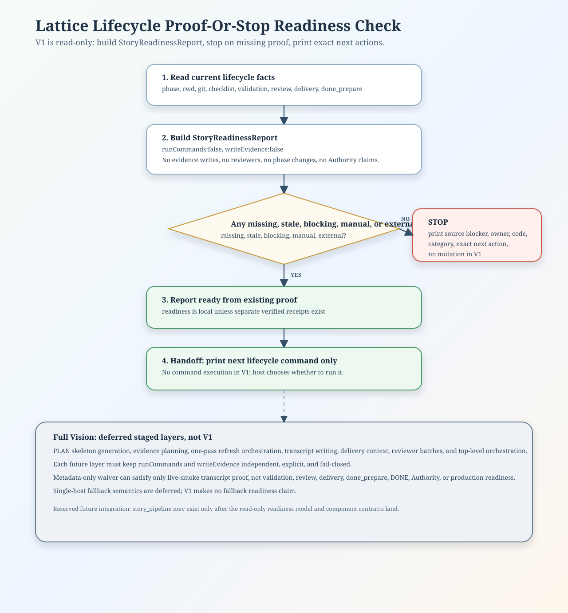
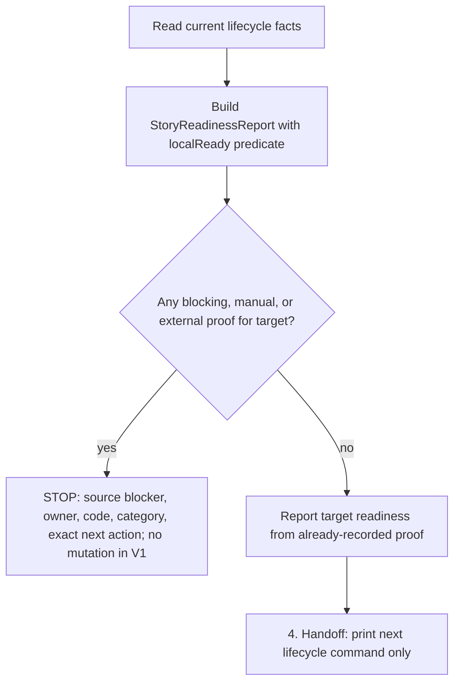

# Lattice Lifecycle Proof-Or-Stop Readiness Check

Status: execution plan; V1 P1 landed in `B-bd45`
Created: 2026-06-20
Short name: Lifecycle Readiness Check
V1 report model: `StoryReadinessReport`

## Purpose

The Lifecycle Readiness Check is a read-only control tower for a Lattice story.
It answers one question:

> What proof is already present for the requested lifecycle target, and what is
> the exact next action when proof is missing, stale, blocking, or external?

It replaces the previous pipeline positioning. The old full-flow material is
now the Full Vision: later staged layers that may plan or orchestrate work only
after V1 proves that a read-only report is stable and does not weaken lifecycle
gates.

V1 does not reduce evidence requirements. It makes missing proof visible early
and stops with exact commands instead of letting hosts infer them from scattered
state.

## V1 Landed Scope

Story `B-bd45` shipped the first read-only slice:

- command: `lattice lifecycle_check --storyId=B-xxxx --target=REVIEW|TEST|DONE`;
- report: `StoryReadinessReport` with phase, hashes, artifacts, readiness rows,
  next actions, and local/Authority/production claims;
- invariant: `claims.localReady` is true iff no readiness row has
  `blocking:true`;
- safety: `runCommands:true` or `writeEvidence:true` fails closed in V1;
- boundary: V1 does not run commands, write evidence, launch reviewers, move
  phases, run `done_prepare`, sign delivery, or claim Authority/production
  completion.

Use it before REVIEW, TEST, or DONE when the host needs to know why a story is
not ready:

```bash
lattice lifecycle_check --storyId=B-xxxx --target=DONE
```

Use JSON output when another tool needs to consume the same readiness facts:

```bash
lattice lifecycle_check --storyId=B-xxxx --target=DONE --format=json
```

The expected time saving is host-cycle reduction, not code generation speed.
The command replaces repeated manual inspection of story state, evidence
freshness, reviewer lanes, validation, delivery status, and DONE blockers with
one read-only report. It should reduce blind `story_advance` attempts and late
gate surprises. It does not skip lifecycle gates or shorten the required
review/evidence work itself.

## V1 Positioning

V1 is not a pipeline executor. It is a proof-or-stop readiness report.

V1 may:

- read story phase, checklist, review, validation, delivery, bug/finding,
  `done_prepare`, git, scope, and freshness facts through existing readers;
- render a `StoryReadinessReport` as text or JSON;
- classify each lifecycle dependency as `pass`, `warn`, `blocked`, `manual`, or
  `external`;
- print exact next commands for the minimum required action;
- explain why a current target is not ready.

V1 must not:

- write `verificationEvidence`, validation evidence, delivery checks, transcript
  artifacts, waivers, review passes, findings, or any other story evidence;
- run validation, smoke, test, build, browser, Authority, reviewer, delivery, or
  `done_prepare` commands on behalf of the host;
- refresh hashes or rebind stale material;
- launch reviewers or sign delivery checks;
- advance phases or roll phases back;
- replace `done_prepare` or reimplement DONE readiness;
- claim remote, Authority, fullAuthority, production, or deployed status.

## V1 Command Surface

The primary V1 command is read-only:

```bash
lattice lifecycle_check --storyId=B-xxxx --target=DONE
```

An alias may be exposed for discoverability:

```bash
lattice story_readiness --storyId=B-xxxx --target=TEST
```

V1 options are explicit. There is no single overloaded `dryRun` flag:

```json
{
  "storyId": "B-xxxx",
  "target": "REVIEW|TEST|DONE",
  "format": "text|json",
  "runCommands": false,
  "writeEvidence": false,
  "includeAdvisory": true
}
```

For V1, `runCommands` and `writeEvidence` are fixed to `false`. If supplied as
`true`, the command must fail closed with a message that the capability belongs
to a later Full Vision layer. Future layers may opt in to either axis
independently; command execution must never imply evidence writing, and evidence
writing must never happen without an explicit writer contract.

`story_pipeline` is not the V1 primary command. It is reserved, if used at all,
for a later Full Vision integration layer after the readiness report, evidence
planning, reviewer orchestration, transcript, delivery context, and DONE
delegation contracts have landed independently.

## Relationship To Existing Plans

This plan complements, rather than replaces, existing truth sources:

- `done-prepare-automation-execution-plan.md` remains the conservative
  TEST-to-DONE readiness assistant.
- `review-assurance-floor-execution-plan.md` defines review floor semantics.
- `story-files-hash-material-drift.md` defines the secondary `storyFilesHash`
  freshness signal.
- `lifecycle-gate-receipt-consumption.md` defines receipt consumption
  boundaries.
- `lattice-unattended-completion-plan.md` and Authority plans cover broader
  unattended or remote completion paths.

The Lifecycle Readiness Check reads these facts and reports readiness. It does
not create a second gate, delivery, Authority, or DONE implementation.

## Boundary With `done_prepare`

`done_prepare` remains the canonical TEST-to-DONE readiness assistant. V1 does
not call it. V1 may only read the latest existing `done_prepare` report and
decide whether that report is current enough to be referenced.

When no current `done_prepare` report exists, V1 prints the exact next command:

```bash
lattice done_prepare '{"storyId":"B-xxxx","mergeMain":true,"refreshStale":true,"validate":true}'
```

V1 must preserve `done_prepare` blocker names, `blockedAt`, and `next` values.
It must not reinterpret a `done_prepare` blocker as pass.

### `done_prepare` HEAD Binding Semantics

A `done_prepare` report can be consumed only when all of these bindings match:

- `storyId` matches the checked story;
- `target` or implied target is DONE;
- `preMergeHead` equals the story HEAD observed when `done_prepare` started;
- `mainTipAtPrepare` equals the local `main` tip observed by `done_prepare` when it
  started;
- `postMergeHead` equals the current story HEAD after a no-op main sync or after
  `done_prepare` merged main;
- `materialHash` and `storyFilesHash` match the current post-merge material;
- validation ref, review round, delivery-check artifact, and stale-evidence
  state match the current story facts;
- the report was produced after the latest material-affecting story change.

If `mergeMain:true` changed HEAD, the post-merge HEAD is the only binding that
can support a later DONE attempt. Any report bound only to the pre-merge HEAD is
stale. V1 reports that stale state and prints the `done_prepare` rerun command;
it does not refresh the report.

If the local `main` tip advanced after report capture, this is also stale even
when the report still carries a matching `postMergeHead`.

## Canonical V1 Report

V1 owns `StoryReadinessReport`. Later Full Vision layers may extend it, but
they must not introduce competing readiness predicates.

Required top-level shape:

```json
{
  "storyId": "B-xxxx",
  "target": "REVIEW|TEST|DONE",
  "phase": "DEV|REVIEW|TEST|DONE",
  "headHash": "<git-head>",
  "materialHash": "<current-material>",
  "storyFilesHash": "<current-story-files>",
  "mode": {
    "runCommands": false,
    "writeEvidence": false
  },
  "artifacts": {
    "verificationEvidence": [],
    "validationRef": null,
    "reviewRound": null,
    "deliveryCheckRef": null,
    "liveSmokeTranscriptRef": null,
    "metadataOnlyWaiverRef": null,
    "donePrepareRef": null
  },
  "readiness": [
    {
      "id": "review.findings",
      "status": "pass|warn|blocked|manual|external",
      "blocking": true,
      "source": "storyMachine|validate|review|delivery|done_prepare|authority",
      "sourceRef": "<artifact-or-command-ref>",
      "owner": "host|reviewer|delivery-reviewer|done_prepare|authority|human",
      "category": "missing|stale|blocking|manual|external|advisory",
      "code": "<stable machine-readable readiness code>",
      "reason": "<specific reason>",
      "nextCommand": "<exact command when available>"
    }
  ],
  "next": [
    {
      "kind": "command|human_decision|external_wait",
      "owner": "host|reviewer|delivery-reviewer|authority|human",
      "command": "<exact command when available>",
      "reason": "<why this is the minimum next action>"
    }
  ],
  "claims": {
    "localReady": false,
    "authorityDone": false,
    "fullAuthorityDone": false,
    "productionDone": false
  }
}
```

Rules:

- `StoryReadinessReport` is assembled from existing structured facts only.
- `claims.localReady` is true iff no `readiness` row has `blocking:true`.
  Advisory/warn rows remain visible but do not block `localReady`.
- `claims.authorityDone`, `claims.fullAuthorityDone`, and
  `claims.productionDone` remain `false` unless a separate Authority receipt
  reader supplies verified facts. V1 does not create those facts.
- `readiness[*].category` is a broad generic classification for grouping and
  text rendering only: `missing`, `stale`, `blocking`, `manual`, `external`, or
  `advisory`.
- `readiness[*].code` is the stable machine-readable readiness detail. Delivery
  rows must use the delivery blocker codes below, such as
  `missing_delivery_check`, `delivery_check_blocking`,
  `docs_promise_unresolved`, or `product_outcome_unproven`.
- `readiness[*].nextCommand` must be the exact command the host can run next, or
  absent only when the next action is genuinely manual or external.
- Report rendering must preserve the original source blocker. It must not
  collapse a `validate`, REVIEW, delivery, or `done_prepare` failure into a
  generic "not ready" row. Text rendering should include both `code` and broad
  `category` while keeping the exact next action visible.

## Readiness Matrix

Every row follows the same rule: proof present or stop. Missing evidence is a
normal readiness result, not an exception.

| Area | V1 reads | Pass condition | If missing or stale | Exact next action |
|---|---|---|---|---|
| State intake | `session_brief`-equivalent readers, story phase, cwd, worktree, git status | target is valid for current phase and cwd is story worktree | stop before any mutation | print `cd <worktree>` or clean-tree guidance |
| PLAN skeleton | checklist, understanding, decision, `verificationIntent`, `story_review` result | PLAN facts are accepted by story review | stay before DEV readiness | print missing `understanding_set`, `decision_set`, or `story_review` command |
| Verification evidence | checklist evidence refs and freshness facts | required refs exist and match current HEAD/material/storyFilesHash | block target readiness | print rerun or refresh command, but do not run it |
| Validation | latest validation artifact | validation pass is current for target | block TEST/DONE readiness | `lattice validate --story=B-xxxx` |
| Review | review round, `review_run_start`, pass/finding state | required lanes have current pass and no blocking verified finding | block REVIEW/TEST/DONE readiness | print reviewer command or rollback command |
| Delivery | delivery context/check facts | delivery artifact is present, fresh, and non-blocking where target requires it | block DONE readiness | print delivery reviewer command |
| Live smoke transcript | transcript artifact or accepted metadata-only waiver | transcript is current, or metadata-only waiver is accepted | block live-smoke transcript proof only | print smoke command or waiver path |
| `done_prepare` | latest report and bindings | current PASS report is bound to post-merge HEAD/material/storyFilesHash | block DONE readiness | print `done_prepare` command |
| Authority/remote | verified receipt refs only | verified receipt says so | local-only report | print external receipt requirement, never claim production |

## Exact Rollback Commands

V1 does not execute rollback itself, but it must print the exact command as a
likely next action when a later phase has to return to implementation work.

From REVIEW to DEV, use this when a verified blocking finding, stale reviewer
pass, missing required lane, or stale material-bound evidence requires code or
evidence changes before review can pass:

```bash
lattice story_advance '{"storyId":"B-xxxx","phase":"DEV"}'
```

From TEST to DEV, use the same command when validation, bug, evidence,
delivery, stale `done_prepare`, or material drift requires implementation
changes before TEST/DONE can proceed:

```bash
lattice story_advance '{"storyId":"B-xxxx","phase":"DEV"}'
```

After rollback, the host fixes the issue, records evidence through the normal
writer commands, commits, and advances forward again through the lifecycle. V1
must not synthesize a rollback reason into story metadata; it only reports the
source blocker and the command.

## Delivery Blocker Categories

Delivery readiness rows use stable `readiness[*].code` values so a host can
tell what kind of proof is missing or blocking. Each code also maps to a broad
`readiness[*].category` for grouping:

| `readiness[*].code` | Broad `category` | Meaning | Typical next action |
|---|---|---|---|
| `missing_delivery_context` | `missing` | delivery reviewer lacks a current context pack or equivalent structured refs | build context through the current delivery-context command for that story |
| `missing_live_smoke_transcript` | `missing` | no current live-smoke transcript and no accepted metadata-only waiver | run the story-specific live smoke command |
| `metadata_waiver_not_accepted` | `manual` | waiver exists but delivery reviewer has not accepted it | ask delivery reviewer to accept or reject the waiver |
| `stale_delivery_context` | `stale` | context predates current HEAD/material/storyFilesHash, validation, or review round | rebuild context through the current delivery-context command |
| `missing_delivery_check` | `missing` | no delivery-check artifact exists where DONE requires one | run the delivery reviewer path that writes `delivery_check_set` |
| `stale_delivery_check` | `stale` | delivery check predates current material, validation, review, transcript, or waiver state | rerun the delivery reviewer path |
| `delivery_check_blocking` | `blocking` | delivery reviewer recorded a blocking user-value concern | return to DEV or resolve the delivery finding |
| `docs_promise_unresolved` | `blocking` | relatedDocs or decision promises were changed/owed but not reconciled | update docs or record why no doc change is required |
| `product_outcome_unproven` | `blocking` | evidence proves commands but not the user-visible outcome | produce live-smoke transcript or delivery-approved waiver |

These codes are report details only in V1. They are not new DONE gate facts
until a future implementation story registers them as process facts.

## Refresh-Only Policy

V1 never refreshes hashes. It only classifies stale evidence and prints the
minimum next action.

Later layers may implement `refresh_only`, but the contract is strict:

- a refresh-only path may use only an existing evidence refresh writer;
- it may run at most one refresh pass for a given report row;
- after that pass, the row must be re-read and reclassified from current facts;
- if the row is still not fresh or advisory after one pass, it escalates to
  `rerun_required` or `hard_stale`;
- no layer may directly rewrite HEAD/material/storyFilesHash bindings.

This prevents loops where a tool repeatedly refreshes stale metadata instead of
forcing real proof to be regenerated.

## Metadata-Only Waiver Policy

A metadata-only waiver waives only the live-smoke transcript requirement. It
does not waive validation, review, delivery check, `done_prepare`, DONE
readiness, Authority receipts, or any lifecycle gate.

Required waiver shape:

```json
{
  "kind": "waiver",
  "waiverType": "metadata-only-live-smoke-transcript",
  "intentRef": "<CHK-id>:<lane>:<index>",
  "reason": "why this story has no user-visible runtime behavior",
  "owner": "implementation host",
  "acceptedBy": "delivery reviewer",
  "sourceRefs": ["<doc-or-code-ref>"]
}
```

Rules:

- only documentation, metadata, process-record, or registry-only stories may use
  the waiver;
- runtime behavior, CLI behavior, Authority behavior, user-visible output, and
  gate semantics cannot use it;
- the implementation host may propose the waiver, but the delivery reviewer
  must accept it before it satisfies the live-smoke transcript row;
- acceptance is local delivery evidence only and must not claim Authority,
  remote, production, validation, review, or DONE status.

## V1 Text Flow

```text
START
  |
  v
[Read current story, git, phase, artifact, review, delivery, validation facts]
  |
  v
[Build StoryReadinessReport with runCommands:false and writeEvidence:false]
  |
  v
{Any missing, stale, blocking, manual, or external proof for target?}
  |-- yes --> [STOP: print source blocker, owner, code, category, exact next action, no mutation in V1]
  |
  no
  |
  v
[Report target readiness from already-recorded proof]
  |
  v
[Print the next lifecycle command; do not execute it]
```

Examples:

```bash
lattice lifecycle_check --storyId=B-xxxx --target=REVIEW
lattice lifecycle_check --storyId=B-xxxx --target=TEST
lattice lifecycle_check --storyId=B-xxxx --target=DONE
```

For a TEST target with a blocking REVIEW finding, the report prints:

```bash
lattice story_advance '{"storyId":"B-xxxx","phase":"DEV"}'
```

For a DONE target with no current `done_prepare` report, the report prints:

```bash
lattice done_prepare '{"storyId":"B-xxxx","mergeMain":true,"refreshStale":true,"validate":true}'
```

## Image Flowchart



Mermaid source for environments that render diagrams directly:



## Full Vision: Later Staged Layers

The previous full-flow pipeline is not V1. It is retained as a staged Full
Vision only after the read-only readiness report is stable.

Later layers may include:

- PLAN skeleton generation;
- evidence planning and optional refresh orchestration;
- command transcript and live-smoke artifact capture;
- delivery context pack generation;
- reviewer batch orchestration;
- optional top-level lifecycle orchestration;
- delegated TEST-to-DONE preparation through `done_prepare`.

Each layer must declare whether it can run commands and whether it can write
evidence. The two permissions stay independent:

| Layer | Default `runCommands` | Default `writeEvidence` | Notes |
|---|---:|---:|---|
| V1 readiness report | `false` | `false` | read-only; no reviewers; no phase changes |
| PLAN skeleton assistant | `false` | `false` unless explicit story writer command | future only |
| Evidence planner | `false` | `false` | future planning layer |
| Evidence refresh/execution | `false` | `false` | future opt-in; one refresh-only pass max |
| Transcript writer | `false` | `false` | future opt-in command capture |
| Delivery context pack | `false` | `false` | future context producer; not a delivery signer |
| Reviewer batch | `false` | `false` | future reviewer launcher; not V1 |
| Top-level orchestration | `false` | `false` | future only; may compose prior layers |

Single-host fallback semantics are deferred. V1 makes no fallback readiness
claim; any future fallback must be advisory-only unless a separate story
registers a hard gate contract and reviewers approve it.

## Full Vision Step Contracts

The staged layers inherit the proof-or-stop rule:

| Step | Full Vision output | V1 relationship |
|---|---|---|
| State intake and preflight | same `StoryReadinessReport` readers | V1 owns this first |
| PLAN skeleton | checklist/context/understanding suggestions | outside V1; explicit writer only |
| Evidence plan/refresh | command plan, optional evidence writes | outside V1; one refresh-only pass max |
| Validation/transcript/context | command transcripts and context pack | outside V1; V1 only reads existing refs |
| Reviewer lane orchestration | `review_run_start`, pass/finding collection | outside V1; V1 only reads review facts |
| Gate preflight | consolidated report | V1 read-only report |
| TEST-to-DONE delegation | `done_prepare` execution/import | V1 only reads current reports |
| Phase handoff | printed or executed `story_advance` | V1 prints only |

## Suggested Story Breakdown

| Story | Title | Primary output |
|---|---|---|
| P1 | Add Lifecycle Readiness Check report | `StoryReadinessReport` and `lifecycle_check` read-only command |
| P2 | Add PLAN skeleton assistant | explicit PLAN writer, separate from V1 |
| P3 | Add evidence planner | dry report of missing/rerun/refresh-only evidence |
| P4 | Add one-pass evidence refresh orchestration | opt-in command/evidence writer layer |
| P5 | Add live-smoke transcript artifact writer | explicit transcript producer |
| P6 | Add delivery context pack | context producer, not delivery signer |
| P7 | Add reviewer batch orchestration | explicit reviewer launcher |
| P8 | Add optional top-level lifecycle orchestration | Full Vision integration only |

P1 must land first. All later stories consume `StoryReadinessReport` rather than
creating new readiness predicates.

## V1 Evidence Requirements

The implementation story for V1 must prove:

- `lifecycle_check` is read-only under normal and failure paths;
- passing `runCommands:true` or `writeEvidence:true` fails closed in V1;
- stale `done_prepare` pre-merge reports are not treated as DONE-ready;
- post-merge `done_prepare` binding is required when main sync changes HEAD;
- REVIEW and TEST blockers print the exact rollback command to DEV;
- delivery blocker categories render distinctly;
- metadata-only waiver satisfies only the live-smoke transcript row;
- remote/Authority/production claims remain false without verified receipts;
- no V1 code path launches reviewers, writes delivery checks, writes evidence,
  refreshes hashes, or advances phases.

Minimum smoke matrix:

| Scenario | Expected result |
|---|---|
| clean REVIEW target | report passes from existing proof and prints REVIEW next command only |
| open verified finding | blocked row plus REVIEW/TEST to DEV rollback command |
| stale validation | blocked row with `lattice validate --story=B-xxxx` next command |
| missing delivery check | `missing_delivery_check` row, no delivery signature written |
| stale pre-merge `done_prepare` | blocked DONE row with `done_prepare` rerun command |
| metadata-only story | live-smoke transcript row waived, validation/review/delivery/DONE still checked |
| `runCommands:true` in V1 | fail closed, no child command invoked |
| `writeEvidence:true` in V1 | fail closed, no evidence file or story metadata write |

## Metrics For Success

Track these before and after V1 rollout:

- number of failed phase-advance attempts caused by predictable blockers;
- number of manual status-inspection commands before REVIEW/TEST/DONE;
- number of stale `done_prepare` reports caught before DONE;
- number of delivery-check reruns caused by missing context;
- number of metadata-only waivers incorrectly assumed to waive non-smoke gates.

Success means fewer blind lifecycle attempts, not fewer gates.

## Decision

Adopt the Lattice Lifecycle Proof-Or-Stop Readiness Check as the V1 direction.

The first valuable slice is a read-only `StoryReadinessReport` surfaced through
`lattice lifecycle_check` / `lattice story_readiness`. Full-flow orchestration is
deferred until V1 proves stable and every later layer keeps command execution,
evidence writing, reviewer authority, delivery signatures, phase movement, and
Authority claims explicitly separated.
