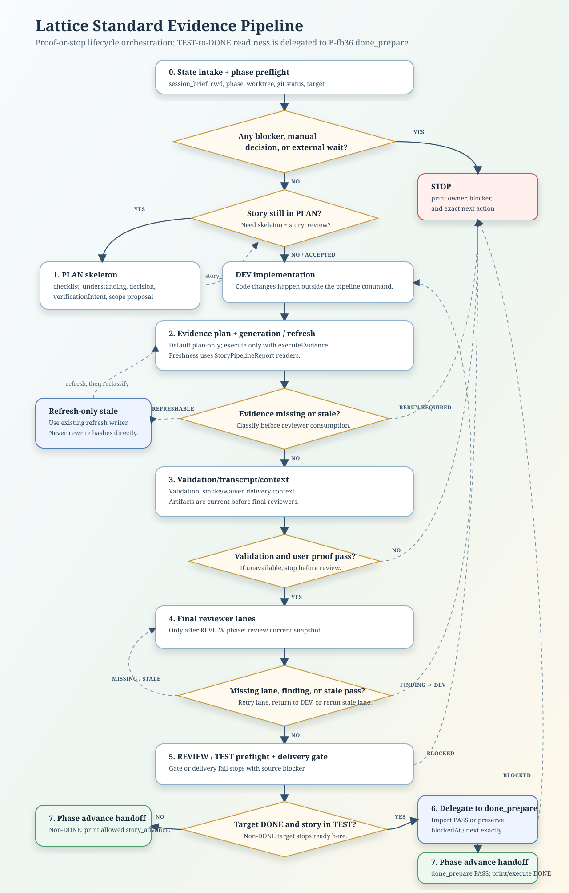
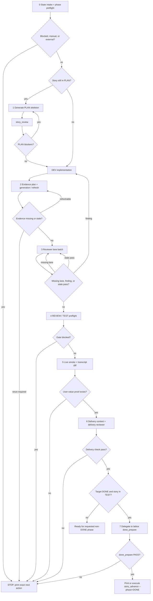

# Lattice Standard Evidence Pipeline Execution Plan

Status: execution plan
Created: 2026-06-20

## Purpose

Reduce Lattice story delivery time by turning repeated host-side process
accounting into a stable standard pipeline.

This plan targets the mechanical work a host currently performs by hand:

- story initialization and PLAN skeleton setup;
- reviewer lane launch and pass/finding collection;
- verification evidence generation and refresh;
- REVIEW/TEST gate preflight aggregation plus DONE-readiness delegation;
- real-machine smoke execution and transcript diff generation;
- delivery-check synthesis from already-recorded evidence.

The goal is time reduction without evidence reduction. The pipeline must not
weaken lifecycle gates, reviewer independence, material freshness, Authority
receipt boundaries, or delivery review requirements. It only standardizes and
orchestrates steps that hosts already perform manually today.

## Problem

In complex Lattice stories, implementation is often not the slowest part. The
slow part is process orchestration:

- hosts repeatedly inspect `session_brief` to infer the next valid command;
- reviewer lanes are launched one by one and manually reconciled;
- stale evidence recovery requires the host to dry-run, rerun commands, refresh
  metadata, validate, and commit in the right order;
- DONE readiness has a conservative assistant in `done_prepare`, but earlier
  stages still hand off evidence, transcript, reviewer, and delivery context
  manually;
- transcript-diff evidence is manually written from command output;
- delivery reviewers repeat evidence collection that already exists in process
  events and validation artifacts.

Those steps are valuable. The inefficiency is that hosts act as flow
accountants. Humans should decide product/risk questions; hosts should not need
to manually assemble routine proof bundles.

## Non-Goals

The standard pipeline must not:

- auto-claim DONE when gates fail;
- hide stale material or stale review evidence;
- rewrite evidence hashes without rerunning or refreshing through existing
  evidence machinery;
- auto-resolve reviewer findings;
- replace reviewer lanes with a single host self-review;
- mint Authority DONE, fullAuthorityDone, or productionDone;
- push to remote;
- stash, revert, delete, or overwrite unrelated user changes;
- bypass delivery review;
- turn advisory documentation gaps into silent success.

## Relationship To Existing Plans

This plan complements existing automation documents:

- `done-prepare-automation-execution-plan.md` covers conservative TEST-to-DONE
  readiness preparation.
- `lattice-unattended-completion-plan.md` covers broader unattended execution
  and Authority-backed job completion.
- `lattice-parallel-wave.md` covers read-only multi-story scheduling guidance.
- `review-assurance-floor-execution-plan.md` defines review floor semantics.
- `story-files-hash-material-drift.md` defines the secondary `storyFilesHash`
  freshness signal.

This document is the orchestration layer across the whole story lifecycle. It
does not replace any gate-specific truth source.

## Boundary With B-fb36 `done_prepare`

B-fb36 already standardized the conservative mechanical closure path between a
TEST-passing story and an explicit DONE attempt. That implementation is the
canonical TEST-to-DONE readiness assistant.

This pipeline must not reimplement that work. For any `--to=DONE` run where the
story is already in TEST, `story_pipeline` delegates DONE readiness to
`lattice done_prepare` and consumes its structured report. The pipeline may
prepare inputs that `done_prepare` or DONE gates later consume, such as
transcript artifacts or delivery context packs, but it must not independently:

- merge `main` for DONE readiness;
- refresh stale TEST evidence;
- rerun DONE validation;
- run `done_closure`;
- calculate post-DONE runtime version-bump readiness;
- rebind or re-endorse stale review escalation / host verdict material.

If the DONE path needs additional behavior, it should be added as a
`done_prepare` follow-up story or as an upstream artifact producer. It should
not become a parallel DONE-readiness implementation inside `story_pipeline`.

## Target Command Surface

Introduce a single high-level command family:

```bash
lattice story_pipeline --storyId=B-xxxx --to=TEST
lattice story_pipeline --storyId=B-xxxx --to=DONE
lattice story_pipeline --storyId=B-xxxx --to=DONE --dryRun
```

Recommended initial options:

```json
{
  "storyId": "B-xxxx",
  "to": "DONE",
  "dryRun": false,
  "runReviewers": true,
  "runValidation": true,
  "runLiveSmoke": true,
  "writeTranscriptDiff": true,
  "runDeliveryContextPack": true,
  "delegateDonePrepare": true,
  "donePrepare": {
    "mergeMain": true,
    "refreshStale": true,
    "validate": true
  },
  "allowDegradedSingleHost": false
}
```

For `--to=DONE`, the `donePrepare` block is a pass-through to
`lattice done_prepare`; it is not a second implementation of DONE readiness.

The first implementation may expose narrower commands internally:

- `story_pipeline_init`
- `story_pipeline_review`
- `story_pipeline_evidence`
- `story_pipeline_preflight`
- `story_pipeline_live_smoke`
- `story_pipeline_delivery`

The user-facing flow should still converge toward one operator command that
prints exact blockers and next actions.

## Step Contract Matrix

Every step follows the same rule: produce required evidence or stop. A step that
cannot produce its required evidence returns `blocked`, `manual`, or `external`
with the exact next command or decision needed. It must not silently advance the
story or rewrite stale proof into fresh proof.

| Step | Inputs | Outputs | Required evidence | If evidence is missing or stale | Responsible verifier |
|---|---|---|---|---|---|
| 0. State intake and phase preflight | `storyId`, current cwd, `session_brief`, story phase, git branch/status, worktree path, target phase | pipeline state snapshot, allowed next stage, immediate blocker list | command transcript or structured result from `session_brief`; git status; resolved story/worktree identity | stop before mutation; print `cd`, clean-tree, phase, or worktree repair command; never stash/revert unrelated files | pipeline preflight plus lifecycle handler |
| 1. Story init / PLAN skeleton | title, description, optional checklist titles, `aux_doc_list`, risk signals, duplicate-story scan | checklist title/context/relatedDocs, understanding snapshot, decision skeleton, verificationIntent skeleton, initial scope proposal | story metadata write through Lattice command; `understanding_set`; decision record when required; `story_review` report | remain in PLAN/INIT_CHECK; print missing skeleton fields or story_review blockers; do not start code changes | `story_review`, verification-intent reviewer, concept reviewer |
| 2. Verification evidence generation / refresh | checklist `verificationIntent`, evidence plan rules, changed files, current HEAD/material/storyFilesHash, known command catalog | evidence plan, generated/rerun command transcripts, refreshed `verificationEvidence`, stale classification | command result with exit code/digest; verificationEvidence refs bound to HEAD/material/storyFilesHash; refresh event from existing evidence writer | classify as rerun-required or refreshable; call existing refresh command only when safe; otherwise stop with rerun command; never rewrite hashes directly | `lattice validate` and coverage reviewer |
| 3. Reviewer lane orchestration | story phase, current review round, lane list, changed files, prior findings, latest `review_run_start` data, final material-bound evidence snapshot | lane status table, pass/finding refs, stalled-lane retry plan | signed `reviewRunId` per lane; `review_pass_set` or `finding_add` per lane; reviewRound/material/evidence bindings | block REVIEW to TEST; retry missing/stalled lanes; return to DEV for blocking verified findings | independent reviewer lanes and REVIEW gate |
| 4. REVIEW / TEST gate preflight | pipeline state snapshot, review state, evidence state, validation state, bug/finding state, scope/delivery/artifact state | consolidated preflight report with `pass`/`warn`/`blocked`/`manual`/`external` entries | source command refs for each gate; lifecycle guard result; for DONE target, imported `done_prepare --dryRun` result | preserve the original gate blocker and next command; do not reinterpret `done_prepare` or lifecycle gate failures | lifecycle gates; `done_prepare` for DONE target checks |
| 5. Live smoke / transcript diff | expected user outcome, validate commands, story-specific smoke commands, current material binding | transcript-diff artifact, stdout/stderr digest, expected/actual/diff notes | real command transcript with exit code; digest; elapsed time; HEAD/material/storyFilesHash binding; artifact path | block user-value verification unless story has explicit metadata-only waiver; print missing smoke command or expected-output gap | test coverage reviewer and delivery reviewer |
| 6. Delivery context pack and delivery review | relatedDocs, decision promises, diff summary, validation/evidence state, transcript artifact, review assurance state | delivery context pack, delivery reviewer instruction, signed delivery check | context pack artifact; delivery reviewer `reviewRunId` when applicable; `delivery_check_set` / delivery-check artifact written by delivery reviewer only | block DONE; launch or instruct delivery reviewer; main agent must not self-sign delivery | delivery reviewer lane and DONE gate |
| 7. TEST-to-DONE readiness delegation | story in TEST, clean worktree, delivery/review/evidence artifacts, `donePrepare` options | `done_prepare` report, exact DONE command or blocker report | `lattice done_prepare` PASS report; `done_closure` result inside that report; validation and stale-evidence status owned by `done_prepare` | stop at `done_prepare` blocker; preserve its `blockedAt` and `next`; fix/rerun via its command surface | B-fb36 `done_prepare`, `done_closure`, `story_advance --phase=DONE` |

## Evidence Failure Policy

Missing evidence is a first-class outcome, not an exceptional case. The pipeline
must always surface which proof is missing, who owns it, and which command or
human decision can produce it.

| Missing proof | Pipeline behavior | Owner to produce proof | Verifier |
|---|---|---|---|
| PLAN skeleton evidence | stop in PLAN; generate or print missing fields | main host / story init skeleton command | `story_review` |
| reviewer pass/finding for a lane | block REVIEW; retry only the missing or stale lane | reviewer lane host | REVIEW gate |
| verified finding fix evidence | return to DEV with finding id and expected proof | implementation host | original reviewer lane |
| verificationEvidence command result | print rerun command; do not mark fresh | implementation host or evidence command runner | `lattice validate` |
| safely refreshable stale evidence | call existing refresh writer when configured; otherwise print refresh command | evidence refresh command | `lattice validate` |
| stale review escalation or host verdict | block and request real re-attestation; no rebinding | appropriate reviewer / host verdict lane | review assurance / escalation gate |
| transcript-diff artifact | block delivery unless a signed metadata-only waiver exists | live smoke command owner | delivery reviewer |
| delivery check | block DONE; run delivery reviewer | delivery reviewer | DONE gate |
| Authority receipt | mark local-only; never claim Authority/fullAuthority/production DONE | Authority server / receipt verifier | Authority receipt gate |
| `done_prepare` blocker | stop and preserve `blockedAt` / `next` exactly | owner named by `done_prepare` | B-fb36 `done_prepare` |

## Pipeline Stages

### 1. Story Init / PLAN Skeleton

Goal: make new stories start with the minimum useful skeleton instead of an
empty process container.

Inputs:

- story title and description;
- optional checklist titles;
- risk signals from description and paths;
- related docs from `aux_doc_list`;
- existing duplicate-story detection.

Outputs:

- checklist items with title/context/relatedDocs;
- understanding snapshot;
- decision skeleton when risk requires it;
- verificationIntent skeleton for happy/edge/adversarial lanes;
- initial scope contract proposal;
- PLAN review readiness summary.

Rules:

- generated skeletons are drafts until story review accepts them;
- high-risk stories still require structured decision and pre-mortem fields;
- skeleton generation must not write old `testIntent`;
- generated relatedDocs are advisory links, not gate pass evidence;
- no code changes occur in this stage.

Acceptance:

- `story_review` can report concrete missing pieces instead of a blank plan;
- verification-intent generation has enough structure for later evidence
  mapping;
- scope contract starts from explicit path patterns rather than ad hoc
  acknowledgements after the fact.

### 2. Verification Evidence Generation And Refresh

Goal: map verificationIntent to executable evidence without manual bookkeeping.

Command shape:

```bash
lattice story_pipeline_evidence --storyId=B-xxxx --refreshStale=true
```

Required behavior:

- read checklist verificationIntent;
- map each intent to one or more known evidence commands;
- detect stale evidence using the same freshness logic as `validate`;
- distinguish safely refreshable metadata from commands that must be rerun;
- rerun required evidence commands when configured and safe;
- call existing `verification_evidence_refresh_stale` rather than rewriting
  hashes directly;
- record head/material/storyFilesHash bindings through existing metadata
  writers.

Evidence mapping examples:

| Intent type | Evidence source |
|---|---|
| docs | process-fact contract, docs grep, decision-doc render |
| logic | unit/smoke task, targeted script |
| cli | command transcript with stdout/stderr digest |
| browser | browser trace artifact |
| authority | live receipt or verified local non-authority boundary result |

Acceptance:

- `validate` reports coverage gaps only when evidence is truly missing/stale;
- host does not manually copy command strings into checklist evidence;
- stale evidence recovery produces a deterministic next action.

### 3. Reviewer Lane Orchestration

Goal: launch and collect reviewer lanes as a managed batch against final
material-bound evidence.

Command shape:

```bash
lattice story_pipeline_review --storyId=B-xxxx --lanes=concept,quality,test-coverage,docs
```

Required behavior:

- run required evidence planning/refresh before final reviewer pass/finding
  collection;
- start each lane with `review_run_start`;
- require every finding/pass to include the lane `agent` and `reviewRunId`;
- run lanes in parallel when host capacity allows;
- collect pass/finding results into one status table;
- surface stalled reviewers and allow retry without invalidating completed
  lanes;
- never convert a missing review into a pass;
- treat coverage and delivery-adjacent lanes as stale when new evidence,
  transcript, validation, or delivery context is written after their pass.

Concept and quality lanes may optionally run early as advisory design checks, but
the final REVIEW gate consumes only reviewer runs bound after the current
material and verification evidence are stable.

Output example:

```json
{
  "storyId": "B-xxxx",
  "reviewRound": "2026-06-20T10:00:00.000Z",
  "evidenceSnapshot": {
    "headHash": "<current-head>",
    "materialHash": "<current-material>",
    "storyFilesHash": "<current-story-files>"
  },
  "lanes": [
    {"lane":"concept","status":"pass","reviewRunId":"B-xxxx:RR-001"},
    {"lane":"quality","status":"finding","findingIds":["B-xxxx:F-001"]},
    {"lane":"test-coverage","status":"pass","reviewRunId":"B-xxxx:RR-003"},
    {"lane":"docs","status":"pass","reviewRunId":"B-xxxx:RR-004"}
  ],
  "blocking": true,
  "next": "Resolve B-xxxx:F-001, return to DEV, refresh evidence, then rerun affected lanes."
}
```

Acceptance:

- a host does not manually spawn four reviewers and reconcile outputs;
- reviewer independence and signed run binding remain intact;
- coverage reviewers never pass before the evidence they are asked to judge
  exists;
- repeated REVIEW rounds only rerun lanes that are stale, affected, or required.

### 4. Gate Preflight Aggregator

Goal: show all current blockers before a host attempts the next phase.

Command shape:

```bash
lattice story_pipeline_preflight --storyId=B-xxxx --target=TEST
lattice story_pipeline_preflight --storyId=B-xxxx --target=DONE --delegateDonePrepare=true
```

The preflight aggregator reads existing gates; it does not redefine them. For
DONE target checks, it delegates to `done_prepare --dryRun` or imports a
previous `done_prepare` report rather than duplicating TEST-to-DONE logic.

Required checks:

- current phase and worktree correctness;
- story owner lease status;
- dirty worktree status;
- branch synced with main;
- scope gate warnings/blockers;
- review status and review-run freshness;
- verification coverage and freshness;
- validation status;
- bug/finding status;
- review escalation status;
- review assurance floor status;
- declared artifact status;
- transcript-diff status;

DONE delegated section:

- call or parse `lattice done_prepare` for main sync, stale TEST evidence,
  validation, `done_closure`, delivery-check status, and post-DONE version-bump
  expectation;
- preserve `done_prepare` blocker names and next commands;
- never reinterpret a `done_prepare` blocker as pass.

Output categories:

- `pass`: gate is satisfied;
- `warn`: advisory or acknowledged expansion;
- `blocked`: must be fixed before target phase;
- `manual`: requires human/product/risk decision;
- `external`: depends on Authority server, host availability, or credentials.

Acceptance:

- DONE blockers from `done_prepare` are visible before
  `story_advance --phase=DONE`;
- stale host verdicts, missing delivery checks, dirty main checkout, and
  main-sync conflicts appear in one report without creating a second DONE
  readiness source;
- the report prints exact commands for the next minimum action.

### 5. Live Smoke And Transcript Diff

Goal: make user-value verification an artifact, not a hand-written summary.

Command shape:

```bash
lattice story_pipeline_live_smoke --storyId=B-xxxx
```

Required behavior:

- infer expected outcome from PLAN/summary/user-value fields;
- run configured validate commands and story-specific live smokes;
- capture command, exit code, stdout/stderr digest, elapsed time, and material
  binding;
- write `.lattice/story/actives/<storyId>/evidence/transcript-diff.md`;
- include expected, actual, and diff notes;
- fail when no concrete user-visible actual output exists for the story type,
  unless the story is explicitly metadata-only.

Transcript template:

```markdown
# <storyId> User-Value Verification Transcript

## Expected
...

## Actual
Command:
...
Result:
...

## Diff Notes
...
```

Acceptance:

- TEST no longer depends on the host manually summarizing command output;
- delivery reviewer can read one canonical transcript artifact;
- real-machine evidence is linked to material hash and validation evidence.

### 6. Delivery Check Synthesis

Goal: let the delivery reviewer consume existing evidence instead of repeating
host bookkeeping.

Command shape:

```bash
lattice story_pipeline_delivery --storyId=B-xxxx
```

Required behavior:

- collect docs promises from relatedDocs and decision docs;
- inspect code diff and evidence refs;
- read transcript diff;
- read validation and evidence freshness state;
- read review escalation and review assurance floor status;
- generate a delivery-review context pack;
- spawn or instruct `lattice-review-delivery`;
- write `delivery-check.json` only through the delivery reviewer lane.

Rules:

- main agent must not self-sign delivery;
- delivery reviewer can pass with explicit advisory notes, but blockers remain
  blockers;
- delivery check must not claim Authority DONE or production DONE.

Acceptance:

- delivery reviewer spends time judging delivery, not collecting scattered
  command output;
- `delivery_check_set` is based on structured evidence refs and transcript
  artifact;
- `done_prepare` and DONE pre-checks can consume the signed delivery artifact
  directly.

## Metadata-Only Waiver Policy

Live smoke and transcript artifacts are required by default. A story can skip
user-value smoke only when it is explicitly metadata-only and the waiver itself
is signed evidence.

Required waiver shape:

```json
{
  "kind": "waiver",
  "waiverType": "permanent",
  "intentRef": "<CHK-id>:<lane>:<index>",
  "reason": "why this story has no user-visible runtime behavior",
  "owner": "implementation host",
  "acceptedBy": "delivery reviewer",
  "sourceRefs": ["<doc-or-code-ref>"]
}
```

Rules:

- only documentation, metadata, process-record, or registry-only stories may use
  the waiver;
- runtime behavior, CLI behavior, Authority behavior, user-visible output, and
  gate semantics cannot use a metadata-only waiver;
- the implementation host may propose the waiver, but the delivery reviewer must
  accept it before DONE;
- waiver acceptance is not Authority evidence and must not claim
  `authorityDone`, `fullAuthorityDone`, or `productionDone`;
- `story_pipeline_live_smoke` must print the missing smoke command unless the
  waiver is present and delivery-accepted.

## End-To-End Flow

Recommended operator path:

```bash
lattice story_pipeline --storyId=B-xxxx --to=REVIEW
lattice story_pipeline --storyId=B-xxxx --to=TEST
lattice story_pipeline --storyId=B-xxxx --to=DONE
```

Internally:

1. Preflight current state.
2. Fill missing PLAN skeleton if still in PLAN.
3. Ensure code is committed before REVIEW/TEST/DONE transitions.
4. Refresh/generate material-bound evidence.
5. Launch required reviewers against the current evidence snapshot and collect
   results.
6. If blockers exist, stop with findings and next action.
7. Run validation.
8. Write transcript diff.
9. Run delivery reviewer against validation and transcript artifacts.
10. If target is DONE and the story is in TEST, delegate readiness to
    `lattice done_prepare`.
11. If all gates pass, print the exact `story_advance --phase=DONE` command or
    execute it when explicitly requested.

The pipeline should prefer stopping with precise blockers over making risky
assumptions.

## Flowcharts

### Text Flowchart

```text
START
  |
  v
[0 State intake + phase preflight]
  |-- blocked/manual/external --> print exact next action and STOP
  v
{Story still in PLAN?}
  | yes
  v
[1 Generate/refresh PLAN skeleton]
  v
[story_review]
  |-- blockers --> revise skeleton and stay in PLAN
  | no / accepted
  v
[DEV implementation happens outside the pipeline command]
  v
[2 Evidence plan + generation/refresh]
  |-- rerun-required evidence --> print rerun command and STOP
  |-- safely refreshable stale evidence --> delegate to existing refresh writer
  v
[3 Reviewer lane batch]
  |-- missing lane --> retry missing lane only
  |-- blocking finding --> return to DEV with finding id
  |-- evidence changed after pass --> rerun affected lane
  v
[4 REVIEW/TEST gate preflight]
  |-- blocked --> print source gate and next command
  v
[5 Live smoke + transcript-diff artifact]
  |-- missing user-value proof --> run smoke or require metadata-only waiver
  v
[6 Delivery context pack + delivery reviewer]
  |-- missing/blocking delivery check --> run delivery reviewer and STOP
  v
{Target is DONE and story is in TEST?}
  | no --> [Ready for requested non-DONE phase]
  |         |
  |         +--> print/execute allowed story_advance command
  | yes
  v
[7 Delegate to lattice done_prepare]
  |-- blocked --> preserve done_prepare blockedAt/next and STOP
  v
[DONE readiness PASS]
  |
  +--> print/execute story_advance --phase=DONE when explicitly requested
```

### Image Flowchart



Mermaid source for environments that render diagrams directly:



## Parallel Development Plan

The implementation should be split into independent stories so multiple hosts
can work safely in parallel.

### Track A. Pipeline State Model And Preflight

Owner scope:

- pipeline report types;
- aggregation of existing gate outputs;
- `done_prepare` report import/delegation for DONE target checks;
- JSON/text renderers;
- no mutation except optional caller-requested output file.

Deliverables:

- `StoryPipelineReport` model;
- `story_pipeline_preflight` command;
- proof that DONE target preflight reuses `done_prepare` output instead of
  duplicating `done_closure`, main-sync, evidence-refresh, or version-bump
  logic;
- smoke tests for representative blockers.

Dependencies:

- B-fb36 `done_prepare`; can start first by treating it as an external report
  producer.

Parallel safety:

- read-only command; low conflict risk.

### Track B. PLAN Skeleton Generator

Owner scope:

- checklist/understanding/decision/verification skeleton generation;
- relatedDocs suggestion from `aux_doc_list`;
- risk-aware decision skeleton.

Deliverables:

- `story_pipeline_init` or `story_init_skeleton`;
- tests for high-risk and ordinary story skeletons;
- no old `testIntent` writes.

Dependencies:

- can run in parallel with Track A.

Parallel safety:

- touches story creation/planning handlers; coordinate with active story flow
  work.

### Track C. Reviewer Batch Orchestrator

Owner scope:

- reviewer lane launcher;
- `review_run_start` orchestration;
- pass/finding collection;
- stalled-lane retry report.
- stale-pass detection when material, verification evidence, transcript, or
  delivery context changes after a reviewer pass.

Deliverables:

- `story_pipeline_review`;
- tests for all-pass, finding, stale run, and stalled reviewer paths;
- exact reviewer next-action text.

Dependencies:

- benefits from Track A report model;
- final coverage-lane gating depends on Track D evidence snapshot output.

Parallel safety:

- touches review-run/reviewer surfaces; avoid overlapping with review-run
  binding stories.

### Track D. Evidence Planner And Refresh Orchestrator

Owner scope:

- verificationIntent-to-command mapping;
- stale classification;
- safe delegation to existing refresh/evidence writers;
- upstream evidence planning before TEST; TEST-to-DONE stale refresh remains
  owned by `done_prepare`.

Deliverables:

- `story_pipeline_evidence`;
- evidence plan dry-run JSON;
- tests for stale, missing, uncomputable, and storyFilesHash-downgraded cases.

Dependencies:

- should consume Track A report model when available;
- must produce the evidence snapshot consumed by Track C final reviewer lanes.

Parallel safety:

- touches checklist/evidence/verifier surfaces; coordinate with validation
  runner work.

### Track E. Live Smoke Transcript Artifact

Owner scope:

- user-value expected/actual/diff template;
- command transcript capture;
- transcript artifact writer;
- metadata classification for transcript artifact.

Deliverables:

- `story_pipeline_live_smoke`;
- transcript-diff artifact smoke;
- delivery-readable evidence refs.

Dependencies:

- independent; later consumed by Track F.

Parallel safety:

- mostly new artifact and task code; low conflict risk.

### Track F. Delivery Context Pack

Owner scope:

- delivery-review context pack builder;
- delivery reviewer invocation contract;
- evidence/doc promise summary;
- upstream delivery context production; DONE-readiness consumption remains owned
  by `done_prepare` and DONE gates.

Deliverables:

- `story_pipeline_delivery`;
- smoke for pass, missing transcript, missing docs promise, stale validation;
- no main-agent self-sign path.

Dependencies:

- consumes Track A and Track E outputs.

Parallel safety:

- touches delivery-check handler/context; coordinate with delivery gate stories.

### Track G. Top-Level Story Pipeline Command

Owner scope:

- command UX;
- stage sequencing;
- dry-run/mutation boundaries;
- error recovery;
- composition with `done_prepare` for TEST-to-DONE readiness.

Deliverables:

- `story_pipeline`;
- end-to-end smoke from DEV to TEST in a fixture repo;
- TEST-to-DONE smoke proving `story_pipeline --to=DONE` delegates to
  `done_prepare`;
- dry-run output contract;
- no push, no Authority DONE claim.

Dependencies:

- depends on Tracks A-F.

Parallel safety:

- final integration story; should run after component tracks land.

## Suggested Story Breakdown

| Story | Title | Depends on | Primary output |
|---|---|---|---|
| P1 | Add story pipeline preflight report | B-fb36 | read-only blocker report that imports DONE prepare output |
| P2 | Generate PLAN skeletons for story pipeline | none | init/PLAN skeleton command |
| P3 | Add verification evidence planner/refresh orchestrator | P1 optional | evidence dry-run, refresh command, and evidence snapshot |
| P4 | Add reviewer batch orchestration | P1, P3 for final coverage semantics | review lane batch command |
| P5 | Add live smoke transcript artifact writer | none | transcript-diff generator |
| P6 | Add delivery context pack and delivery pipeline command | P1, P5 | delivery context + reviewer flow |
| P7 | Integrate top-level `story_pipeline` command | P1-P6, B-fb36 | end-to-end orchestration with DONE prepare delegation |

P1, P2, P3, and P5 can start in parallel if file ownership is kept separate.
P4 can prototype reviewer launch/status handling in parallel, but its final
coverage-lane gate must wait for P3's evidence snapshot contract. P6 should wait
for P5. P7 should wait for all prior tracks.

## Evidence Requirements

Every implementation story must include:

- process-fact registry updates for any gate-consumed command or artifact;
- CLI schema and command policy updates;
- smoke tests for success and fail-closed behavior;
- `lattice validate` evidence;
- reviewer evidence for concept, quality, test coverage, and docs when material
  behavior changes;
- delivery check before DONE.

Minimum smoke matrix:

| Scenario | Expected |
|---|---|
| clean story, all gates pass | pipeline reports ready |
| stale verification evidence | pipeline reports refresh/rerun next action |
| reviewer finding open | pipeline blocks before TEST |
| delivery check missing | pipeline blocks before DONE |
| main branch behind | pipeline reports merge requirement |
| dirty main checkout overlap | pipeline blocks, no stash/revert |
| storyFilesHash match with whole-tree drift | advisory, not hard stale |
| story-owned file changed | hard stale |
| Authority receipts missing | no production/authority DONE claim |

## Safety And Authority Boundary

The pipeline is a local lifecycle orchestrator. It cannot satisfy Authority
completion by itself.

Required invariants:

- `authorityDone=false` unless a verified Authority receipt says otherwise;
- `fullAuthorityDone=false` unless independent host verdict policy and native
  receipt rules pass;
- `productionDone=false` for local-only pipeline outputs;
- local host verdicts remain non-authority evidence;
- stale or missing receipt refs fail closed;
- pipeline reports must label local-only evidence clearly.

## Metrics For Success

Track these before and after rollout:

- number of host-issued commands per story;
- number of manual evidence refresh cycles;
- number of repeated validate runs caused by stale metadata;
- time from DEV commit to REVIEW complete;
- time from REVIEW pass to TEST pass;
- time from TEST pass to DONE as reported through `done_prepare`;
- number of DONE attempts blocked by predictable preflight issues;
- number of manual transcript-diff edits;
- number of delivery check reruns due to missing context.

Success target:

- reduce host orchestration commands by at least 40%;
- preserve or improve B-fb36 TEST-to-DONE elapsed-time gains by feeding
  `done_prepare` better upstream artifacts, not by replacing it;
- reduce avoidable stale-evidence retry loops to near zero when story-owned
  files are unchanged;
- keep gate failure detection equal or stricter than current behavior.

## Rollout Plan

1. Ship read-only preflight first.
2. Add PLAN skeleton generation behind explicit command.
3. Add reviewer batch orchestration without auto-advance.
4. Add evidence planner in dry-run mode.
5. Enable evidence refresh delegation only after dry-run tests pass.
6. Add transcript artifact writer.
7. Add delivery context pack.
8. Integrate top-level `story_pipeline --to=TEST`.
9. Integrate top-level `story_pipeline --to=DONE` as a wrapper that delegates
   TEST-to-DONE readiness to `done_prepare`, with explicit confirmation.
10. Measure command count and elapsed time against recent workflow-heavy
    stories.

## Open Questions

- Should top-level `story_pipeline --to=DONE` execute DONE automatically, or only
  print the exact DONE command unless `--execute` is supplied?
- Should reviewer batch orchestration use local host subagents directly, or only
  print host-neutral commands for the current surface?
- How should the pipeline persist large stdout/stderr: inline summary, digest
  plus artifact, or both?
- Should stale review escalation host verdicts ever be regenerated by pipeline,
  or should pipeline always stop and require explicit host re-attestation?

## Decision

Adopt the standard evidence pipeline as a staged implementation plan.

The first valuable slice is read-only preflight plus evidence/transcript
planning. Mutating automation should be added only after read-only diagnostics
prove stable and reviewers confirm that no lifecycle gate is weakened.
